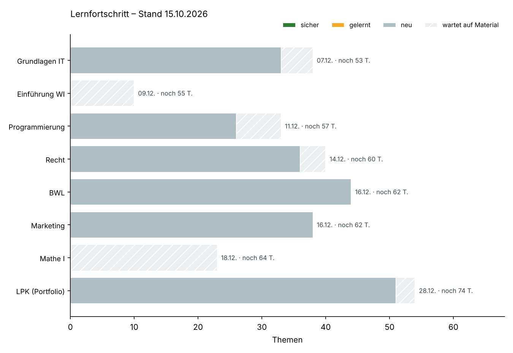

# Lernen – Lernpläne für das 1. Semester

Lernpläne, Kernpunkte, Karteikarten und Fehlerprotokolle, die der Lern-Coach (Claude) mit dir pflegt.
Klausurrelevant ist, was im Skript bzw. auf den Folien steht. Alles, was darüber hinausgeht, ist mit
„(über das Skript hinaus)“ markiert.

## Prüfungen und Lernpläne

| Datum | Prüfung | Dauer | Lernplan | Themen | davon 🔴 hoch | Lernzeit |
|---|---|---|---|---|---|---|
| Mo 07.12. | Grundlagen der IT | 48 Min. | [Lernplan](grundlagen-it/lernplan.md) | 38 (5 ohne Material) | 27 | 17,4 h |
| Mi 09.12. | Einführung in die WI | 48 Min. | [Lernplan](wirtschaftsinformatik/lernplan.md) | 10 (vorläufig) | – | 5,4 h |
| Fr 11.12. | Grundlagen der Programmierung | 120 Min. | [Lernplan](programmierung/lernplan.md) | 33 (7 ohne Material) | 26 | 17,5 h |
| Mo 14.12. | Vertrags- und Schuldrecht | 60 Min. | [Lernplan](recht/lernplan.md) | 40 (4 ohne Material) | 24 | 20,1 h |
| Mi 16.12. | Grundlagen der BWL – Teil BWL | 120 Min. gesamt | [Lernplan](bwl/lernplan.md) | 44 | 14 | 22,6 h |
| Mi 16.12. | Grundlagen der BWL – Teil Marketing | (gemeinsam) | [Lernplan](marketing/lernplan.md) | 38 | 14 | 17,9 h |
| Fr 18.12. | Mathematik I | 120 Min. | [Lernplan](mathematik/lernplan.md) | 23 (vorläufig) | – | 13,1 h |
| Mo 28.12. | LPK – Portfolio-Abgabe (vermutlich) | schriftlich | [Lernplan](lernen-praesentieren-kommunizieren/lernplan.md) | 54 (3 ohne Material) | 16 | 26,8 h |

Summe: 280 Themen, rund 141 h Lernzeit für einen ersten Durchgang; davon 121 🔴-Themen mit rund 63 h.
Die Uhrzeiten aller Klausuren sind laut Stundenplan noch offen. „Vorläufig“ heißt: noch kein Skript,
Themen nach dem DHBW-Modulhandbuch.

## Fortschritt



Fällige Wiederholungen und aktueller Stand:

```
python3 -I lernen/status.py                    # Übersicht als Text (Stand heute)
python3 -I lernen/status.py --karten --plot lernen/grafiken/fortschritt.png   # Grafiken neu zeichnen
```

## Dateien pro Fach

| Datei | Inhalt |
|---|---|
| `lernplan.md` | Prüfung, höchste Priorität, Themen mit Lernzielen, Relevanz, Quelle, Status und Wiederholungstermin, Mindmap, offene Punkte |
| `kernpunkte.md` | Kernpunkte je Thema (für Blurting und Active Recall), Formeln bzw. Prüfschemata, Klausurfallen, Visualisierungsideen. Bei BWL und Marketing auch Rechenwege zur Musterklausur – 🙈 erst selbst rechnen |
| `karteikarten.md` | Frage \| Antwort – entsteht beim Lernen |
| `fehlerprotokoll.md` | eigene Fehler und Verwechslungen – entsteht beim Lernen |
| `grafiken/` | Themenkarte und die Visualisierungen aus den Lerneinheiten |

## Regeln

- **Relevanz:** 🔴 hoch (kommt in der Musterklausur vor oder wird im Material ausdrücklich betont) · 🟡 mittel · ⚪ niedrig · ❔ offen (noch kein Skript)
- **Status:** neu → gelernt (Lernzyklus abgeschlossen) → sicher (Wiederholung nach 7 Tagen fehlerfrei)
- **Wiederholung:** Stufe 1–5 = nach 1 / 3 / 7 / 14 / 30 Tagen. Ein Fehler setzt auf Stufe 1 zurück.
- **Jede Sitzung:** zuerst die fälligen Wiederholungen (10 Min. Active Recall aus Karteikarten und Fehlerprotokoll), dann Neues.
- **Lernzyklus pro Thema:** Vortest → Überblick → Erklären in Häppchen → Feynman → Blurting → Active Recall → Klausuraufgaben (vorgerechnet, Lücken füllen, selbst) → Verknüpfen → Abschluss mit Zusammenfassung, Cheat Sheet, Karteikarten und Fehlerprotokoll.

## Befehle

weiter · einfacher · Beispiel · zeichne · Quiz · Wiederholung · Klausursimulation <Fach> · Spickzettel · Status · Pause
