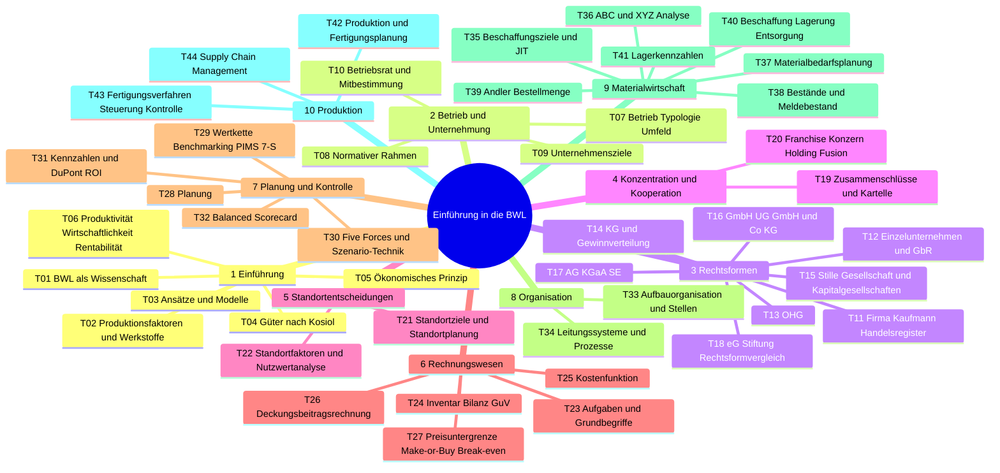
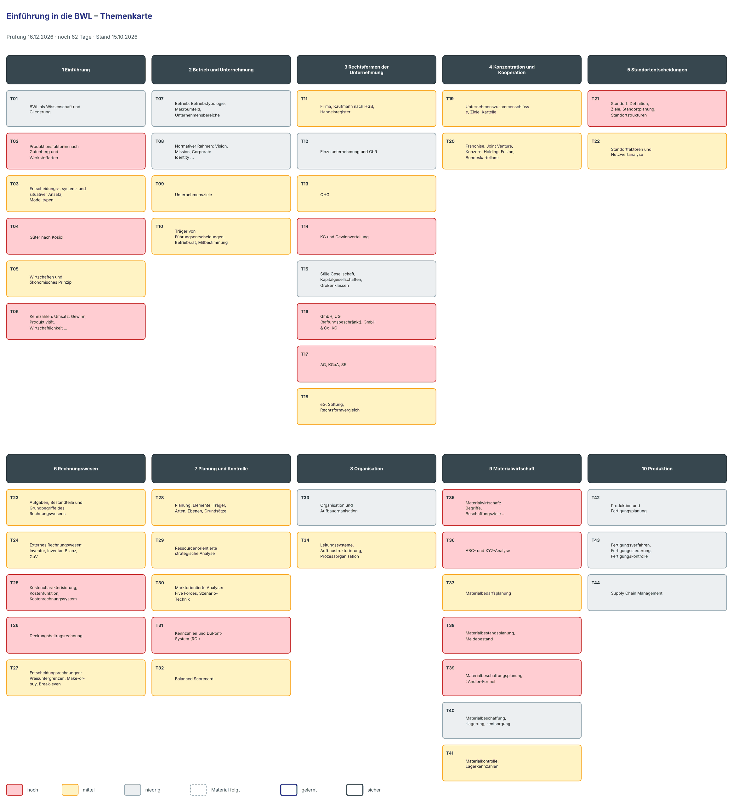

# Lernplan: Einführung in die BWL

<!-- klausur: 2026-12-16 -->
> Stand 15.10.2026 · erstellt aus: Skript Einführung in die BWL 2026 (133 S., 56 Übungen), Musterklausur BWL 2025, dein Spickzettel BWL + Marketing und deine Vorlesungsnotiz 01

## Prüfung auf einen Blick

| | |
|---|---|
| **Klausur „Grundlagen der BWL“** | **Mi 16.12.2026** – noch 62 Tage |
| Form | gemeinsame Klausur mit Marketing, **120 Minuten**; BWL-Teil vermutlich ≈ 72 Min. (Musterklausur 72 von 120 Punkten – nur ein Indiz) |
| Uhrzeit, Raum | noch offen |
| Hilfsmittel | unbekannt – die Musterklausur verlangt eine Wurzel (Andler-Formel, A6a), ein Taschenrechner ist also wahrscheinlich, aber nicht bestätigt; der Spickzettel ist nirgends geregelt |
| Musterklausur | BWL 2025: 8 Aufgaben, 72 Punkte, davon 43 Rechnen, ohne Lösung; fast alle Aufgaben sind nahezu wortgleich mit Skript-Übungen (z. B. Ü 6b, 28d/e, 31–33, 42, 43b) |
| Dozentin | Michaela Geiger · 9 Termine (15.10.–17.11.) |
| Hinweis | Das Skript hat 56 Übungen und 10 Kapitel (inkl. Produktion); README und Briefing nennen 51 Übungen |

## Höchste Priorität

1. **T31 Kennzahlen und DuPont-ROI:** MK A5 = 11 P., die größte Einzelaufgabe; Ü 31–33 sind praktisch identisch.
2. **T06 Produktivität, Wirtschaftlichkeit, Rentabilität:** MK A1b = 6 P.; Ü 6b ist fast dieselbe Aufgabe.
3. **T25 + T26 Kostenfunktion und Deckungsbeitragsrechnung:** MK A3 + A4 = 10 P.; Ü 28d/e fast wortgleich.
4. **T38 + T39 Meldebestand und Andler-Formel:** MK A6 = 7 P.
5. **T35 + T36 ABC-Analyse und Just-in-time:** MK A7 = 9 P.
6. **T14 + T16 + T17 Rechtsformen KG, UG, AG:** MK A2 = 13 P., die zweitgrößte Aufgabe.

**Quick Wins** (reines Lernen, ca. 75 Min.): T02 Werkstoffarten, T04 Güter nach Kosiol und T21 Standortziele bringen in der Musterklausur zusammen 16 P.

## Fortschritt

`░░░░░░░░░░░░░░░░░░░░` 0 von 44 Themen gelernt · 0 sicher · 1355 Min. Lernzeit gesamt

## Themen

Relevanz: 🔴 hoch · 🟡 mittel · ⚪ niedrig — Status: neu → gelernt → sicher — Stufe 1–5: nächste Wiederholung nach 1 / 3 / 7 / 14 / 30 Tagen

### 1 Einführung

| Nr | Thema | Lernziele | Relevanz | Quelle | Min | Status | Stufe | Nächste Wdh. |
|---|---|---|---|---|---|---|---|---|
| T01 | BWL als Wissenschaft und Gliederung | Ich kann die vier Kennzeichen einer Wissenschaft (Erkenntnisobjekt, Erkenntnisziel, Methodik, System) nennen. Ich kann erklären, warum die BWL eine Real- und Sozialwissenschaft ist (Raffée, OECD-FOS). Ich kann Allgemeine und Spezielle BWL vergleichen und die vier Gliederungsarten der BWL nennen. | ⚪ niedrig – nicht in der MK; das Modulhandbuch nennt die FOS-Einordnung | Kap. 1.1 · Skript S. 5–8 (keine Übung) | 20 | neu | – | – |
| T02 | Produktionsfaktoren nach Gutenberg und Werkstoffarten | Ich kann Elementarfaktoren und dispositiven Faktor nach Gutenberg nennen und erklären. Ich kann Rohstoffe, Vorprodukte, Hilfs- und Betriebsstoffe mit je einem Beispiel aus der Möbelproduktion nennen. Ich kann die Testfrage „Hauptbestandteil – Nebenbestandteil – nicht im Produkt" auf neue Güter (z. B. Nudelhersteller) anwenden. | 🔴 hoch – MK A1a (6 P.) | Kap. 1.2 a · Skript S. 9–10; Ü 1 (S. 10) | 25 | neu | – | – |
| T03 | Entscheidungs-, system- und situativer Ansatz, Modelltypen | Ich kann die Phasen des Entscheidungsprozesses nach Heinen am Beispiel „Anschaffung einer Maschine" erklären. Ich kann einen Regelkreis (Soll, Ist, Abweichung, Maßnahme) zum Fehlzeiten-Beispiel zeichnen und erklären. Ich kann die vier Modelltypen nach Leitfrage und Beispiel vergleichen. | 🟡 mittel – nicht in der MK; das Modulhandbuch nennt „Unternehmen als Regelkreis" | Kap. 1.2 b–d · Skript S. 11–13; Ü 2 (S. 11), Ü 3 (S. 12) | 30 | neu | – | – |
| T04 | Güter nach Kosiol | Ich kann freie Güter und Wirtschaftsgüter vergleichen. Ich kann die Klassifikation Gebrauchs-/Verbrauchs- und Investitions-/Konsumgut per Kreuz und Strich auf Inputgüter anwenden. Ich kann Outputgüter (unfertiges/fertiges Erzeugnis, Eigenleistung, Ware) zuordnen und erklären, warum der Verwendungszweck entscheidet. | 🔴 hoch – MK A1c (4 P.) | Kap. 1.3 · Skript S. 13–14; Ü 4 (S. 14) | 25 | neu | – | – |
| T05 | Wirtschaften und ökonomisches Prinzip | Ich kann Maximal-, Minimal- und Extremumprinzip erklären. Ich kann das Maximal- bzw. Minimalprinzip auf Alltagsbeispiele anwenden. Ich kann die drei Prinzipien des magischen Dreiecks der BWL nennen. | 🟡 mittel – nicht in der MK; klassische Zuordnungsfrage (Ü 5) | Kap. 1.4 · Skript S. 15–16; Ü 5 (S. 15) | 20 | neu | – | – |
| T06 | Kennzahlen: Umsatz, Gewinn, Produktivität, Wirtschaftlichkeit, Rentabilität | Ich kann Arbeits-, Material- und Betriebsmittelproduktivität mit Einheit berechnen. Ich kann die Wirtschaftlichkeit berechnen und Werte über, gleich und unter 1 erklären. Ich kann Eigenkapital-, Gesamtkapital- und Umsatzrentabilität in % berechnen. Ich kann Produktivität, Wirtschaftlichkeit und Rentabilität vergleichen (Menge – Wert – Kapitalverzinsung). | 🔴 hoch – MK A1b (6 P.); Grundlage für A5 | Kap. 1.5 · Skript S. 16–18; Ü 6 (S. 18) | 40 | neu | – | – |

### 2 Betrieb und Unternehmung

| Nr | Thema | Lernziele | Relevanz | Quelle | Min | Status | Stufe | Nächste Wdh. |
|---|---|---|---|---|---|---|---|---|
| T07 | Betrieb, Betriebstypologie, Makroumfeld, Unternehmensbereiche | Ich kann Betrieb, Unternehmung, Firma und Fabrik vergleichen. Ich kann die Merkmale der Betriebstypologie auf ein Unternehmen anwenden. Ich kann die sechs Faktoren des Makroumfelds mit Beispiel nennen. | ⚪ niedrig – nicht in der MK, keine Übung | Kap. 2.1–2.4 · Skript S. 19–20 (keine Übung) | 20 | neu | – | – |
| T08 | Normativer Rahmen: Vision, Mission, Corporate Identity, Unternehmensgrundsätze | Ich kann Vision und Mission nach Zweck, Inhalt und Zeithorizont vergleichen. Ich kann Corporate Design, Corporate Communication und Corporate Behaviour mit Beispiel erklären. Ich kann fünf Ziele der Corporate Governance nennen. | ⚪ niedrig – nicht in der MK | Kap. 2.5 · Skript S. 21–22, 26; Ü 7 (S. 21) | 25 | neu | – | – |
| T09 | Unternehmensziele | Ich kann die SMART-Regel auf ein Unternehmensziel anwenden. Ich kann strategische, taktische und operative Ziele mit Zeithorizont nennen. Ich kann konkurrierende, indifferente und komplementäre Zielbeziehungen am Umweltschutz-Beispiel erklären. Ich kann Shareholder- und Stakeholder-Value-Ansatz vergleichen. | 🟡 mittel – nicht in der BWL-MK; das Modulhandbuch nennt Ziele und den Shareholder-/Stakeholder-Ansatz | Kap. 2.6 · Skript S. 23–26; Ü 8 (S. 25), Ü 9 (S. 26) | 35 | neu | – | – |
| T10 | Träger von Führungsentscheidungen, Betriebsrat, Mitbestimmung | Ich kann Unternehmer und Manager (Eigentümer- vs. Geschäftsführer-Unternehmung) vergleichen. Ich kann die Voraussetzungen für Betriebsrat und Betriebsratswahl nennen. Ich kann Informations-/Beratungs-, Mitwirkungs- und Mitbestimmungsrechte mit Beispielen erklären. Ich kann Aufgabe und Arbeitsweise von Wirtschaftsausschuss und Einigungsstelle erklären. | 🟡 mittel – nicht in der MK; das Modulhandbuch nennt Betriebsrat und Mitbestimmung | Kap. 2.7 · Skript S. 27–30; Ü 10 (S. 27), Ü 11 (S. 30) | 30 | neu | – | – |

### 3 Rechtsformen der Unternehmung

| Nr | Thema | Lernziele | Relevanz | Quelle | Min | Status | Stufe | Nächste Wdh. |
|---|---|---|---|---|---|---|---|---|
| T11 | Firma, Kaufmann nach HGB, Handelsregister | Ich kann die sechs Firmengrundsätze nennen. Ich kann Ist-, Kann- und Formkaufmann vergleichen. Ich kann die deklaratorische und die konstitutive Wirkung des HR-Eintrags an Beispielen erklären. | 🟡 mittel – nicht in der MK; Grundlage für alle Rechtsformen | Kap. 3.1 · Skript S. 31–32; Ü 12 (S. 32) | 25 | neu | – | – |
| T12 | Einzelunternehmung und GbR | Ich kann die Merkmale der Einzelunternehmung (Firma, Gründung, Geschäftsführung, Haftung) nennen. Ich kann Vor- und Nachteile des Einzelunternehmers nennen. Ich kann GbR und eGbR vergleichen. | ⚪ niedrig – nicht in der MK | Kap. 3.2–3.3.1 · Skript S. 33–34; Ü 13 (S. 33) | 20 | neu | – | – |
| T13 | OHG | Ich kann Geschäftsführung (Innenverhältnis) und Vertretung (Außenverhältnis) der OHG erklären. Ich kann die Haftung „unbeschränkt, unmittelbar, solidarisch" erklären. Ich kann Gewinn- und Verlustanteile nach der Regelung seit 2024 berechnen. | 🟡 mittel – nicht in der MK; die Gewinnverteilung ist eine Variante von A2a | Kap. 3.3.2 · Skript S. 35–37; Ü 14 (S. 37) | 35 | neu | – | – |
| T14 | KG und Gewinnverteilung | Ich kann Rechte und Pflichten von Komplementär und Kommanditist vergleichen. Ich kann die Haftungsregeln des Kommanditisten (Haftsumme, Pflichteinlage, Neueintritt) erklären. Ich kann die KG-Gewinnverteilung mit Tätigkeitsvergütung, Zinsen und Restgewinn nach Anteilen berechnen. | 🔴 hoch – MK A2a (6 P.) | Kap. 3.3.3 · Skript S. 38–39; Ü 15 (S. 38), Ü 16, Ü 17 (S. 39); Ü 21c, e (S. 51) | 40 | neu | – | – |
| T15 | Stille Gesellschaft, Kapitalgesellschaften, Größenklassen | Ich kann die stille Gesellschaft als Innengesellschaft erklären. Ich kann vier Merkmale von Kapitalgesellschaften nennen. Ich kann die Größenklassen nach § 267 HGB (2 von 3 Merkmalen) auf ein Unternehmen anwenden. | ⚪ niedrig – nicht in der MK | Kap. 3.3.4–3.4 · Skript S. 40–41 (keine eigene Übung) | 25 | neu | – | – |
| T16 | GmbH, UG (haftungsbeschränkt), GmbH & Co. KG | Ich kann die Mindesteinzahlung bei der GmbH-Gründung (25 % je Anteil, mind. 12.500 €) berechnen. Ich kann die Zwangsthesaurierungspflicht der UG erklären. Ich kann die drei Organe der GmbH und die Aufsichtsratspflicht nach Mitarbeiterzahl nennen. Ich kann vier Gründe für eine GmbH & Co. KG nennen. | 🔴 hoch – MK A2b (4 P.) | Kap. 3.4.1–3.4.2 · Skript S. 42–45; Ü 18 (S. 44), Ü 19 (S. 45) | 40 | neu | – | – |
| T17 | AG, KGaA, SE | Ich kann Grundkapital, Nennbetrag, über/unter pari und Agio erklären. Ich kann die drei Organe der AG mit Funktion und je zwei Aufgaben nennen. Ich kann den GmbH-Geschäftsführer und den AG-Vorstand nach Amtszeit und Kontrolle vergleichen. | 🔴 hoch – MK A2c (3 P.) | Kap. 3.4.3–3.4.5 · Skript S. 46–48; Ü 20 (S. 47); Ü 21h (S. 51) | 35 | neu | – | – |
| T18 | eG, Stiftung, Rechtsformvergleich | Ich kann die Merkmale der eG (Gründer, Organe, Nachschusspflicht) nennen. Ich kann erklären, was eine Stiftung ist und wie sie haftet. Ich kann die Rechtsformen nach Gründerzahl, Kapital, Haftung, Leitung und Kontrolle vergleichen (Übersicht S. 52). | 🟡 mittel – nicht in der MK; Ü 21/22 sind typische Vergleichsfragen | Kap. 3.5 · Skript S. 49–52; Ü 21, Ü 22 (S. 51) | 30 | neu | – | – |

### 4 Konzentration und Kooperation

| Nr | Thema | Lernziele | Relevanz | Quelle | Min | Status | Stufe | Nächste Wdh. |
|---|---|---|---|---|---|---|---|---|
| T19 | Unternehmenszusammenschlüsse, Ziele, Kartelle | Ich kann horizontale, vertikale und anorganische Zusammenschlüsse mit Ziel und Beispiel erklären. Ich kann gewinnbezogene und nicht gewinnbezogene Ziele von Zusammenschlüssen nennen. Ich kann Kooperation und Konzentration vergleichen. Ich kann vier Kartellarten und die Ausnahmen vom Kartellverbot nennen. | 🟡 mittel – nicht in der MK; das Modulhandbuch nennt Zusammenschlüsse und Kooperationen | Kap. 4.1–4.3.1 (1) · Skript S. 53–55; Ü 23c–f, i und Ü 25c, d (S. 60) | 35 | neu | – | – |
| T20 | Franchise, Joint Venture, Konzern, Holding, Fusion, Bundeskartellamt | Ich kann die Leistungen von Franchisegeber und Franchisenehmer nennen. Ich kann Gleichordnungs- und Unterordnungskonzern vergleichen. Ich kann Fusion durch Aufnahme und durch Neugründung erklären. Ich kann die Aufgaben des Bundeskartellamts und die Umsatzschwellen der Fusionskontrolle nennen. | 🟡 mittel – nicht in der MK; steht im Modulhandbuch | Kap. 4.3.1 (2)–4.3.2 · Skript S. 56–59; Ü 23a, b, g, h, Ü 24, Ü 25a, b (S. 60) | 35 | neu | – | – |

### 5 Standortentscheidungen

| Nr | Thema | Lernziele | Relevanz | Quelle | Min | Status | Stufe | Nächste Wdh. |
|---|---|---|---|---|---|---|---|---|
| T21 | Standort: Definition, Ziele, Standortplanung, Standortstrukturen | Ich kann die drei Kategorien der Ziele von Standortentscheidungen je mit Beispiel erklären. Ich kann strategische und operative Standortplanung vergleichen. Ich kann die drei Standortstrukturen betrieblichen Funktionen zuordnen und erklären. | 🔴 hoch – MK A8 (6 P.) | Kap. 5.1–5.3 · Skript S. 61–62; Ü 27c, d, e, g (S. 65) | 25 | neu | – | – |
| T22 | Standortfaktoren und Nutzwertanalyse | Ich kann je drei unternehmens-, produktions- und absatzbezogene Standortfaktoren nennen. Ich kann Herkunftsgoodwill und Local-content-Bedingungen an Beispielen erklären. Ich kann eine Nutzwertanalyse berechnen und daraus eine Standortentscheidung ableiten. | 🟡 mittel – nicht in der MK; die NWA ist eine Rechenaufgabe (Ü 26) | Kap. 5.4–5.5 · Skript S. 63–65; Ü 26, Ü 27a, b, f, h (S. 65) | 35 | neu | – | – |

### 6 Rechnungswesen

| Nr | Thema | Lernziele | Relevanz | Quelle | Min | Status | Stufe | Nächste Wdh. |
|---|---|---|---|---|---|---|---|---|
| T23 | Aufgaben, Bestandteile und Grundbegriffe des Rechnungswesens | Ich kann die vier Hauptaufgaben des Rechnungswesens nennen. Ich kann externes und internes Rechnungswesen vergleichen. Ich kann die Begriffspaare Aus-/Einzahlung, Ausgabe/Einnahme, Aufwand/Ertrag, Kosten/Leistung erklären. | 🟡 mittel – nicht in der MK; die Begriffe werden in A1b und A5 vorausgesetzt | Kap. 6 (Einleitung) · Skript S. 66–67 (keine Übung) | 30 | neu | – | – |
| T24 | Externes Rechnungswesen: Inventur, Inventar, Bilanz, GuV | Ich kann den Aufbau des Inventars (Vermögen − Schulden = Reinvermögen) erklären. Ich kann die Gliederung der Bilanz (Aktiva nach Liquidität, Passiva nach Fälligkeit) zeichnen. Ich kann fehlende Bilanzwerte mit AV + UV = EK + FK berechnen. Ich kann Erträge und Aufwendungen der GuV nennen. | 🟡 mittel – die Bilanzgleichung wird in MK A5a (Fremdkapital) gebraucht, sonst nicht in der MK | Kap. 6.1 · Skript S. 68–72; Ü 28a, b (S. 79) | 35 | neu | – | – |
| T25 | Kostencharakterisierung, Kostenfunktion, Kostenrechnungssystem | Ich kann Einzel-/Gemeinkosten und variable/fixe Kosten mit Beispielen vergleichen. Ich kann kv und Kfix mit dem Zweipunktverfahren berechnen. Ich kann mit K = Kfix + kv · x die Gesamtkosten für eine neue Menge berechnen. Ich kann Kostenarten-, Kostenstellen- und Kostenträgerrechnung mit ihrer Leitfrage nennen. | 🔴 hoch – MK A3 (4 P.) | Kap. 6.2.1–6.2.2 · Skript S. 73–75; Ü 28c, d (S. 79) | 35 | neu | – | – |
| T26 | Deckungsbeitragsrechnung | Ich kann Stück- und Periodendeckungsbeitrag berechnen. Ich kann das Betriebsergebnis für mehrere Produkte berechnen und das Vorzeichen erklären. Ich kann Voll- und Teilkostenrechnung vergleichen. | 🔴 hoch – MK A4 (6 P.) | Kap. 6.2.3 · Skript S. 76; Ü 28e (S. 79) | 30 | neu | – | – |
| T27 | Entscheidungsrechnungen: Preisuntergrenzen, Make-or-buy, Break-even | Ich kann die kurz- und die langfristige Preisuntergrenze berechnen. Ich kann die Übergangsmenge berechnen und die Make-or-buy-Regel anwenden. Ich kann die Break-even-Menge berechnen und das Break-even-Diagramm zeichnen. | 🟡 mittel – nicht in der MK; Rechenaufgaben direkt neben A3/A4 (Ü 28f, g) | Kap. 6.2.4 · Skript S. 77–78; Ü 28f (S. 79), Ü 28g und zweites „f)" (S. 80) | 40 | neu | – | – |

### 7 Planung und Kontrolle

| Nr | Thema | Lernziele | Relevanz | Quelle | Min | Status | Stufe | Nächste Wdh. |
|---|---|---|---|---|---|---|---|---|
| T28 | Planung: Elemente, Träger, Arten, Ebenen, Grundsätze | Ich kann Prognose und Planung vergleichen und die Planelemente nennen. Ich kann top-down, bottom-up und Gegenstromverfahren mit Vor- und Nachteilen erklären. Ich kann rollierende Planung und Blockplanung vergleichen. Ich kann Planungsebenen und Planungsgrundsätze nennen. | 🟡 mittel – nicht in der MK; Ü 30 fragt das direkt ab | Kap. 7.1–7.4 · Skript S. 81–83; Ü 30a, b, e, f (S. 91) | 35 | neu | – | – |
| T29 | Ressourcenorientierte strategische Analyse | Ich kann ressourcen- und marktorientierte Strategieformulierung vergleichen. Ich kann die Wertkette nach Porter zeichnen und erklären. Ich kann die drei Benchmarking-Arten und die drei wichtigsten PIMS-Faktoren nennen. Ich kann harte und weiche Faktoren des 7-S-Modells sowie Kernkompetenzen erklären. | 🟡 mittel – nicht in der MK; das Modulhandbuch nennt die Wertkette | Kap. 7.5.1 · Skript S. 84–88; Ü 29a–c, Ü 30c, d, g, h (S. 91) | 40 | neu | – | – |
| T30 | Marktorientierte Analyse: Five Forces, Szenario-Technik | Ich kann die fünf Wettbewerbskräfte nach Porter nennen. Ich kann den Durchschnitt einer Five-Forces-Bewertung berechnen und erklären. Ich kann die Phasen der Szenario-Technik erklären. | 🟡 mittel – nicht in der MK; Ü 30i ist eine Nennfrage | Kap. 7.5.2 · Skript S. 89–90; Ü 29d, Ü 30i (S. 91) | 25 | neu | – | – |
| T31 | Kennzahlen und DuPont-System (ROI) | Ich kann die vier Anforderungen an Kennzahlen und die fünf Aufgaben von Kennzahlen nennen. Ich kann DB, Gewinn, Kapitalumschlag, Umsatzrentabilität und ROI berechnen. Ich kann das Fremdkapital aus AV + UV − EK berechnen. Ich kann den DuPont-Baum zeichnen. | 🔴 hoch – MK A5 (11 P., größte Einzelaufgabe) | Kap. 7.6 · Skript S. 91–93 (dazu S. 17, 70–71); Ü 31 (S. 92), Ü 32, Ü 33 (S. 93) | 40 | neu | – | – |
| T32 | Balanced Scorecard | Ich kann die vier Perspektiven der BSC mit Ziel und Kennzahl nennen. Ich kann die Ursache-Wirkungs-Kette einer BSC erklären. Ich kann das Schema Ziel – Messgröße – Vorgabe – Maßnahme auf einen Fall anwenden. | 🟡 mittel – nicht in der MK | Kap. 7.6 (BSC) · Skript S. 94–96; Ü 34 (S. 96) | 25 | neu | – | – |

### 8 Organisation

| Nr | Thema | Lernziele | Relevanz | Quelle | Min | Status | Stufe | Nächste Wdh. |
|---|---|---|---|---|---|---|---|---|
| T33 | Organisation und Aufbauorganisation | Ich kann Organisation, Improvisation und Disposition vergleichen. Ich kann Aufgabenanalyse und Aufgabensynthese erklären. Ich kann Instanz, Linien- und Stabsstelle vergleichen und ein Organigramm zeichnen. | ⚪ niedrig – nicht in der MK | Kap. 8, 8.1 (1) · Skript S. 97–100; Ü 35 (S. 99), Ü 36 (S. 100) | 30 | neu | – | – |
| T34 | Leitungssysteme, Aufbaustrukturierung, Prozessorganisation | Ich kann Ein-, Mehr-, Stab-Linien- und Matrixorganisation zeichnen. Ich kann die Leitungssysteme nach Vor- und Nachteilen vergleichen. Ich kann sektorale, funktionale, divisionale und Tensororganisation erklären. Ich kann Kern-, Führungs- und Unterstützungsprozesse mit Merkmalen nennen. | 🟡 mittel – nicht in der MK; Vor-/Nachteile sind eine typische Klausurfrage (Ü 37, Ü 38) | Kap. 8.1 (2)–8.2 · Skript S. 101–104; Ü 37 (S. 101), Ü 38 (S. 102) | 35 | neu | – | – |

### 9 Materialwirtschaft

| Nr | Thema | Lernziele | Relevanz | Quelle | Min | Status | Stufe | Nächste Wdh. |
|---|---|---|---|---|---|---|---|---|
| T35 | Materialwirtschaft: Begriffe, Beschaffungsziele, Beschaffungsprinzipien (JIT) | Ich kann das materialwirtschaftliche Optimum und den Zielkonflikt der Materialwirtschaft erklären. Ich kann Einzel-, Vorrats- und JIT-Beschaffung nach Vor- und Nachteilen vergleichen. Ich kann das passende Bereitstellungsprinzip auf einen Fall anwenden und begründen. | 🔴 hoch – MK A7b (3 P.) und Stellungnahme in A7a | Kap. 9.1–9.3.1 · Skript S. 105–106; Ü 39 (S. 106); Ü 50c (S. 122) | 25 | neu | – | – |
| T36 | ABC- und XYZ-Analyse | Ich kann die fünf Schritte der ABC-Analyse nennen. Ich kann Wertanteile berechnen und die ABC-Einteilung auf Materialien anwenden. Ich kann die ABC-XYZ-Matrix erklären und daraus eine Bereitstellungsstrategie ableiten. | 🔴 hoch – MK A7a (6 P.) | Kap. 9.3.2 · Skript S. 107–109; Ü 40 (S. 108–109) | 35 | neu | – | – |
| T37 | Materialbedarfsplanung | Ich kann programm- und verbrauchsorientierte Bedarfsplanung vergleichen. Ich kann den gleitenden und den gewogenen gleitenden Mittelwert berechnen. | 🟡 mittel – nicht in der MK; Rechenaufgabe Ü 41 | Kap. 9.4.1 · Skript S. 110; Ü 41 (S. 110) | 20 | neu | – | – |
| T38 | Materialbestandsplanung, Meldebestand | Ich kann die sechs Bestandsarten erklären. Ich kann Sicherheitsbestand, Meldebestand und Bestellmenge berechnen. Ich kann Bestellpunkt- und Bestellrhythmusverfahren vergleichen und den Lagerverlauf zeichnen. | 🔴 hoch – MK A6b (3 P.) | Kap. 9.4.2 · Skript S. 111–112; Ü 42 (S. 112); Ü 44c (S. 115) | 30 | neu | – | – |
| T39 | Materialbeschaffungsplanung: Andler-Formel | Ich kann Beschaffungs-, Bestell- und Lagerhaltungskosten erklären. Ich kann die optimale Bestellmenge nach Andler und die Anzahl der Bestellungen berechnen. Ich kann den Verlauf von Lager-, Bestell- und Gesamtkosten zeichnen. | 🔴 hoch – MK A6a (4 P.) | Kap. 9.4.3 · Skript S. 113–115; Ü 43 (S. 114), Ü 44, Ü 45 (S. 115) | 40 | neu | – | – |
| T40 | Materialbeschaffung, -lagerung, -entsorgung | Ich kann die vier Schritte der Materialbeschaffung und die drei Sourcing-Varianten nennen. Ich kann die fünf Prüfungen beim Materialeingang nennen. Ich kann Fest- und Freiplatzsystem sowie FIFO und LIFO vergleichen. | ⚪ niedrig – nicht in der MK | Kap. 9.5–9.7 · Skript S. 116–119; Ü 46 (S. 116), Ü 47 (S. 117), Ü 48 (S. 118) | 30 | neu | – | – |
| T41 | Materialkontrolle: Lagerkennzahlen | Ich kann Ø Lagerbestand, Umschlagshäufigkeit und Ø Lagerdauer berechnen. Ich kann Lagerzinssatz und Lagerzinsen berechnen. Ich kann Lagerkennzahlen mit Branchenwerten vergleichen und Maßnahmen nennen. | 🟡 mittel – nicht in der MK; rechenintensiv (Ü 49–51) | Kap. 9.8 · Skript S. 120–124; Ü 49 (S. 121), Ü 50 (S. 122), Ü 51 (S. 123–124) | 40 | neu | – | – |

### 10 Produktion

| Nr | Thema | Lernziele | Relevanz | Quelle | Min | Status | Stufe | Nächste Wdh. |
|---|---|---|---|---|---|---|---|---|
| T42 | Produktion und Fertigungsplanung | Ich kann Produktion im engeren und im weiteren Sinn erklären. Ich kann die fünf Teilplanungen der Fertigungsplanung nennen. Ich kann vier Maßnahmen bei unzureichender Kapazität nennen. | ⚪ niedrig – nicht in der MK und nicht im Inhalt des Modulhandbuchs | Kap. 10.1–10.2 · Skript S. 125–127; Ü 55a (S. 131) | 30 | neu | – | – |
| T43 | Fertigungsverfahren, Fertigungssteuerung, Fertigungskontrolle | Ich kann Punkt-, Werkstatt-, Fließ- und Gruppenfertigung vergleichen. Ich kann die Fertigungstypen (Einzel-, Serien-, Sorten-, Chargen-, Massenfertigung) auf Beispiele anwenden. Ich kann Störungsarten und Formen der Fertigungskontrolle nennen. | ⚪ niedrig – nicht in der MK; eine Kreuztabelle wie in MK A1c wäre möglich (Ü 52, Ü 54) | Kap. 10.3–10.5 · Skript S. 128–131; Ü 52 (S. 128), Ü 53 (S. 129), Ü 54 (S. 130), Ü 55b, c (S. 131) | 35 | neu | – | – |
| T44 | Supply Chain Management | Ich kann Supply Chain und SCM erklären. Ich kann Vorteile und Probleme des SCM nennen. Ich kann die Bedeutung des Lieferkettengesetzes für das SCM erklären. | ⚪ niedrig – nicht in der MK | Kap. 10.6 · Skript S. 131–132; Ü 56 (S. 132) | 20 | neu | – | – |

## Mindmap

Als Bild mit Relevanz-Farben und Lernstand (aktualisieren mit `python3 -I lernen/status.py --karten`):

## Was über die Prüfung bekannt ist

| Merkmal | Stand | Quelle |
|---|---|---|
| Bezeichnung | „Klausur Grundlagen der BWL (120 Min)" – gemeinsame Klausur für Einführung in die BWL **und** Marketing | ICS-Stundenplan; faecher.json |
| Modul | W4WI_105 „Grundlagen der Betriebswirtschaftslehre", 5 ECTS, Workload 150 h (60 h Präsenz, 90 h Selbststudium) | Modulhandbuch |
| Form | Klausur, benotet | Modulhandbuch |
| Dauer | 120 Minuten für die ganze Klausur (BWL + Marketing) | Modulhandbuch; ICS |
| Datum | Mi 16.12.2026 | ICS |
| Uhrzeit / Raum | **unbekannt** (im ICS steht „Uhrzeit laut Stundenplan noch offen") | ICS |
| Prüferin | **unbekannt**. Vermutlich Michaela Geiger: Sie liest BWL und Marketing und hat beide MK verfasst (PDF-Metadaten). | ICS; PDF-Metadaten |
| Hilfsmittel | **unbekannt**. Weder Spickzettel noch Taschenrechner sind irgendwo geregelt. MK A6a verlangt eine Wurzel, ohne Taschenrechner ist das kaum lösbar. | – |
| Aufteilung BWL/Marketing | **unbekannt**. Keine Angabe in MK, Skript oder Modulhandbuch; Indizien siehe unten. | MK; Marketing-MK; ICS |
| Notenschlüssel, Bestehensgrenze, Gewichtung der Teile | **unbekannt** | – |
| Prüfungsstoff | **nicht abgegrenzt**. Die MK deckt Kap. 1, 3, 5, 6, 7, 9 ab, Kap. 2, 4, 8, 10 kommen nicht vor. Das Modulhandbuch nennt zusätzlich „Abgrenzung zur VWL" und „Lebensphasen von Unternehmen", beides steht nicht im Skript. | MK; Modulhandbuch |
| Lösungen zur MK | keine (die Moodle-Rubrik „Lösungen" ist leer) | `_listen/18616.json` |

**Aufteilung BWL/Marketing: Indizien, nicht bestätigt**

- Die BWL-MK enthält **keine Marketing-Aufgaben**. Alle 8 Aufgaben stammen aus Skript-Kap. 1, 3, 5, 6, 7 und 9.
- Marketing hat eine **eigene MK** („Klausur_Marketing_2025.pdf", 7 Aufgaben, **48 P.**). Sie verwendet dasselbe Fallunternehmen „Miller Gartenmöbel KG". Beide MK sind also sehr wahrscheinlich die zwei Teile der Klausur 2025.
- Zusammen ergeben sich 72 P. (BWL) + 48 P. (Marketing) = **120 P. für 120 Min.**, also 1 Punkt pro Minute. Das entspricht genau dem Verhältnis der Termine: 9 BWL zu 6 Marketing = 60 % zu 40 % = 72 zu 48 Min.
- Eine ausdrückliche Aufteilung (z. B. 60 + 60 Min., getrennte Bögen oder getrennte Abgabe) steht **nirgends**.

**MK-Aufgaben (Klausur 2025, BWL-Teil)**

| Aufgabe | Thema | Punkte | Typ | Skriptstelle |
|---|---|---|---|---|
| MK A1a | 3 Werkstoffarten mit je 1 Beispiel (Tischproduktion) | 6 | Nennen (+ Beispiel) | Skript S. 9–10; Ü 1 |
| MK A1b | Wirtschaftlichkeit, Arbeitsproduktivität, Eigenkapitalrentabilität | 6 | Rechnen | Skript S. 16–17; Vorlage Ü 6b (S. 18) |
| MK A1c | 4 Inputgüter klassifizieren (Gebrauchs-/Verbrauchs-/Investitions-/Konsumgut) | 4 | Grafik/Tabelle (Kreuz und Strich) | Skript S. 13–14; gleiches Format wie Ü 4a |
| MK A2a | Gewinnverteilung KG (Tätigkeitsvergütung, Rest nach Einlagen) | 6 | Rechnen | Skript S. 38–39; Ü 16, Ü 17.3 |
| MK A2b | Zwangsthesaurierungspflicht der UG (haftungsbeschränkt) | 4 | Erklären | Skript S. 42 |
| MK A2c | Organe der AG und ihre Funktion | 3 | Nennen | Skript S. 46; fast wortgleich mit Ü 21h (S. 51) |
| MK A3 | Kostenfunktion: kv, Kfix, K bei x = 15.000 | 4 | Rechnen | Skript S. 74; fast wortgleich mit Ü 28d (S. 79) |
| MK A4 | Stückdeckungsbeiträge A/B, Betriebsergebnis | 6 | Rechnen | Skript S. 76; fast wortgleich mit Ü 28e (S. 79) |
| MK A5a | Gewinn, Kapitalumschlag, Umsatzrentabilität, ROI, Fremdkapital | 8 | Rechnen | Skript S. 92 (DuPont), S. 17, S. 70–71; Ü 31–33 (S. 92–93) |
| MK A5b | Anforderungen an Kennzahlen (3 Nennungen) | 3 | Nennen | Skript S. 91 |
| MK A6a | Optimale Bestellmenge (Andler) und Anzahl der Bestellungen | 4 | Rechnen | Skript S. 113; fast wortgleich mit Ü 43b (S. 114) |
| MK A6b | Meldebestand | 3 | Rechnen | Skript S. 111; Ü 42c (S. 112) |
| MK A7a | ABC-Einordnung PP (Wertanteil) + Stellungnahme zu JIT (2 Begründungen) | 6 | Rechnen + Erklären | Skript S. 107–109, S. 106, S. 111–112; Ü 40 |
| MK A7b | Zwei Nachteile des Just-in-Time-Verfahrens | 3 | Nennen | Skript S. 106; Ü 39a |
| MK A8 | Drei Kategorien der Ziele von Standortentscheidungen mit Beispiel | 6 | Erklären (mit Beispiel) | Skript S. 61; fast wortgleich mit Ü 27e (S. 65) |

**Gesamtpunkte: 72** (A1 16 · A2 13 · A3 4 · A4 6 · A5 11 · A6 7 · A7 9 · A8 6), verteilt auf 15 Teilaufgaben.

- **Nach Typ:** Rechnen 43 P. (60 %, einschließlich A7a mit Stellungnahme) · Nennen 15 P. · Erklären 10 P. · Kreuztabelle 4 P.
- **Nach Kapitel:** Kap. 1 16 P. · Kap. 3 13 P. · Kap. 5 6 P. · Kap. 6 10 P. · Kap. 7 11 P. · Kap. 9 16 P. · **Kap. 2, 4, 8, 10: 0 P.**

**Punkte pro Minute (BWL-Teil, 72 P.)**

| Annahme für die BWL-Zeit | Punkte/Min. | Min. je Punkt | Einschätzung |
|---|---|---|---|
| 72 Min. (60 % von 120; BWL-MK 72 P. + Marketing-MK 48 P. = 120 P.) | 1,0 | 1,0 | wahrscheinlichste Annahme, nicht bestätigt |
| 60 Min. (Hälfte) | 1,2 | 0,83 (50 s) | strengster Fall, deshalb Übungsziel |
| 120 Min. (nur BWL) | 0,6 | 1,67 | unwahrscheinlich, weil gemeinsame Klausur |

Empfehlung: Die MK unter Zeitdruck in **höchstens 60 Minuten** üben.

**Weitere Beobachtungen zur MK**

- **MK-Aufgaben sind fast Kopien von Skript-Übungen:**
  - A1b ↔ Ü 6b
  - A1c ↔ Ü 4a
  - A2a ↔ Ü 16 / Ü 17.3
  - A2c ↔ Ü 21h
  - A3 ↔ Ü 28d
  - A4 ↔ Ü 28e
  - A5 ↔ Ü 31–33
  - A6a ↔ Ü 43b
  - A6b ↔ Ü 42c
  - A7 ↔ Ü 39a / Ü 40
  - A8 ↔ Ü 27e

  Diese Übungen sind deshalb die beste Klausurvorbereitung.
- Bei jeder Rechenaufgabe steht die geforderte Genauigkeit: A1b ≥ 1 NK, A3 ≥ 0 NK, A5a ≥ 1 NK, A6 0 NK, A7a 2 NK beim Wertanteil. Lösungsfelder und Tabellen sind vorgegeben.
- Das Fallunternehmen „Miller Gartenmöbel KG" (40 Mitarbeiter, Tische und Sitzmöbel) kommt in A1, A2, A4 und A7 vor. A3, A5 und A6 sind neutral formuliert.

Die Rechenwege zur Musterklausur stehen in [kernpunkte.md](kernpunkte.md) – erst selbst rechnen!

## Offene Punkte – in der Vorlesung klären

- **Hilfsmittel:** Spickzettel, Taschenrechner usw. sind nirgends geregelt. Bei der Dozentin klären, bevor der Spickzettel weiter ausgebaut wird.
- **Zeitaufteilung BWL/Marketing:** Es gibt nur Indizien (72 + 48 P. = 120 P., Termine 9 : 6). Zu klären sind auch die Gewichtung in der Note, ob beide Teile einzeln bestanden werden müssen und ob es getrennte Bögen gibt.
- **Uhrzeit und Raum der Klausur** sind noch offen.
- **Prüfungsstoff:** Ist Kap. 10 Produktion prüfungsrelevant? Es kommt weder in der MK noch im Inhalt des Modulhandbuchs vor. Umgekehrt nennt das Modulhandbuch „Abgrenzung zur VWL" und „Lebensphasen von Unternehmen (Gründung, Wachstum, Umwandlung, Sanierung, Insolvenz, Liquidation)"; beides steht nicht im Skript.
- **Lösungen:** Die Moodle-Rubrik „Lösungen" ist leer. Alle Rechenwege hier sind eigene Rechnungen. Wenn später Lösungen erscheinen, abgleichen.
- **Übungen fragen Inhalte ab, die im Skript nicht erklärt sind:**
  - Zweipunktverfahren (Ü 28d): keine Formel, keine Regel für die Wahl der Punkte
  - Leitungsspanne/Leitungstiefe (Ü 36)
  - Beschäftigungsgrad und Kapazitätsauslastung (Ü 28, zweites f)
  - kritische Lagermenge (Ü 51d)
  - Gesamthandsvermögen (Ü 21a)
  - Ministererlaubnis (Ü 24)
  - Prämissen des Andler-Modells (Ü 45c)
  - GmbH-Gewinnverteilung nach Geschäftsanteilen (Ü 18.4)
- **Stimmrecht in der GmbH:** Im Skript S. 43 steht „Je Geschäftsanteil = 1 Stimme". Nach § 47 Abs. 2 GmbHG gewährt jeder Euro eines Geschäftsanteils eine Stimme (über das Skript hinaus: eigene Anmerkung). Klären, welche Lesart in Ü 18.5 gemeint ist.
- **Unstimmigkeiten im Skript:**
  - Ü 28 hat zweimal „f)" (S. 79 und S. 80).
  - Das Szenario-Beispiel „Umsatzsteigerung = Wirtschaftswachstum : 1,5" passt nicht zu 2 % → 3 % (richtig wäre · 1,5).
  - Strategische Ziele „5–10 Jahre" (S. 23) vs. strategische Planung „> 5 Jahre" (S. 83).
  - Die Andler-Legende gibt kL in „[%]" an, gerechnet wird aber mit der Dezimalzahl.
  - Die Grafik S. 113 nennt die fallende Kurve „Beschaffungskosten", die Tabelle darüber definiert die bestellmengenunabhängigen Kosten als „Bestellkosten".
  - „BetrVG 1952" (S. 27): Heute steht diese Regel im Drittelbeteiligungsgesetz (über das Skript hinaus: eigene Anmerkung). In der Klausur vermutlich den Begriff aus dem Skript verwenden.
- **Abweichungen der Repo-Notizen vom Skript:**
  - README, Briefing und Vorlesungsnotiz sprechen von „51 Übungen", tatsächlich sind es **56** (Ü 52–56 gehören zu Kap. 10).
  - Der Skript-Überblick in Vorlesungsnotiz 01 nennt nur Kap. 1–9, **Kap. 10 Produktion fehlt**.
  - Die Notiz schreibt „Optimumprinzip (generelles Extremumprinzip)", das Skript sagt **Extremumprinzip**.
  - Die Phasen des Entscheidungsprozesses heißen im Skript Anregung, Suche, Auswahl, Vollzug und Kontrolle.
- **MK A7:** Die Angaben 9 Bestellungen/Jahr, 5,6 % und 11.025 € werden in a) und b) nicht gebraucht. Entweder lenken sie bewusst ab oder die Originalaufgabe wurde gekürzt. Die Variante „optimale Bestellmenge PP" (790,57 t) sollte man mitüben.
- **MK A1b:** „Variable Kosten 250 €" steht ohne „pro Stück". Ich habe es als Stückkosten gelesen, anders ergibt die Aufgabe keinen Sinn.
- **Vorlesungstempo:** 133 Seiten auf 9 Termine sind etwa 15 Seiten pro Termin. Welche Kapitel in welchem Termin drankommen, ist unbekannt. Termin 1 behandelt vermutlich Kap. 1.
- **Lernzeiten:** Die Minutenangaben sind Schätzungen für das erste Lernen einschließlich ein bis zwei Übungen. Wiederholung und das Durchrechnen der ganzen MK unter Zeitdruck sind nicht eingerechnet.

## Quellen

**Ausgewertete Materialien (Moodle-Downloads, nur gelesen)**

- **Skript** = „Einführung in die Betriebswirtschaftslehre – Skript – 2026" (PDF, 133 S., Autorin Michaela Geiger). Inhalt: Kap. 1–10 (S. 5–132) und Quellenverzeichnis (S. 133). Es enthält **56 Übungen** (Ü 1–56). Den Text habe ich vollständig mit `pdftotext` gelesen. Seiten mit Grafiken habe ich gerendert und angesehen (S. 5, 11–13, 15–16, 20–21, 23–24, 30–31, 33, 46, 52–53, 55, 62, 66, 72, 74–78, 84, 88, 91–92, 95, 97, 101, 113).
- **Seitenzahlen:** Die aufgedruckte Seitenzahl ist gleich der PDF-Seite. S. 1 ist das Deckblatt ohne Nummer, ab S. 2 stimmen beide überein. Es gibt also **keine Abweichung**, und jede Angabe „Skript S. N" gilt für den Druck und für das PDF.
- **MK** = „Klausur_BWL_2025.pdf" (5 S., Titel „Klausur 2025", in Moodle „Musterklausur"). Sie hat 8 Aufgaben und 72 Punkte und ist vollständig ausgewertet (Text und gerenderte Seiten). Eine Musterlösung gibt es nicht: Die Moodle-Rubrik „Lösungen" ist laut Kursliste `_listen/18616.json` leer.

**Nur für die Prüfungsinfos zusätzlich herangezogen**

- Modulhandbuch WI Heilbronn (`/tmp/dhbw-material/modulhandbuch/`, Stand 15.10.2026), Modul **W4WI_105 „Grundlagen der Betriebswirtschaftslehre"**. Die Angaben sind in allen fünf HN-Profilen gleich.
- Marketing-Musterklausur „Klausur_Marketing_2025.pdf": Hier habe ich **nur** die Punktsumme (48 P.) und das Fallunternehmen geprüft. Inhaltlich wertet sie der Marketing-Agent aus.

**Repo (nur gelesen)**

- `bwl/README.md`: 9 Termine. Fortschritt: Termin 1 = Kap. 1 (vermutet). Materialliste: Skript id=190112, Musterklausur id=190113.
- `bwl/vorlesungen/01_2026-10-15.md`: Notiz zu Termin 1 (Kap. 1, S. 5–18). Darin ist MK A1b durchgerechnet (1,125 / 1,5 Stück/h / 20 %); das stimmt mit meiner Rechnung überein.
- `briefings/2026-10-15.md` (BWL-Teil): Erklärt Kap. 1. Hausaufgabe bis 22.10.: Ü 1–6 und MK Aufgabe 1.
- `klausur/spickzettel_bwl_marketing.html` und `.pdf` (2 Seiten A4, Commit 572fff9 vom 15.10.2026): siehe unten.
- `stundenplan/DHBW_DS26A2_1Semester.ics`: BWL-Termine, Marketing-Termine und Klausurtermin.
- `faecher.json`: „Klausur Grundlagen der BWL" gehört zu den Ordnern `bwl` und `marketing`.
- `marketing/README.md`: Marketing hat eine eigene Musterklausur in Moodle (id=190111).

**Spickzettel `klausur/spickzettel_bwl_marketing.html`** (Vorderseite BWL „nur Skript 2026", Rückseite Marketing; 4 Spalten, ca. 6,4 pt)

- **BWL-Inhalte, die er abdeckt:**
  - Kap. 1 komplett: Wissenschaft, Gutenberg, Werkstoffe, Heinen/Ulrich, Modelle, Güter mit der Tabelle aus MK A1c, ökonomisches Prinzip, Kennzahlen-Formeln mit der Rechnung zu MK A1b.
  - Kap. 2: Makroumfeld, normativer Rahmen, Ziele mit SMART und Zielarten, Betriebsrat, Mitbestimmung.
  - Kap. 3: Firmengrundsätze, Wirkung des HR-Eintrags, Rechtsformtabelle, OHG, KG mit Zinsformel und der Rechnung zu MK A2a, stille Gesellschaft, GmbH, UG-Zwangsthesaurierung, GmbH & Co. KG, AG-Organe, § 267 HGB.
  - Kap. 4: Richtungen, Ziele, Kartellarten, Konzern/Holding/Fusion, Fusionskontrolle.
  - Kap. 5: drei Zielkategorien, Standortfaktoren, Nutzwertanalyse.
  - Kap. 6: Begriffspaare, Inventar/Bilanz, Kostenarten, Kostenfunktion, DB, Break-even, Preisuntergrenze, Make-or-buy, dazu die Rechnungen zu MK A3 und A4.
  - Kap. 7: Planung, strategische Analyse, Porter, 7-S, Anforderungen an Kennzahlen, BSC, DuPont mit der Rechnung zu MK A5a.
  - Kap. 8: Stellen, Leitungssysteme, Strukturen, Prozesse.
  - Kap. 9: Zielkonflikt, Beschaffungsprinzipien/JIT, ABC/XYZ, Meldebestand, Andler, Lagerkennzahlen, dazu die Rechnungen zu MK A6 und A7a.
  - Kap. 10: nur Stichworte.
- **Fehlt oder ist zu knapp:**
  - Mittelwertverfahren (S. 110)
  - Lagerzinsen-Formel und Wareneinsatz (S. 120)
  - Bestandsarten sowie Bestellpunkt- und Bestellrhythmusverfahren (S. 111–112)
  - Wareneingangsprüfung, Lagerplatzvergabe, FIFO/LIFO (S. 117–118)
  - Kaufmannsarten (S. 31) und Einigungsstelle (S. 30)
  - GuV und Ablauf des Jahresabschlusses (S. 69, 72)
  - Szenario-Technik (S. 90) und Aufgaben des Bundeskartellamts (S. 59)
  - SCM (S. 131–132): nur ein Halbsatz
  - Die Formel „kv = ΔK/Δx" steht so nicht im Skript, sie ist abgeleitet.
- **Ist er erlaubt?** Das steht nirgends: nicht in der MK, nicht im Skript, nicht im Modulhandbuch, nicht im Repo und nicht in der Commit-Nachricht. Ob ein Spickzettel oder andere Hilfsmittel erlaubt sind, ist also **unbekannt**.

## Dateien zu diesem Fach

- [Kernpunkte, Klausurfallen und Visualisierungsideen](kernpunkte.md)
- Karteikarten: `karteikarten.md` (entsteht beim Lernen)
- Fehlerprotokoll: `fehlerprotokoll.md` (entsteht beim Lernen)
- Grafiken: [`grafiken/`](grafiken/) – u. a. die Themenkarte
