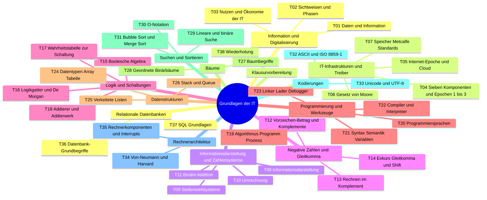
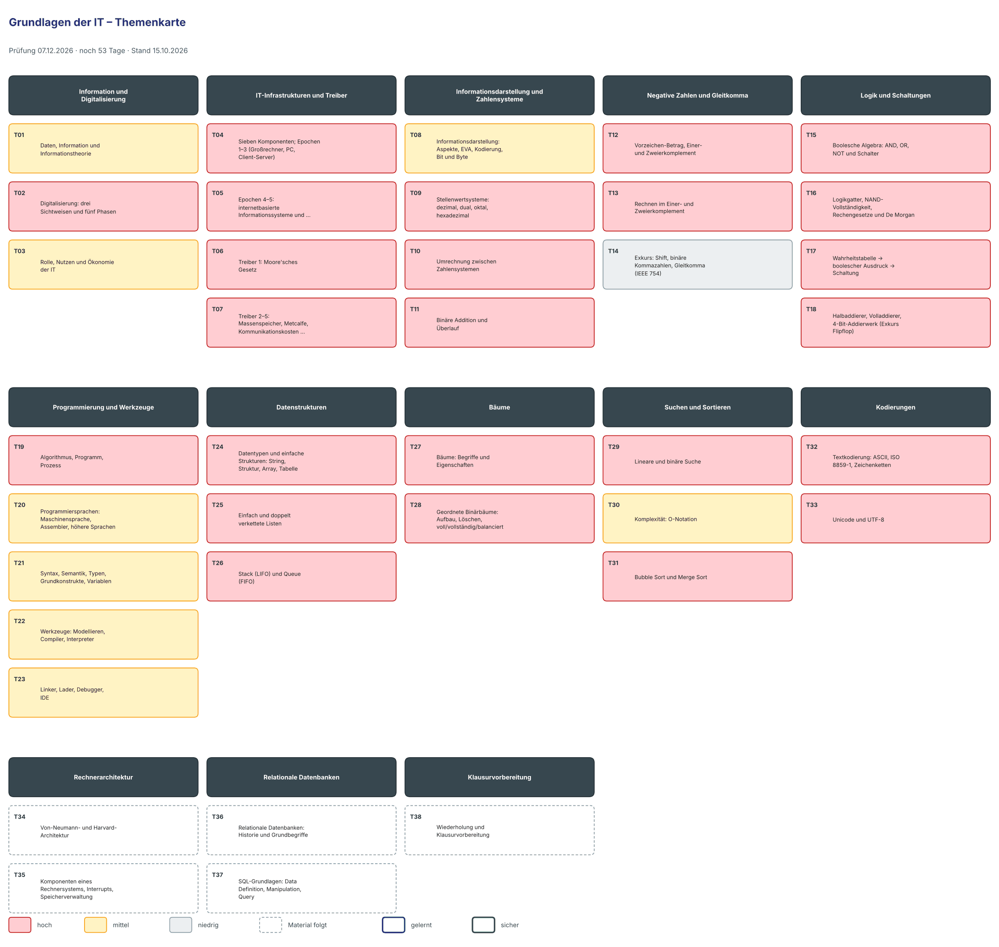

# Lernplan: Grundlagen der IT

<!-- klausur: 2026-12-07 -->
> Stand 15.10.2026 · erstellt aus: Folien VL01 und VL02 V4, beide Rückschauen, Selbsteinschätzung und deine Vorlesungsnotizen 01–03

## Prüfung auf einen Blick

| | |
|---|---|
| **Klausur** | **Mo 07.12.2026** – noch 53 Tage |
| Form | Klausur, **48 Minuten** – die erste Klausur der Klausurphase |
| Uhrzeit, Raum | noch offen |
| Hilfsmittel | unbekannt – bis zur Klärung alle Rechnungen ohne Taschenrechner üben |
| Musterklausur | keine – Relevanz aus Rückschau-Folien, Grundaufgaben und Modulbeschreibung (VL01 F. 4) |
| Dozent | Gisbert Loff · 6 Termine; offen: 16.10. Rechnerarchitektur, 19.10. Datenbanken, 21.10. Wiederholung |
| Nicht prüfungsrelevant | „Historische Bezüge“ und alles, was als „Exkurs“ markiert ist (VL01 F. 8) |

## Höchste Priorität

1. **T12–T13 Komplemente und Rechnen im Zweierkomplement:** sechs Rückschau-Folien und eine Grundaufgabe. ⚠️ Folienfehler auf VL02 F. 36 und RS02 F. 15: „−42 = 1 0101010“ ist Vorzeichen-Betrag – im Zweierkomplement gilt −42 = 1101 0110.
2. **T10 Umrechnung zwischen Zahlensystemen:** „Üben !!“ (VL02 F. 27); Grundlage für Komplement, ASCII und UTF-8.
3. **T16–T17 Logikgatter, De Morgan, Wahrheitstabelle → Ausdruck → Schaltung:** sieben Grundaufgaben-Folien.
4. **T28 Geordnete Binärbäume:** ausdrückliche „Aufgabe Bäume“ (VL02 F. 133).
5. **T32–T33 ASCII, Unicode und UTF-8:** stehen in der Modulbeschreibung; das UTF-8-Bytemuster ist eine echte Rechenaufgabe.
6. **T18 Halbaddierer, Volladdierer, Addierwerk:** beantwortet die Leitfrage „Wie rechnen Computer?“.

## Fortschritt

`░░░░░░░░░░░░░░░░░░░░` 0 von 38 Themen gelernt · 0 sicher · 1045 Min. Lernzeit gesamt · 5 Themen warten noch auf Material

## Themen

Relevanz: 🔴 hoch · 🟡 mittel · ⚪ niedrig — Status: neu → gelernt → sicher — Stufe 1–5: nächste Wiederholung nach 1 / 3 / 7 / 14 / 30 Tagen

### Information und Digitalisierung

| Nr | Thema | Lernziele | Relevanz | Quelle | Min | Status | Stufe | Nächste Wdh. |
|---|---|---|---|---|---|---|---|---|
| T01 | Daten, Information und Informationstheorie | Ich kann Daten, Information, Wissen und Handlung am Kontostand- und Temperaturbeispiel unterscheiden. Ich kann das Shannon-Modell (Quelle → Sender → Kanal → Empfänger → Ziel) mit Entropie, Redundanz und Kanalkapazität erklären. Ich kann Kompression (RLE, Huffman) und Fehlerkorrektur (Paritätsbit, Hamming, Reed-Muller) als Entfernen bzw. Hinzufügen von Redundanz vergleichen. | 🟡 mittel – Daten/Information in RS01 F. 2 wiederholt; Informationstheorie nur in VL01 | VL01 F. 11–14; RS01 F. 2 | 25 | neu | – | – |
| T02 | Digitalisierung: drei Sichtweisen und fünf Phasen | Ich kann die betriebswirtschaftliche, gesellschaftliche und technische Sichtweise auf Digitalisierung erklären. Ich kann die Phasen der Digitalisierung nach Österle/Fleisch/Alt mit je einem Beispiel nennen. Ich kann Phasen der Digitalisierung (ökonomisch) und Epochen der IT-Infrastruktur (technisch) unterscheiden. | 🔴 hoch – komplett in RS01 F. 3–5 wiederholt; typische Nenne-/Erkläre-Frage | VL01 F. 15–17; RS01 F. 3–5 | 25 | neu | – | – |
| T03 | Rolle, Nutzen und Ökonomie der IT | Ich kann die Rolle der IT vor und nach der kommerziellen Internetnutzung vergleichen. Ich kann die Nutzenstufen Automatisierung, Informatisierung und Transformation an einem Beispiel erklären. Ich kann ökonomische Folgen der Digitalisierung (Long Tail, Freemium, Plattformen, Eintrittsbarrieren, Branchenkonvergenz) nennen. | 🟡 mittel – nicht in RS01, aber WI-typische Erklärfrage | VL01 F. 18–22 | 20 | neu | – | – |

### IT-Infrastrukturen und Treiber

| Nr | Thema | Lernziele | Relevanz | Quelle | Min | Status | Stufe | Nächste Wdh. |
|---|---|---|---|---|---|---|---|---|
| T04 | Sieben Komponenten; Epochen 1–3 (Großrechner, PC, Client-Server) | Ich kann die sieben Hauptkomponenten einer IT-Infrastruktur nennen. Ich kann die fünf Epochen der IT-Infrastruktur in der richtigen Reihenfolge nennen. Ich kann eine N-Tier-Architektur (Client – Internet – Webserver – Anwendungsserver – Daten) zeichnen. Ich kann Großrechner-, PC- und Client-Server-Epoche vergleichen. | 🔴 hoch – 7 Komponenten in RS01 F. 6 wiederholt; Epochen-Details eher Einordnung | VL01 F. 24–35; RS01 F. 6 | 25 | neu | – | – |
| T05 | Epochen 4–5: internetbasierte Informationssysteme und Cloud Computing | Ich kann erklären, was TCP/IP ab 1995 für unternehmensübergreifende Informationssysteme ermöglichte. Ich kann Cloud Computing mit den Servicemodellen IaaS, PaaS und SaaS erklären. Ich kann die Entstehung von AWS und vier Hyperscaler nennen. | 🔴 hoch – 4. Epoche und Cloud-Anbieter in RS01 F. 7–8 wiederholt | VL01 F. 36–43; RS01 F. 7–8 | 25 | neu | – | – |
| T06 | Treiber 1: Moore'sches Gesetz | Ich kann Moores Aussage von 1965 und ihre Korrektur auf zwei Jahre nennen. Ich kann die drei 18-Monats-Interpretationen von der Originalaussage unterscheiden. Ich kann Grenzen des Gesetzes und Auswege (Lithographie, 3D-Chips, Quantencomputer, GPU-Cluster) erklären. Ich kann die Zahl der Verdopplungen und den Wachstumsfaktor über einen Zeitraum berechnen. | 🔴 hoch – drei Folien in RS01 F. 9–11 wiederholt | VL01 F. 45–56; RS01 F. 9–11 | 25 | neu | – | – |
| T07 | Treiber 2–5: Massenspeicher, Metcalfe, Kommunikationskosten, Standardisierung | Ich kann die fünf Treiber des technischen Fortschritts nennen. Ich kann die potenziellen Verbindungen nach Metcalfe mit n·(n−1) berechnen. Ich kann die Entwicklung von Speicherkapazität, Speicherkosten und Kommunikationskosten erklären. Ich kann die Wirkung von Standards (Skaleneffekte, Preissenkung) mit Beispielen erklären. | 🔴 hoch – Speicher und Kommunikationskosten in RS01 F. 12–15 wiederholt; Metcalfe-Formel rechenbar | VL01 F. 57–68; RS01 F. 12–15 | 30 | neu | – | – |

### Informationsdarstellung und Zahlensysteme

| Nr | Thema | Lernziele | Relevanz | Quelle | Min | Status | Stufe | Nächste Wdh. |
|---|---|---|---|---|---|---|---|---|
| T08 | Informationsdarstellung: Aspekte, EVA, Kodierung, Bit und Byte | Ich kann den syntaktischen, semantischen und pragmatischen Aspekt von Information unterscheiden. Ich kann das EVA-Prinzip und die Aufgabe einer Kodierung am Arecibo-Beispiel erklären. Ich kann Speichergrößen zwischen Bit, Byte, KB, MB, GB und TB (Faktor 1024) berechnen. | 🟡 mittel – nicht in RS02; Grundbegriffe für alle Rechenthemen; Geschichte F. 6–9 nicht prüfungsrelevant | VL02 F. 4–17; RS02 F. 2 | 20 | neu | – | – |
| T09 | Stellenwertsysteme: dezimal, dual, oktal, hexadezimal | Ich kann Ziffernmengen und Stellenwerte der vier Zahlensysteme nennen. Ich kann den Dezimalwert einer Dual-, Oktal- oder Hexadezimalzahl über die Stellenwertsumme berechnen. Ich kann Stellenwertsysteme vom römischen Zahlensystem unterscheiden. | 🔴 hoch – RS02 F. 3–6; Modulbeschreibung „Zahlendarstellungen“ | VL02 F. 18–24; RS02 F. 3–6 | 25 | neu | – | – |
| T10 | Umrechnung zwischen Zahlensystemen | Ich kann die Dual-, Oktal- und Hexadezimaldarstellung einer Dezimalzahl mit der Restwertmethode berechnen. Ich kann die Gruppenbildung (3 bzw. 4 Bit) für binär ↔ oktal/hex anwenden. Ich kann Zahlen aus verschiedenen Systemen der Größe nach vergleichen. Ich kann eine Probe per Rückrechnung anwenden. | 🔴 hoch – RS02 F. 7–11, Übungsfolien mit Lösungen (F. 30, 33), „Üben !!“ (F. 27) | VL02 F. 25–30, 33; RS02 F. 7–11 | 40 | neu | – | – |
| T11 | Binäre Addition und Überlauf | Ich kann die Summe zweier Dualzahlen schriftlich mit Überträgen berechnen. Ich kann erklären, wann bei fester Bitbreite ein Überlauf entsteht. Ich kann die Dezimalprobe anwenden. | 🔴 hoch – RS02 F. 12, Rechenaufgabe; Grundlage für Komplement und Addierwerk | VL02 F. 31–32; RS02 F. 12 | 20 | neu | – | – |

### Negative Zahlen und Gleitkomma

| Nr | Thema | Lernziele | Relevanz | Quelle | Min | Status | Stufe | Nächste Wdh. |
|---|---|---|---|---|---|---|---|---|
| T12 | Vorzeichen-Betrag, Einer- und Zweierkomplement | Ich kann eine negative Zahl in Vorzeichen-Betrag, Einer- und Zweierkomplement (8 Bit) berechnen. Ich kann die drei Darstellungen nach Wertebereich, Anzahl der Nullen und Rechenaufwand vergleichen. Ich kann den Wert einer Zweierkomplementzahl über die Wertigkeit −128 des höchsten Bits berechnen. | 🔴 hoch – RS02 F. 13–15; Modulbeschreibung „Komplementdarstellungen“ | VL02 F. 34–36, 41; RS02 F. 13–15 | 30 | neu | – | – |
| T13 | Rechnen im Einer- und Zweierkomplement | Ich kann eine Subtraktion als Addition im Zweierkomplement berechnen. Ich kann die Einerkomplement-Addition mit End-around Carry anwenden. Ich kann ein Ergebnis per Rückrechnung prüfen und einen Überlauf erklären. | 🔴 hoch – RS02 F. 16–18, Grundaufgaben F. 39; typische Rechenaufgabe | VL02 F. 37–40; RS02 F. 16–18 | 35 | neu | – | – |
| T14 | Exkurs: Shift, binäre Kommazahlen, Gleitkomma (IEEE 754) | Ich kann den Shift-Operator als Multiplikation bzw. Division mit 2 erklären. Ich kann die binäre Darstellung einer Dezimalzahl mit Nachkommastellen berechnen. Ich kann den Aufbau einer IEEE-754-Zahl (Vorzeichen, Exponent mit Bias, Mantisse) nennen. | ⚪ niedrig – als Exkurs markiert, nicht in RS02; aber Modulbeschreibung nennt Fließkommadarstellung → klären | VL02 F. 42–48 | 25 | neu | – | – |

### Logik und Schaltungen

| Nr | Thema | Lernziele | Relevanz | Quelle | Min | Status | Stufe | Nächste Wdh. |
|---|---|---|---|---|---|---|---|---|
| T15 | Boolesche Algebra: AND, OR, NOT und Schalter | Ich kann die Wahrheitstabellen von AND, OR und NOT nennen. Ich kann AND als Reihen- und OR als Parallelschaltung erklären. Ich kann einfache boolesche Ausdrücke für alle Belegungen berechnen. | 🔴 hoch – RS02 F. 19; Basis aller Gatteraufgaben | VL02 F. 49–54; RS02 F. 19 | 20 | neu | – | – |
| T16 | Logikgatter, NAND-Vollständigkeit, Rechengesetze und De Morgan | Ich kann die sieben Logikgatter mit IEC-Symbol zeichnen. Ich kann XOR/XNOR („ungleich“/„gleich“) und NAND/NOR (negiertes AND/OR) unterscheiden. Ich kann die NAND-Substitution für NOT, AND und OR anwenden. Ich kann die De-Morgan-Gesetze zum Nachweis einer Substitution anwenden. | 🔴 hoch – RS02 F. 20–21; Aufgabe „AND aus NAND“ (F. 60–61) | VL02 F. 55–61; RS02 F. 20–21 | 35 | neu | – | – |
| T17 | Wahrheitstabelle → boolescher Ausdruck → Schaltung | Ich kann das Standardvorgehen (Teilausdrücke der 1-Zeilen mit ODER verbinden) anwenden. Ich kann aus einem Ausdruck eine Schaltung aus NOT-, AND- und OR-Gattern zeichnen. Ich kann XOR- und XNOR-Muster in Wahrheitstabellen unterscheiden. Ich kann die Probe durch Einsetzen aller Belegungen anwenden. | 🔴 hoch – RS02 F. 22–24; sieben Grundaufgaben-Folien | VL02 F. 62–69; RS02 F. 22–24 | 35 | neu | – | – |
| T18 | Halbaddierer, Volladdierer, 4-Bit-Addierwerk (Exkurs Flipflop) | Ich kann Wahrheitstabelle und Gleichungen des Halbaddierers (s = A XOR B, c = A AND B) nennen. Ich kann einen Volladdierer aus zwei Halbaddierern und einem OR-Gatter zeichnen. Ich kann den Ablauf einer Addition im 4-Bit-Addierwerk erklären. | 🔴 hoch – RS02 F. 25–26 (Addierwerk als „Nachtrag“ ergänzt); Flipflop nur Exkurs | VL02 F. 70–72; RS02 F. 25–26 | 30 | neu | – | – |

### Programmierung und Werkzeuge

| Nr | Thema | Lernziele | Relevanz | Quelle | Min | Status | Stufe | Nächste Wdh. |
|---|---|---|---|---|---|---|---|---|
| T19 | Algorithmus, Programm, Prozess | Ich kann Algorithmus, Programm und Prozess unterscheiden. Ich kann erklären, warum eine Endlosschleife ein Programm, aber kein Algorithmus ist. Ich kann Struktogramm und UML-Aktivitätsdiagramm als Darstellungsformen nennen. | 🔴 hoch – RS02 F. 27–28; klare Definitionsfrage | VL02 F. 73–75; RS02 F. 27–28 | 20 | neu | – | – |
| T20 | Programmiersprachen: Maschinensprache, Assembler, höhere Sprachen | Ich kann Maschinensprache, Assembler und höhere Programmiersprachen unterscheiden. Ich kann das Assembler-Prinzip (Register laden, rechnen, an symbolische Adresse speichern) erklären. Ich kann erklären, was der TIOBE-Index misst und was nicht. Ich kann Entwicklungslinien (strukturiert, objektorientiert, speichersicher) mit Beispielsprache nennen. | 🟡 mittel – Einstieg in RS02 F. 29 wiederholt; TIOBE und Sprachgeschichte eher Einordnung | VL02 F. 76–82; RS02 F. 29 | 25 | neu | – | – |
| T21 | Syntax, Semantik, Typen, Grundkonstrukte, Variablen | Ich kann Syntax- und Semantikfehler unterscheiden. Ich kann die int/int-Falle in Java erklären. Ich kann die Grundkonstrukte von Programmiersprachen nennen. Ich kann Deklaration, Initialisierung und Zuweisung einer Variablen unterscheiden. | 🟡 mittel – nicht in RS02 (vermutlich 14.10.); gut abfragbar, aber „KEIN Programmierkurs“ | VL02 F. 83–89 | 25 | neu | – | – |
| T22 | Werkzeuge: Modellieren, Compiler, Interpreter | Ich kann Modellieren, Programmieren, Compilieren und Interpretieren unterscheiden. Ich kann die Compilerphasen mit ihrem Zwischenergebnis nennen. Ich kann Compiler und Interpreter (inkl. Bytecode) vergleichen. | 🟡 mittel – nicht in RS02 (vermutlich 14.10.); Phasen als Aufzählung abfragbar | VL02 F. 90–93 | 25 | neu | – | – |
| T23 | Linker, Lader, Debugger, IDE | Ich kann die Aufgabe des Linkers erklären. Ich kann statisches und dynamisches Linken vergleichen. Ich kann die Adressanpassung des Laders (Offset) anwenden. Ich kann die Debugger-Befehle Run, Step, Next, Cont und Undo unterscheiden. | 🟡 mittel – nicht in RS02 (vermutlich 14.10.); Vor-/Nachteile typische Vergleichsfrage | VL02 F. 94–98 | 25 | neu | – | – |

### Datenstrukturen

| Nr | Thema | Lernziele | Relevanz | Quelle | Min | Status | Stufe | Nächste Wdh. |
|---|---|---|---|---|---|---|---|---|
| T24 | Datentypen und einfache Strukturen: String, Struktur, Array, Tabelle | Ich kann elementare Datentypen und Datenstrukturen unterscheiden. Ich kann Vor- und Nachteile eines Arrays nennen. Ich kann erklären, wie aus Struktur und Array/Liste eine Tabelle mit eindeutigem Schlüssel wird. | 🔴 hoch – RS02 F. 30–36 (sieben Folien) | VL02 F. 99–107; RS02 F. 30–36 | 30 | neu | – | – |
| T25 | Einfach und doppelt verkettete Listen | Ich kann eine einfach verkettete Liste mit Kopf, Elementen und next-Zeigern zeichnen. Ich kann Einfügen und Löschen über das Umsetzen von Zeigern erklären. Ich kann einfach/doppelt verkettete Liste sowie Liste und Array vergleichen. | 🔴 hoch – RS02 F. 37–40 | VL02 F. 108–113; RS02 F. 37–40 | 25 | neu | – | – |
| T26 | Stack (LIFO) und Queue (FIFO) | Ich kann Stack (LIFO) und Queue (FIFO) unterscheiden. Ich kann eine Folge von push/pop/top bzw. put/get auf Stack und Queue anwenden. Ich kann die Realisierung als Array (Index, Ringpuffer) oder als verkettete Liste erklären. | 🔴 hoch – RS02 F. 41–42; Operationsfolgen leicht prüfbar | VL02 F. 114–120; RS02 F. 41–42 | 25 | neu | – | – |

### Bäume

| Nr | Thema | Lernziele | Relevanz | Quelle | Min | Status | Stufe | Nächste Wdh. |
|---|---|---|---|---|---|---|---|---|
| T27 | Bäume: Begriffe und Eigenschaften | Ich kann Knoten, Kante, Pfad, Wurzel, Blatt, inneren Knoten, Unterbaum, Wald und n-ären Baum erklären. Ich kann Ebene, Höhe und Pfadlänge eines Baums berechnen. | 🔴 hoch – RS02 F. 43–45; Begriffe für die Baumaufgabe | VL02 F. 121–125; RS02 F. 43–45 | 25 | neu | – | – |
| T28 | Geordnete Binärbäume: Aufbau, Löschen, voll/vollständig/balanciert | Ich kann aus einer Zahlenfolge einen geordneten Binärbaum zeichnen. Ich kann die Löschregel (größter Knoten links oder kleinster Knoten rechts) anwenden. Ich kann volle, vollständige, balancierte und degenerierte Binärbäume unterscheiden. Ich kann die Ordnungseigenschaft als Probe anwenden. | 🔴 hoch – RS02 F. 46–49; ausdrückliche „Aufgabe Bäume“ (F. 133) | VL02 F. 126–133; RS02 F. 46–49 | 40 | neu | – | – |

### Suchen und Sortieren

| Nr | Thema | Lernziele | Relevanz | Quelle | Min | Status | Stufe | Nächste Wdh. |
|---|---|---|---|---|---|---|---|---|
| T29 | Lineare und binäre Suche | Ich kann lineare und binäre Suche nach Voraussetzung und Aufwand vergleichen. Ich kann die binäre Suche schrittweise auf ein sortiertes Array anwenden. Ich kann die maximale Schrittzahl der binären Suche berechnen. | 🔴 hoch – RS02 F. 51–53 mit Beispielen | VL02 F. 134–137; RS02 F. 50–53 | 25 | neu | – | – |
| T30 | Komplexität: O-Notation | Ich kann den Zweck der O-Notation erklären. Ich kann O(1), O(log n), O(n), O(n log n) und O(n²) mit Beispielen aus der Vorlesung nennen. Ich kann Komplexitätsklassen nach ihrem Wachstum vergleichen. | 🟡 mittel – F. 138 als Exkurs markiert; O-Klassen der Verfahren aber in RS02 F. 52, 54–55 | VL02 F. 138, 141 (O-Klassen auch F. 136, 139–140) | 25 | neu | – | – |
| T31 | Bubble Sort und Merge Sort | Ich kann Bubble Sort Durchlauf für Durchlauf anwenden. Ich kann Merge Sort als Teilen-und-Mischen-Diagramm zeichnen. Ich kann Bubble Sort und Merge Sort nach Vorgehen und Aufwand vergleichen. | 🔴 hoch – RS02 F. 54–55 | VL02 F. 139–140; RS02 F. 54–55 | 30 | neu | – | – |

### Kodierungen

| Nr | Thema | Lernziele | Relevanz | Quelle | Min | Status | Stufe | Nächste Wdh. |
|---|---|---|---|---|---|---|---|---|
| T32 | Textkodierung: ASCII, ISO 8859-1, Zeichenketten | Ich kann die Eigenschaften von ASCII (7 Bit, 128 Zeichen, 33 nicht druckbar, Paritätsbit) nennen. Ich kann die ASCII-Tabelle anwenden, um eine Zeichenkette dezimal, hexadezimal und binär darzustellen. Ich kann ASCII und 8-Bit-Erweiterungen wie ISO 8859-1 unterscheiden. Ich kann ein Paritätsbit berechnen. | 🔴 hoch – Modulbeschreibung „Zeichensätze (ASCII, Unicode)“; Umrechnungsaufgabe F. 150; noch ohne Rückschau | VL02 F. 142–147, 150 | 25 | neu | – | – |
| T33 | Unicode und UTF-8 | Ich kann Ziel und Umfang von Unicode erklären. Ich kann die UTF-8-Bytemuster für 1 bis 4 Byte nennen. Ich kann die UTF-8-Bytes eines Zeichens und den Speicherbedarf eines Textes berechnen. Ich kann Unicode (Zeichensatz) und UTF-8 (Kodierung) unterscheiden. | 🔴 hoch – Modulbeschreibung; Bitmuster-Regel als Rechenaufgabe | VL02 F. 148–149 | 35 | neu | – | – |

### Rechnerarchitektur

| Nr | Thema | Lernziele | Relevanz | Quelle | Min | Status | Stufe | Nächste Wdh. |
|---|---|---|---|---|---|---|---|---|
| T34 | Von-Neumann- und Harvard-Architektur (Material folgt, 16.10.) | Ich kann die Komponenten der Von-Neumann-Architektur nennen. Ich kann Von-Neumann- und Harvard-Architektur vergleichen. | 🔴 hoch (vermutet) – eigener Termin; Modulbeschreibung | VL01 F. 4–5, 71; VL02 F. 152 | 30 | neu | – | – |
| T35 | Komponenten eines Rechnersystems, Interrupts, Speicherverwaltung (Material folgt, 16.10.) | Ich kann die Komponenten eines Rechnersystems mit ihrer Aufgabe nennen. Ich kann Interrupts und Ereignissteuerung erklären. | 🟡 mittel (vermutet) – Modulbeschreibung nennt Interrupts, Memory Management, parallele Architekturen; Umfang offen („ggf. Präsentationen“) | VL01 F. 4–5; VL02 F. 152 | 30 | neu | – | – |

### Relationale Datenbanken

| Nr | Thema | Lernziele | Relevanz | Quelle | Min | Status | Stufe | Nächste Wdh. |
|---|---|---|---|---|---|---|---|---|
| T36 | Relationale Datenbanken: Historie und Grundbegriffe (Material folgt, 19.10.) | Ich kann Tabelle, Datensatz, Attribut und Schlüssel erklären. Ich kann den Zweck eines ER-Diagramms erklären. | 🔴 hoch (vermutet) – eigener Termin; Vorgriff in RS02 F. 33, 36 | VL01 F. 5, 71; VL02 F. 104, 107; RS02 F. 33, 36 | 30 | neu | – | – |
| T37 | SQL-Grundlagen: Data Definition, Manipulation, Query (Material folgt, 19.10.) | Ich kann Data Definition, Data Manipulation und Data Query unterscheiden. Ich kann einfache SQL-Befehle anwenden (falls behandelt). | 🟡 mittel (vermutet) – SQL nur in VL01 F. 5 genannt; „KEIN Programmierkurs“ | VL01 F. 5; VL02 F. 107; RS02 F. 36 | 30 | neu | – | – |

### Klausurvorbereitung

| Nr | Thema | Lernziele | Relevanz | Quelle | Min | Status | Stufe | Nächste Wdh. |
|---|---|---|---|---|---|---|---|---|
| T38 | Wiederholung und Klausurvorbereitung (Material folgt, 21.10.) | Ich kann alle Rechenverfahren unter Zeitdruck (48 Minuten) anwenden. Ich kann die Klausurhinweise des Dozenten (Aufgabentypen, Hilfsmittel) nennen. | 🔴 hoch – Klausurhinweise erwartet | VL01 F. 5, 7; VL02 F. 160 | 30 | neu | – | – |

## Mindmap

Als Bild mit Relevanz-Farben und Lernstand (aktualisieren mit `python3 -I lernen/status.py --karten`):

## Was über die Prüfung bekannt ist

| Punkt | Was bekannt ist | Quelle |
|---|---|---|
| Form | Klausur | README; Stundenplan „Klausur Grundlagen IT I (48 Min)“ |
| Dauer | **exakt 48 Minuten** | VL01 F. 7; README; Stundenplan |
| Datum | **Mo 07.12.2026** – erste Klausur der Klausurphase (danach 09.12. Einführung WI, 11.12. Programmierung, 14.12. Recht, 16.12. BWL, 18.12. Mathematik); Prüfungsvorbereitung 03./04.12. | `stundenplan/DHBW_DS26A2_1Semester.ics` |
| Uhrzeit, Raum | **unbekannt** („Uhrzeit laut Stundenplan noch offen“) | Stundenplan |
| Hilfsmittel | **unbekannt** – weder VL01, RS01, VL02, RS02 noch README/Notizen nennen Hilfsmittel | – |
| Taschenrechner | **unbekannt** – nirgends erwähnt → alle Rechenverfahren von Hand üben | – |
| Aufgabentypen | **nicht angekündigt.** Indizien: „Grundaufgaben“-Folien zu Umrechnung (VL02 F. 25–33), Binäraddition (F. 31–32), Zweierkomplement (F. 39–40), Logikgatter/Wahrheitstabellen/Schaltungen (F. 60–68), „Aufgabe Bäume“ (F. 133), binäre Suche (F. 137); zu Teil I vermutlich Nenne-/Erkläre-Fragen zu den in RS01 wiederholten Folien | VL02; RS01; RS02 |
| Prüfungsrelevanz | „Dies ist KEIN Programmierkurs“ · „Historische Bezüge sind nicht prüfungsrelevant“ · „Exkurse sind ‚good to know‘ … nicht prüfungsrelevant“ | VL01 F. 8 |
| Stoff laut Modulbeschreibung | Grundlagen: geschichtliche Entwicklung, Zahlendarstellungen (binär, hexadezimal), Komplementdarstellungen, Fließkommadarstellung, arithmetische Operationen, Zeichensätze (ASCII, Unicode). Rechnerarchitektur: Komponenten eines Rechnersystems, Von-Neumann-Architektur, Interrupts, Asynchronität, Ereignissteuerung, Memory Management (HW), parallele Architekturen | VL01 F. 4 |
| Arbeitsaufwand | 24 h Präsenz, 36 h Selbststudium | VL01 F. 4 |
| Klausurvorbereitung | letzter Termin 21.10. „Wdh, Klausurvorbereitung“ → dort Hinweise zu Aufgaben/Hilfsmitteln erwarten | VL01 F. 5, 7 |
| Musterklausur / Altklausur | **keine bekannt** | – |
| Punkte, Aufgabenzahl, Bestehensgrenze, Anteil an der Modulnote | **unbekannt** | – |

**Einschätzung (eigene):** 48 Minuten sind knapp. Rechenaufgaben (Umrechnen, Komplement, Wahrheitstabelle, Baum, UTF-8) müssen in wenigen Minuten ohne Nachdenken laufen, inklusive Probe. Zwischen der letzten Vorlesung (21.10.) und der Klausur liegen rund 7 Wochen.

## Offene Punkte – in der Vorlesung klären

- **Hilfsmittel und Taschenrechner:** nirgends genannt → am 21.10. klären (oder vorher per Moodle/E-Mail); bis dahin alles ohne Taschenrechner üben.
- **Aufgabentypen, Punkte, Gewichtung von VL01/VL02/Terminen 4–6, Anteil an der Modulnote:** unbekannt; keine Musterklausur.
- **Termin 3 (14.10.) unbestätigt:** Notiz 03 hat Status „vorbereitet“, die Grundlage ist geschätzt. Ob VL02 F. 77–98, 138, 141–150 tatsächlich behandelt wurden oder schon Rechnerarchitektur begann, zeigt erst eine Rückschau zu Termin 3. Die Relevanzangaben für T20–T23, T30, T32–T33 sind deshalb vorläufig.
- **Folienfehler Zweierkomplement:** VL02 F. 36 und RS02 F. 15 zeigen „−42 = 1 0101010“, auch in V4 nicht korrigiert (richtig 1 1010110) → ggf. beim Dozenten ansprechen.
- **Exkurs vs. Modulbeschreibung:** Fließkommadarstellung (VL02 F. 46–48) und O-Notation (F. 138) sind als „Exkurs“ markiert, laut VL01 F. 8 also nicht prüfungsrelevant; Fließkomma steht aber in der Modulbeschreibung (VL01 F. 4). Ebenso „geschichtliche Entwicklung“ (Modulbeschreibung) vs. „historische Bezüge nicht prüfungsrelevant“ (VL01 F. 8) – wie viel VL01-Wissen (Epochen, Jahreszahlen) wird geprüft?
- **Baumdefinitionen:** VL02 F. 132 nennt den balancierten Baum „(= voller Baum)“, F. 126/128 definieren „voll“ anders; „Tiefe log₂(n+1)“ zählt Ebenen, nicht die Höhe nach F. 124 → Definitionen am 21.10. bestätigen lassen.
- **Binäre Suche:** Die Wahl der Mitte bei gerader Bereichsgröße ist auf VL02 F. 137 uneinheitlich (bei 61 abgerundet, bei 19 aufgerundet).
- **Bubble Sort:** „so viele Durchläufe wie Elemente“ (VL02 F. 139) vs. höchstens n−1 nötige Durchläufe.
- **Flipflop (VL02 F. 72, in v3 F. 69):** Die Zustandstabelle widerspricht „S = Set, R = Reset“ (Exkurs, trotzdem unklar).
- **Kleinere Folienfehler:** „ISO-Norm 10636“ statt ISO/IEC 10646 (VL02 F. 148); Java `double(z1)` statt `(double) z1` (F. 86); „XIV“ statt „XIX“ in der Zahlentabelle (F. 19); Metcalfe „exponentiell“ vs. Formel n·(n−1) (VL01 F. 61).
- **Agenda-Abweichungen:** „Einführung Rechnernetze und Internetdienste“ steht nur auf VL01 F. 71 (nicht auf VL01 F. 5, VL02 F. 2/160) – entfällt das Thema? „SQL“ nur in VL01 F. 5; „ggf. Präsentationen“ zu Rechnerkomponenten (VL01 F. 5) – sind Studierendenvorträge prüfungsrelevant?
- **Versionsstände:** Die Repo-Notizen nennen teils Foliennummern aus VL02 v3 (z. B. Flipflop v3 F. 69 = V4 F. 72); RS02 F. 51 weicht leicht von V4 F. 135 ab. Dieser Plan nutzt durchgehend V4. VL02 v2/v3 und die alte 56-Folien-Rückschau wurden nicht ausgewertet.
- **Klausurorganisation:** Uhrzeit und Raum am 07.12. offen (Stundenplan).
- **T34–T38:** nach den Terminen am 16., 19. und 21.10. Themen, Lernziele, Minuten und Relevanz mit dem echten Material nachziehen.

## Quellen

| Kürzel | Datei | Umfang | Inhalt / Stand |
|---|---|---|---|
| SE | 0_Selbsteinschätzung.pdf | 1 S. | Fragebogen zu Vorkenntnissen (Hausaufgabe zu Termin 1: PC-Aufbau, Arduino/ESP, Sprachen, digitale Schaltungen, Linux, SQL, TCP/IP, Cloud, KI) – kein Prüfungsstoff |
| VL01 | 01_Loff_GIT - VL01 - Organisation und Themeneinführung.pdf | 71 F. | Organisation, Modulbeschreibung (F. 4), Teil I: Information und Digitalisierung, IT-Infrastrukturen, Treiber des Fortschritts; erstellt 05.10.2026 |
| RS01 | 01_Loff_GIT - VL01 - Rückschau.pdf | 15 F. | „Rückschau 1, 9.10.2026“: 14 Kernfolien aus VL01 (= VL01 F. 12, 15, 16, 17, 24, 36, 40, 46, 47, 54, 57, 58, 59, 63), zu Beginn von Termin 2 wiederholt |
| VL02 | GIT VL02 V4.pdf | 160 F. | Einheit 2 „Grundlegende Konzepte“: Zahlensysteme, Komplemente, Logik, Programmiersprachen, Werkzeuge, Datenstrukturen, Bäume, Suchen/Sortieren, Kodierungen; aktuellste Fassung (erstellt 12.10.2026), ersetzt v2 (157 F.) und v3 (161 F.) |
| RS02 | GIT VL02 - Rückschau.pdf | 55 F. | „Rückschau Einheit 2“ (erstellt 12.10.2026): 54 Folien aus VL02 F. 4–140 = am 09.10. behandelter und wiederholter Stoff |

**Repo-Notizen (nur gelesen):**
- `grundlagen-it/README.md` – Termine, Fortschritt, Materialliste („Prüfung: Klausur, 48 Minuten“)
- `grundlagen-it/vorlesungen/01_2026-10-07.md` – Termin 1, abgeschlossen
- `grundlagen-it/vorlesungen/02_2026-10-09.md` – Termin 2, abgeschlossen (Foliennummern teils nach VL02 v3)
- `grundlagen-it/vorlesungen/03_2026-10-14.md` – Termin 3, Status „vorbereitet“, Inhalt nur geschätzt (VL02 F. 76–98, 128–132, 138, 141–151)
- `stundenplan/DHBW_DS26A2_1Semester.ics` – Vorlesungs- und Klausurtermine

**Zuordnung RS02 → VL02:** RS02 F. 2 = VL02 F. 4 · F. 3–11 = F. 21–29 · F. 12 = F. 31 · F. 13–17 = F. 34–38 · F. 18 = F. 40 · F. 19 = F. 51 · F. 20–21 = F. 56–57 · F. 22–23 = F. 63–64 · F. 24 = F. 68 · F. 25–26 = F. 70–71 · F. 27–29 = F. 74–76 · F. 30–31 = F. 100–101 · F. 32–36 = F. 103–107 · F. 37 = F. 109 · F. 38–40 = F. 111–113 · F. 41 = F. 115 · F. 42 = F. 118 · F. 43–45 = F. 122–124 · F. 46 = F. 127 · F. 47–48 = F. 129–130 · F. 49 = F. 133 · F. 50–53 = F. 134–137 · F. 54–55 = F. 139–140.

**Nicht in RS02:** VL02 F. 5–20 (Geschichte, Informationsdarstellung), F. 30, 32–33, 39 (Lösungs-/Übungsfolien), F. 41–48 (Java-Typen, Exkurse), F. 52–54, 58–62, 65–67, 69, 72, F. 77–98 (Assembler bis IDE), F. 102, 110, 116–117, 119–120, 125–126, 128, 131–132, 138, 141–150 (u. a. O-Notation, Kodierungen) sowie Agenda-, Ausblick- und Anhangfolien (z. B. F. 151–160).

## Dateien zu diesem Fach

- [Kernpunkte, Klausurfallen und Visualisierungsideen](kernpunkte.md)
- Karteikarten: `karteikarten.md` (entsteht beim Lernen)
- Fehlerprotokoll: `fehlerprotokoll.md` (entsteht beim Lernen)
- Grafiken: [`grafiken/`](grafiken/) – u. a. die Themenkarte
