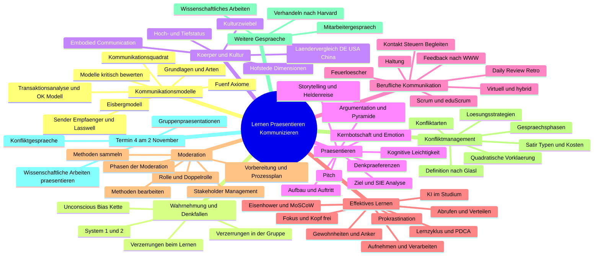
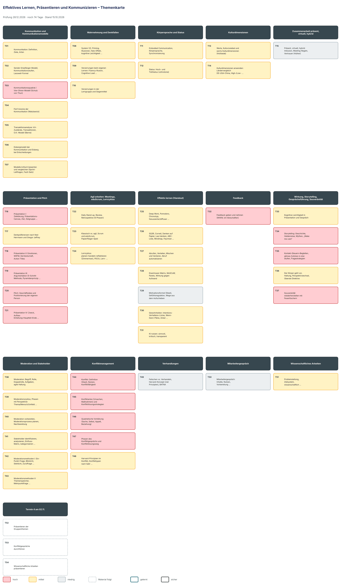

# Lernplan: Effektives Lernen, Präsentieren und Kommunizieren

<!-- klausur: 2026-12-28 -->
> Stand 15.10.2026 · erstellt aus: Skript Teil 1 (58 S.) und Teil 2 (68 S.), Handout Effektives Lernen, Fotoprotokolle 06.10., 08.10. und 12.10., Aufgabe Kulturdimensionen und deine Vorlesungsnotizen 01–03

## Prüfung auf einen Blick

| | |
|---|---|
| **Portfolio-Abgabe** | **Mo 28.12.2026** – noch 74 Tage |
| Form | schriftliche Portfolio-Prüfungsleistung – **Aufgabenstellung, Umfang und Bewertung stehen in keinem Material** (das Wort „Portfolio“ kommt in den Unterlagen nicht vor) |
| Abgabe | vermutlich Mo 28.12.2026 (Sammeltermin „Abgabe schriftliche Portfolioprüfungsleistungen“ im Stundenplan, ohne Fachbezug) |
| Nächster Termin | **Mo 02.11.** – vorbereiten: Gruppenpräsentation (Themen und Gruppen: FP08 F. 44), Konfliktgespräch nach der quadratischen Vorklärung (FP12 F. 32–34), „Wissenschaftliche Arbeiten präsentieren“ |
| Dozentin | Anke Menzler · 4 ganztägige Termine (06.10., 08.10., 12.10., 02.11.) |
| Relevanz | vorläufig: „hoch“ heißt hier „wird am 02.11. gebraucht“ – nach Bekanntgabe der Portfolio-Aufgabe neu vergeben |

## Höchste Priorität

0. **Portfolio-Aufgabenstellung klären** (Moodle oder am 02.11. bei Frau Menzler) – davon hängt alles Weitere ab.
1. **T16, T18–T21 Präsentation und Pitch für den 02.11.:** Ziel, Kernbotschaft, Zielgruppe (Entscheider), Nutzen, Struktur, Start und Ende.
2. **T44–T47 Konfliktgespräch:** quadratische Vorklärung und Gesprächsphasen – der einzige ausdrückliche Hausauftrag mit Methode, am 02.11. live.
3. **T34 Storytelling:** Die Storyline aus der Übung soll in die Präsentation (FP08 F. 55).
4. **T32 Feedback (WWW):** in beiden Skripten, in jeder Übung angewandt.
5. **T03, T35, T37 Gesprächstechnik:** Kommunikationsquadrat, aktives Zuhören, Fragen, Feuerlöscher.

## Fortschritt

`░░░░░░░░░░░░░░░░░░░░` 0 von 54 Themen gelernt · 0 sicher · 1610 Min. Lernzeit gesamt · 3 Themen warten noch auf Material

## Themen

Relevanz: 🔴 hoch · 🟡 mittel · ⚪ niedrig — Status: neu → gelernt → sicher — Stufe 1–5: nächste Wiederholung nach 1 / 3 / 7 / 14 / 30 Tagen

### Kommunikation und Kommunikationsmodelle

| Nr | Thema | Lernziele | Relevanz | Quelle | Min | Status | Stufe | Nächste Wdh. |
|---|---|---|---|---|---|---|---|---|
| T01 | Kommunikation: Definition, Ziele, Arten | Ich kann den Unterschied zwischen Informationsübermittlung und Kommunikation am Trichterbild erklären. Ich kann je drei Gesprächsziele der Prozess- und der Beziehungsebene nennen. Ich kann die fünf Kommunikationsarten auf eine eigene Chat- oder Meeting-Situation anwenden. | 🟡 mittel – Grundbegriffe für alle Modelle, im Unterricht nur kurz (FP08 F. 4) | S1 Kap. 1.1 Grundlagen · S1 S. 7–9; FP06 F. 21; FP08 F. 4 | 20 | neu | – | – |
| T02 | Sender-Empfänger-Modell, Kommunikationsstufen, Lasswell-Formel | Ich kann das Sender-Empfänger-Modell (Shannon/Weaver 1949) mit Codieren und Decodieren erklären. Ich kann die Kommunikationsstufen von „gedacht“ bis „umgesetzt“ nennen. Ich kann die fünf Lasswell-Fragen auf meine Präsentation am 02.11. anwenden. | 🟡 mittel – Lasswell war im Modell-Sprint wählbar (FP06 F. 23), gutes Planungsraster | S1 Kap. 1.2 Kommunikationsmodelle · S1 S. 10, 18–20; FP06 F. 23 | 25 | neu | – | – |
| T03 | Kommunikationsquadrat / Vier-Ohren-Modell (Schulz von Thun) | Ich kann die vier Seiten einer Nachricht nennen und erklären. Ich kann das Quadrat auf eine Teamnachricht anwenden und alle vier Botschaften herausarbeiten. Ich kann erklären, wie Missverständnisse entstehen, wenn Sender und Empfänger verschiedene Ohren nutzen. | 🔴 hoch – Grundlage der quadratischen Vorklärung für das Konfliktgespräch am 02.11. (FP12 F. 30–32), in beiden Skripten | S1 Kap. 1.2 Kommunikationsmodelle · S1 S. 10–12; S2 S. 35; FP06 F. 24; FP08 F. 6–7 | 35 | neu | – | – |
| T04 | Fünf Axiome der Kommunikation (Watzlawick) | Ich kann die fünf Axiome nennen. Ich kann „analog/digital“ und „symmetrisch/komplementär“ im Sinne Watzlawicks erklären. Ich kann jedes Axiom auf ein Beispiel aus meinem Alltag anwenden und einen eigenen kommunikativen Teufelskreis reflektieren. | 🟡 mittel – im Modell-Sprint wählbar (FP06 F. 23) | S1 Kap. 1.2 Kommunikationsmodelle · S1 S. 12–14; FP06 F. 23 | 30 | neu | – | – |
| T05 | Transaktionsanalyse: Ich-Zustände, Transaktionen, O.K.-Modell (Berne) | Ich kann die drei Ich-Zustände und die vier Grundeinstellungen nennen. Ich kann komplementäre, gekreuzte und verdeckte Transaktionen an Beispielen erklären. Ich kann eine gekreuzte Transaktion im Rollenspiel aus dem Erwachsenen-Ich auflösen (anwenden). | 🟡 mittel – im Modell-Sprint als Flipchart bearbeitet (FP06 F. 25) | S1 Kap. 1.2 Kommunikationsmodelle · S1 S. 14–18; FP06 F. 25 | 40 | neu | – | – |
| T06 | Eisbergmodell der Kommunikation und Eisberg bei Entscheidungen | Ich kann sichtbare und unsichtbare Anteile des Eisbergs nennen. Ich kann die vier Ebenen des Entscheidungs-Eisbergs (Oestereich/Schröder) erklären. Ich kann eine Gruppenentscheidung mit dem Eisberg analysieren (anwenden). | 🟡 mittel – im Modell-Sprint (FP08 F. 7) und als Ergänzung (FP06 F. 27) | S1 Kap. 1.2 Kommunikationsmodelle · S1 S. 20–21; FP06 F. 27; FP08 F. 9 | 25 | neu | – | – |
| T07 | Modelle kritisch bewerten und vergleichen (Sprint-Leitfragen, Fazit-Satz) | Ich kann die Sprint-Leitfragen zur Bewertung eines Modells nennen. Ich kann für drei Modelle ein begründetes Fazit „Das Modell ist heute …, weil …“ formulieren (reflektieren). Ich kann ein reales Missverständnis mit zwei Modellen erklären und deren Grenzen benennen. | 🟡 mittel – Lernziel 1 beider Skripte (S1 S. 6, S2 S. 6), Format aus dem Sprint | S1 Kap. 1.2 Kommunikationsmodelle · S1 S. 6, 31; FP06 F. 23–24; FP08 F. 6–7 | 25 | neu | – | – |

### Wahrnehmung und Denkfallen

| Nr | Thema | Lernziele | Relevanz | Quelle | Min | Status | Stufe | Nächste Wdh. |
|---|---|---|---|---|---|---|---|---|
| T08 | System 1/2, Priming, Illusionen, Halo-Effekt, kognitive Leichtigkeit, Kette Wahrnehmen–Vermuten–Bewerten–Reagieren | Ich kann System 1 und System 2 nach Kahneman erklären. Ich kann Priming, Wiederholungs-Illusion und Halo-Effekt mit je einem Beispiel nennen. Ich kann eine Beobachtung in die vier Stufen Wahrnehmen–Vermuten–Bewerten–Reagieren zerlegen und eine faire Reaktion wählen (anwenden). | 🟡 mittel – Unconscious-Bias-Kette am 12.10. (FP12 F. 5), erklärt Fehlurteile im Konflikt | S1 Kap. 1.2.8 Wahrnehmungsfilter · S1 S. 21–24; FP12 F. 4–5; HO S. 2 | 35 | neu | – | – |
| T09 | Verzerrungen beim eigenen Lernen: Fluency-Illusion, Cognitive Load, Satisficing, Planungsfehlschluss, Bias-Katalog | Ich kann Fluency-Illusion (Illusion des Wissens) und Rückschaufehler mit Gegenmittel erklären. Ich kann fünf Verzerrungen mit Urheber nennen. Ich kann meinen Zeitplan fürs Portfolio mit der Außensicht gegen den Planungsfehlschluss prüfen (anwenden). | 🟡 mittel – Team-Sprint „Verzerrungen beim Lernen“ (FP06 F. 29–30) | HO Kap. 1 Denkfallen · HO S. 2–7; FP06 F. 28–30; FP08 F. 10–11 | 35 | neu | – | – |
| T10 | Verzerrungen in der Lerngruppe und Gegenmittel | Ich kann Gruppendenken, Trittbrettfahren und Gemeinsames-Wissen-Effekt erklären. Ich kann die acht Gegenmittel aus HO 1.8 nennen. Ich kann für meine Präsentationsgruppe zwei Regeln gegen Gruppenverzerrungen anwenden. | 🟡 mittel – Sprint-Teil „Gruppenlernen“ (FP08 F. 11), nützlich für die Gruppenpräsentation | HO Kap. 1 Denkfallen · HO S. 7–10; FP08 F. 11 | 30 | neu | – | – |

### Körpersprache und Status

| Nr | Thema | Lernziele | Relevanz | Quelle | Min | Status | Stufe | Nächste Wdh. |
|---|---|---|---|---|---|---|---|---|
| T11 | Embodied Communication, Körpersprache, Synchronisierung | Ich kann die Kernaussage „Der Körper beginnt, der Kopf folgt“ (Storch/Tschacher) erklären. Ich kann Signale von Blick, Händen, Armen und Stand und ihre kulturelle Abhängigkeit nennen. Ich kann meine Haltung beim Probevortrag gezielt verändern und die Wirkung reflektieren. | 🟡 mittel – Basis für Status und „Body first“, hilft beim Auftritt | S1 Kap. 1.2.9 Embodied Communication · S1 S. 21, 24–27 | 25 | neu | – | – |
| T12 | Status: Hoch- und Tiefstatus (Johnstone) | Ich kann je fünf verbale und nonverbale Signale für Hoch- und Tiefstatus nennen. Ich kann erklären, warum Statusflexibilität Augenhöhe ermöglicht. Ich kann in der Status-Übung bewusst zwischen Hoch- und Tiefstatus wechseln (durchführen). | 🟡 mittel – Status-Übung zu Unsicherheit beim Präsentieren (FP12 F. 6), nicht ausdrücklich gefordert | S1 Kap. 1.2.9 Embodied Communication · S1 S. 27–28; FP12 F. 6 | 25 | neu | – | – |

### Kulturdimensionen

| Nr | Thema | Lernziele | Relevanz | Quelle | Min | Status | Stufe | Nächste Wdh. |
|---|---|---|---|---|---|---|---|---|
| T13 | Werte, Kulturzwiebel und sechs Kulturdimensionen (Hofstede) | Ich kann die Schichten der Kulturzwiebel nennen und erklären, was sichtbar ist. Ich kann die sechs Dimensionen mit ihren Polen nennen. Ich kann erklären, was eine Kulturdimension ist und warum kein Pol richtig oder falsch ist. | 🟡 mittel – Team-Sprint mit Review am 08.10. (abgeschlossen) | S1 Kap. 1.2.10 Kulturdimensionen · S1 S. 28–30; AK S. 2–3; FP08 F. 23–25 | 30 | neu | – | – |
| T14 | Kulturdimensionen anwenden: Ländervergleich DE–USA–China, High-/Low-Context, Lösungsideen | Ich kann eine Dimension für Deutschland, USA und China vergleichen (anwenden). Ich kann daraus ein Missverständnis in einem internationalen Team erklären. Ich kann drei Lösungsideen für Kommunikation und Zusammenarbeit entwickeln (anwenden). | 🟡 mittel – Sprint-Aufgabe mit 4-Min.-Review (AK S. 4–5), Bezug zu Wertekonflikten | S1 Kap. 1.2.10 Kulturdimensionen · AK S. 4–5; FP08 F. 26–28 | 30 | neu | – | – |

### Zusammenarbeit präsent, virtuell, hybrid

| Nr | Thema | Lernziele | Relevanz | Quelle | Min | Status | Stufe | Nächste Wdh. |
|---|---|---|---|---|---|---|---|---|
| T15 | Präsent, virtuell, hybrid: Inklusion, Meeting-Regeln, Vertrauen (Hüther) | Ich kann Präsenz, virtuelle und hybride Zusammenarbeit unterscheiden und je eine Herausforderung nennen. Ich kann die vier Grundsätze für virtuelle Meetings erklären. Ich kann ein Online-Gruppentreffen mit Rahmen, Ziel und Kontaktphase planen (anwenden). | ⚪ niedrig – nur im Skript, laut Protokollen nicht behandelt | S1 Kap. 2.1–2.2.1 Zusammenarbeit · S1 S. 31–36 | 25 | neu | – | – |

### Präsentation und Pitch

| Nr | Thema | Lernziele | Relevanz | Quelle | Min | Status | Stufe | Nächste Wdh. |
|---|---|---|---|---|---|---|---|---|
| T16 | Präsentation I: Zielklärung, Präsentations-Canvas, Ziel, Zielgruppe (SIE-Analyse, Rollen) | Ich kann die Schritte des Präsentations-Canvas in der richtigen Reihenfolge nennen. Ich kann die SIE-Analyse (Situation, Interesse, Einstellung) erklären. Ich kann Ziel und SIE-Analyse der Entscheider für mein Präsentationsthema ausarbeiten (anwenden). | 🔴 hoch – Leitfragen „Präsentation vorbereiten“ für den 02.11. (FP08 F. 45, 47; FP12 F. 39) | S1 Kap. 2.2.2.1 Präsentation · S1 S. 37–40; FP08 F. 39–47; FP12 F. 38–39 | 35 | neu | – | – |
| T17 | Denkpräferenzen nach Ned Herrmann und Gregor Jeffrey | Ich kann die vier Denkpräferenzen und ihre Bedürfnisse nennen. Ich kann erklären, wann in einer Präsentation welche Präferenz angesprochen werden will. Ich kann meine Gliederung so anpassen, dass jede Präferenz bedient wird (anwenden). | 🟡 mittel – Zielgruppen-Werkzeug (FP08 F. 19–20), nicht ausdrücklich gefordert | FP08 Denkpräferenzen (zu S1 Kap. 2.2.2.1.4 Zielgruppe) · FP08 F. 17–22; S2 S. 16 | 25 | neu | – | – |
| T18 | Präsentation II: Emotionen, WIIFM, Kernbotschaft, Action Titles | Ich kann erklären, warum eine Präsentation Emotionen und einen klaren Nutzen (WIIFM) braucht. Ich kann die Kernbotschaft meiner Präsentation in einem Satz formulieren (anwenden). Ich kann Unterthesen als Action Titles zu einem roten Faden verbinden (anwenden). | 🔴 hoch – Kernbotschaft, Nutzen und Emotionen sind Leitfragen für den 02.11. (FP08 F. 45) | S1 Kap. 2.2.2.1 Präsentation · S1 S. 41; FP08 F. 45; FP12 F. 38 | 25 | neu | – | – |
| T19 | Präsentation III: Argumentation (5-Schritt-Methode, Pyramidenprinzip, Behauptung–Begründung–Beispiel), Start und Abschluss | Ich kann die drei Varianten der 5-Schritt-Methode und die fünf Stufen der Pyramide nach Minto nennen. Ich kann den Unterschied zwischen Pyramiden- und Trichtermodell erklären. Ich kann meinen Hauptteil mit einer passenden Argumentationsstruktur aufbauen und Einstieg und Schluss planen (anwenden). | 🔴 hoch – Struktur, Argumente sowie Start und Ende sind Leitfragen für den 02.11. (FP08 F. 45; FP12 F. 38) | S1 Kap. 2.2.2.1 Präsentation · S1 S. 42–43; FP12 F. 38 | 35 | neu | – | – |
| T20 | Pitch: Geschäftsidee und Positionierung der eigenen Person | Ich kann die vier Pitch-Fragen für eine Geschäftsidee nennen. Ich kann die drei Erfolgsbedingungen jedes Pitches erklären. Ich kann einen 60-Sekunden-Pitch halten und dazu Feedback einholen (durchführen). | 🔴 hoch – „Geschäftsidee pitchen“ ist ein Präsentationsthema am 02.11. (FP08 F. 40, 44, 46) | S1 Kap. 2.2.2.2 Pitch · S1 S. 44; FP08 F. 40, 44, 46; FP12 F. 40 | 25 | neu | – | – |
| T21 | Präsentation IV: Zweck, Aufbau Einleitung–Hauptteil–Ende, Auftritt | Ich kann die drei Zwecke einer Präsentation und den Inhalt von Einleitung, Hauptteil und Ende nennen. Ich kann die neun Auftritts-Tipps erklären. Ich kann eine Generalprobe mit Zeitnahme durchführen und anhand der Tipps reflektieren. | 🔴 hoch – unmittelbar vor dem 02.11. als Vorbereitung gegeben (FP12 F. 35–41) | FP12 Tipps zum Präsentieren (zu S1 Kap. 2.2.2.1) · FP12 F. 35–41; FP08 F. 45 | 25 | neu | – | – |

### Agil arbeiten: Meetings, eduScrum, Lernzyklus

| Nr | Thema | Lernziele | Relevanz | Quelle | Min | Status | Stufe | Nächste Wdh. |
|---|---|---|---|---|---|---|---|---|
| T22 | Daily Stand-up, Review, Retrospektive (6 Phasen) | Ich kann die drei Fragen des Daily und die sechs Phasen der Retrospektive nennen. Ich kann den Unterschied zwischen Review und Retrospektive erklären. Ich kann eine 10-Minuten-Retro nach einer Gruppensitzung moderieren (durchführen). | 🟡 mittel – Retro nach jedem Team-Sprint geübt (FP06 F. 26, 31) | S1 Kap. 2.2.2.3 Projektmeetings · S1 S. 44–47; FP06 F. 26, 31 | 25 | neu | – | – |
| T23 | Klassisch vs. agil, Scrum und eduScrum, Papierflieger-Spiel | Ich kann Merkmale agilen Vorgehens im Vergleich zu klassischen Modellen nennen. Ich kann Rollen, Ereignisse und Artefakte von eduScrum (inkl. Definition of Doing und of Fun) erklären. Ich kann die Vorbereitung unserer Präsentation als Sprint mit Backlog und Board planen (anwenden). | 🟡 mittel – Arbeitsform des Kurses, nicht im Skript | FP06 eduScrum (zu S1 Kap. 2.2.2.3) · FP06 F. 7–20 | 30 | neu | – | – |
| T24 | Lernzyklus: planen–handeln–reflektieren (Zimmerman), PDCA, Lern-Sprint | Ich kann die drei Phasen nach Zimmerman und die vier PDCA-Schritte nennen. Ich kann die Zuordnung zu Sprint Planning, Daily, Review und Retro erklären. Ich kann eine Lernwoche als Sprint planen und am Ende einen Act-Schritt ableiten (anwenden). | 🟡 mittel – Brücke zwischen Scrum und Lernen (HO S. 24–25), Rahmen für den Portfolio-Plan | HO Kap. 7.9 Lernzyklus (zu Scrum) · HO S. 24–25 | 20 | neu | – | – |

### Effektiv lernen (Handout)

| Nr | Thema | Lernziele | Relevanz | Quelle | Min | Status | Stufe | Nächste Wdh. |
|---|---|---|---|---|---|---|---|---|
| T25 | Deep Work, Pomodoro, Chronotyp, fokussierter/diffuser Modus, Kopf frei, Schlaf | Ich kann Attention Residue (Leroy) und die Pomodoro-Regel erklären. Ich kann die Übung „Kopf frei“ in fünf Schritten durchführen. Ich kann nach einer Testwoche meine beste Lernzeit reflektieren. | 🟡 mittel – Übung „Kopf frei“ am 06.10. (FP06 F. 36–37), Rest nur im Handout | HO Kap. 2 Aufmerksamkeit · HO S. 10–12; FP06 F. 35–37 | 30 | neu | – | – |
| T26 | SQ3R, Cornell, Denken auf Papier, Laut denken, ABC-Liste, Mindmap, Feynman, Dual Coding | Ich kann sechs Verarbeitungsmethoden mit Etikett nennen. Ich kann erklären, warum „Denken auf Papier“ mehr bringt als eine Liste und warum Lerntypen nicht belegt sind. Ich kann „Denken auf Papier“ und „Laut denken“ an einem Kursthema durchführen. | 🟡 mittel – „Laut denken“ und „Denken auf Papier“ am 08.10. geübt (FP08 F. 29–32) | HO Kap. 3 Aufnehmen und verarbeiten · HO S. 12–16; FP06 F. 43; FP08 F. 29–32 | 40 | neu | – | – |
| T27 | Abrufen, Verteilen, Mischen und Variieren, Abruf automatisieren | Ich kann die beiden am besten belegten Techniken nach Dunlosky et al. (2013) nennen. Ich kann erklären, warum Abrufen besser wirkt als Wiederlesen (Roediger/Karpicke 2006). Ich kann für dieses Fach einen verteilten Abrufplan anwenden. | 🟡 mittel – bestbelegtes Handout-Kapitel, im Unterricht über die Lernübungen angewandt | HO Kap. 4 Behalten · HO S. 16–17 | 30 | neu | – | – |
| T28 | Eisenhower-Matrix, MoSCoW, Pareto, Wirkung gegen Aufwand | Ich kann „dringend“ und „wichtig“ nach Handout-Definition erklären. Ich kann die vier Eisenhower-Felder und die vier MoSCoW-Kategorien nennen. Ich kann meine Aufgaben bis 28.12. priorisieren und zwei „wichtig, nicht dringend“-Blöcke terminieren (anwenden). | 🟡 mittel – Eisenhower-Übung am 06.10. (FP06 F. 38–40) | HO Kap. 5 Priorisieren · HO S. 18–19; FP06 F. 38–40 | 25 | neu | – | – |
| T29 | Motivationsformel (Steel), Gefühlsregulation, Wege aus dem Aufschieben | Ich kann die Formel der Temporal Motivation Theory nennen und erklären. Ich kann Aufschieben als Gefühlsregulation (Sirois/Pychyl) erklären. Ich kann zwei Gegenstrategien auf eine eigene aufgeschobene Aufgabe anwenden. | ⚪ niedrig – nur im Handout, aber nützlich für die lange Abgabefrist | HO Kap. 6 Prokrastination · HO S. 19–21 | 30 | neu | – | – |
| T30 | Gewohnheiten: Intentions-Verhaltens-Lücke, Wenn-Dann-Pläne, Anker, Umgebung, Belohnung, Rückschläge | Ich kann die drei Kippstellen der Intentions-Verhaltens-Lücke nennen. Ich kann den Unterschied zwischen Wenn-Dann-Plan und Anker erklären. Ich kann einen Anker-Satz mit Vorbereitungsschritt und Ausfallplan formulieren und zwei Wochen testen (anwenden). | 🟡 mittel – Übung „Mein Anker“ am 06.10. (FP06 F. 41–42) | HO Kap. 7 Dranbleiben · HO S. 21–24; FP06 F. 41–42 | 35 | neu | – | – |
| T31 | KI nutzen: sinnvoll, kritisch, transparent | Ich kann die zwei Leitprinzipien Transparenz und Eigenständigkeit nennen. Ich kann je zwei sinnvolle und kritische KI-Nutzungen erklären. Ich kann meine eigenen KI-Regeln für das Portfolio reflektieren und schriftlich festhalten. | 🟡 mittel – wichtig für eine schriftliche Abgabe, Regeln der Dozentin unbekannt | HO Kap. 8 KI im Studium · HO S. 25 | 20 | neu | – | – |

### Feedback

| Nr | Thema | Lernziele | Relevanz | Quelle | Min | Status | Stufe | Nächste Wdh. |
|---|---|---|---|---|---|---|---|---|
| T32 | Feedback geben und nehmen (WWW, Ich-Botschaften) | Ich kann Zweck und Regeln für Feedback geben und nehmen nennen. Ich kann den Unterschied zwischen Feedback und Kritik sowie die Schwäche der Sandwich-Methode erklären. Ich kann ein Feedbackgespräch nach Wahrnehmung–Wirkung–Wunsch durchführen. | 🔴 hoch – in beiden Skripten und FP06, Grundlage aller Übungen mit Rückmeldung (FP08 F. 16; FP12 F. 14) | S1 Kap. 2.2.2.4 Feedback · S1 S. 47–48; S2 S. 54–55, 60–61; FP06 F. 5–6; HO S. 14 | 35 | neu | – | – |

### Wirkung, Storytelling, Gesprächsführung, Souveränität

| Nr | Thema | Lernziele | Relevanz | Quelle | Min | Status | Stufe | Nächste Wdh. |
|---|---|---|---|---|---|---|---|---|
| T33 | Kognitive Leichtigkeit in Präsentation und Gespräch | Ich kann die vier Input-Faktoren und vier Wirkungen der kognitiven Leichtigkeit nennen. Ich kann erklären, warum sie für Zuhörer hilft, für Lernende aber eine Falle ist. Ich kann drei Folien nach den sechs Grundsätzen überarbeiten (anwenden). | 🟡 mittel – Gestaltungsregeln für Folien und Vortrag | S1 Kap. 3.1 Kognitive Leichtigkeit · S1 S. 23–24, 49–50; HO S. 3 | 20 | neu | – | – |
| T34 | Storytelling: Geschichte, Heldenreise, Mythen, „Make me care“ | Ich kann die vier Elemente einer Geschichte und die Stationen der Heldenreise nennen. Ich kann erklären, warum eine Story zur Zielgruppe passen muss („weniger ist mehr“). Ich kann eine kurze Storyline für meine Präsentation entwickeln (anwenden). | 🔴 hoch – die Storyline soll in die Präsentation am 02.11. (FP08 F. 55) | S1 Kap. 3.2 Storytelling · S1 S. 50; FP08 F. 48–55 | 35 | neu | – | – |
| T35 | Kontakt–Steuern–Begleiten, aktives Zuhören in drei Stufen, Fragestrategien | Ich kann Kontakt, Steuern und Begleiten mit je zwei Mitteln erklären. Ich kann die drei Stufen des aktiven Zuhörens und fünf Frageformen nennen. Ich kann in einer Zweier-Übung aktiv zuhören und gezielt fragen (durchführen). | 🔴 hoch – Gesprächstechnik für das Konfliktgespräch am 02.11., Übung am 08.10. (FP08 F. 16) | S1 Kap. 3.3 Gelungene Kommunikation · S1 S. 50–52; FP08 F. 13–16 | 35 | neu | – | – |
| T36 | Der Körper geht vor, Haltung, Perspektivwechsel, Oberste Direktive | Ich kann die Oberste Direktive sinngemäß nennen. Ich kann erklären, wie die innere Haltung ein Gespräch über den Moment hinaus beeinflusst. Ich kann vor einem schwierigen Gespräch einen Perspektivwechsel formulieren (anwenden). | 🟡 mittel – Grundhaltung für Feedback, Retro und Konfliktgespräch | S1 Kap. 3.4–3.5 Haltung · S1 S. 52–53 | 20 | neu | – | – |
| T37 | Souveränität wiederherstellen mit Feuerlöschern | Ich kann „Body first“ und mindestens sechs weitere Feuerlöscher nennen. Ich kann erklären, warum man 1–2 Strategien auswählen und trainieren soll. Ich kann auf einen verbalen Angriff mit zwei Feuerlöschern reagieren (anwenden). | 🔴 hoch – für Fragen nach der Präsentation und das Konfliktgespräch am 02.11.; „1–2 Strategien trainieren“ (FP12 F. 8) | S1 Kap. 3.6–3.7 Souveränität · S1 S. 53–55; FP12 F. 7–13 | 30 | neu | – | – |

### Moderation und Stakeholder

| Nr | Thema | Lernziele | Relevanz | Quelle | Min | Status | Stufe | Nächste Wdh. |
|---|---|---|---|---|---|---|---|---|
| T38 | Moderation: Begriff, Rolle, Doppelrolle, Aufgaben, agile Haltung | Ich kann Rollen und Nicht-Rollen eines Moderators nennen. Ich kann erklären, wie man eine Doppelrolle transparent macht und trennt. Ich kann fünf Moderationsaufgaben in einer Übung anwenden (z. B. fragende Haltung, Visualisieren, Balance der Redebeiträge). | 🟡 mittel – am 12.10. geübt (FP12 F. 14–16), am 02.11. nicht gefordert | S2 Kap. 1.1 Moderation · S2 S. 7–9; FP12 F. 15–16 | 25 | neu | – | – |
| T39 | Moderationszyklus, Phasen mit Perspektive Thema/Mensch/Umfeld, Methoden je Phase, Moderationslogik | Ich kann die Phasen von Vorbereitung bis Nachbereitung nennen. Ich kann „Themen bearbeiten“ und „Maßnahmen planen“ voneinander abgrenzen (erklären). Ich kann den Ablauf eines Meetings den Phasen zuordnen und je Phase eine Methode wählen (anwenden). | 🟡 mittel – Grundlage der Moderationsübung am 12.10. (FP12 F. 17–18) | S2 Kap. 1.2 Phasen der Moderation · S2 S. 9–11; FP12 F. 17–18; Repo `moderation_lerngruppe.md` | 35 | neu | – | – |
| T40 | Moderation vorbereiten, Moderationsprozess planen, Nachbereitung | Ich kann die Punkte der Vorbereitungs-Checkliste nennen. Ich kann erklären, warum die eigene Akzeptanz als Moderator zuerst zu prüfen ist. Ich kann einen Moderationsprozessplan (Funktion, Fragen, Methode, Material, Zeit, Wer) erstellen (anwenden). | 🟡 mittel – Vorbereitung der Übung am 12.10. (FP12 F. 19–22) | S2 Kap. 1.2.1.2 Vorbereitung · S2 S. 12–14; FP12 F. 19–22; Repo `moderation_lerngruppe.md` | 35 | neu | – | – |
| T41 | Stakeholder identifizieren, analysieren, Einfluss-Matrix, kategorisieren, Handlungen ableiten | Ich kann die fünf Prozessschritte und die drei Stakeholder-Kategorien nennen. Ich kann die drei Quadranten der Einfluss-Matrix erklären. Ich kann eine Stakeholder-Analyse für mein Präsentationsthema durchführen. | 🟡 mittel – am 08.10. eingeführt (FP08 F. 33–38); die Entscheider-Zielgruppe nutzt dieselbe Analyse | S2 Kap. 1.3 Stakeholder Management · S2 S. 15–18; FP08 F. 33–38 | 35 | neu | – | – |
| T42 | Moderationsmethoden I: Ein-Punkt-Frage, Blitzlicht, Stehlicht, Zuruffrage, Brainstorming, Sammelraster, Kartenfrage | Ich kann Funktion und Einsatzzeitpunkt jeder Methode nennen. Ich kann erklären, wann Kartenfrage statt Zuruffrage sinnvoll ist. Ich kann ein Blitzlicht mit Regeln anleiten (durchführen). | 🟡 mittel – Methodenwahl in der Moderationsübung (FP12 F. 22) | S2 Kap. 1.4 Methoden · S2 S. 19–23, 28–29 | 30 | neu | – | – |
| T43 | Moderationsmethoden II: Themenspeicher, Mehrpunktfrage, Bearbeitungsraster, Maßnahmenplan, Kopfstand, Ideenfabrik, Mindmap | Ich kann die Punkteregel der Mehrpunktfrage und die Spalten des Maßnahmenplans nennen. Ich kann den Ablauf der Kopfstandmethode erklären. Ich kann Kopfstand, Mehrpunktfrage und Maßnahmenplan zu einer 10-Minuten-Sequenz verbinden (anwenden). | 🟡 mittel – in der eigenen Moderationsübung genutzt (Repo-Plan) | S2 Kap. 1.4 Methoden · S2 S. 23–31; Repo `moderation_lerngruppe.md` | 35 | neu | – | – |

### Konfliktmanagement

| Nr | Thema | Lernziele | Relevanz | Quelle | Min | Status | Stufe | Nächste Wdh. |
|---|---|---|---|---|---|---|---|---|
| T44 | Konflikt: Definition (Glasl), Nutzen, Konfliktfähigkeit | Ich kann die Konfliktdefinition nach Glasl nennen und sozialen von innerem Konflikt unterscheiden. Ich kann fünf Nutzen von Konflikten nennen. Ich kann die zwei Spannungsachsen der Konfliktfähigkeit an meinem Verhalten reflektieren. | 🔴 hoch – Grundlage des Konfliktgesprächs am 02.11. (FP12 F. 24–26) | S2 Kap. 2.1–2.3 Konfliktmanagement · S2 S. 32–33; FP12 F. 23–26 | 20 | neu | – | – |
| T45 | Konfliktarten (Ursachen, Maßnahmen) und Konfliktlösungsstrategien | Ich kann die fünf Konfliktarten mit Ursachen und passender Maßnahme nennen. Ich kann die fünf Lösungsstrategien in der Matrix aus eigenem und fremdem Interesse erklären. Ich kann meinen Fall für den 02.11. einer Konfliktart zuordnen und eine Zielstrategie begründen (anwenden). | 🔴 hoch – Fall für den 02.11. einordnen (FP12 F. 27–28, 32) | S2 Kap. 2.4–2.5 Konfliktmanagement · S2 S. 33–35; FP12 F. 27–28 | 30 | neu | – | – |
| T46 | Quadratische Vorklärung (Sache, Selbst, Appell, Beziehung) | Ich kann die vier Felder mit ihren Leitfragen nennen. Ich kann erklären, warum die Vorklärung auch die Sicht des Anderen erfasst. Ich kann die Vorklärung für meinen Konfliktfall vollständig ausfüllen (anwenden). | 🔴 hoch – ausdrücklich bis 02.11. vorzubereiten (FP12 F. 32) | S2 Kap. 2.6.1 Konfliktlösungsgespräch · S2 S. 35–36; FP12 F. 30, 32 | 30 | neu | – | – |
| T47 | Phasen des Konfliktgesprächs und Konfliktlösungsweg | Ich kann die Phasen von Einstieg bis „Überprüfen und nachjustieren“ mit Ziel nennen. Ich kann die sechs Schritte des Konfliktlösungswegs erklären. Ich kann ein fünfminütiges Konfliktgespräch nach den Phasen durchführen. | 🔴 hoch – Phasen ansehen und Gespräch am 02.11. durchführen (FP12 F. 32–34, 43) | S2 Kap. 2.6.2–2.6.3 Konfliktlösungsgespräch · S2 S. 36–38; FP12 F. 29, 33–34 | 40 | neu | – | – |
| T48 | Harvard-Prinzipien im Konflikt, Konflikttypen nach Satir, Kostendimensionen | Ich kann die vier Konflikttypen nach Satir mit Glaubenssatz nennen. Ich kann die vier Kostendimensionen anhaltender Konflikte erklären. Ich kann im Rollenspiel auf einen Ankläger und einen Ablenker passend reagieren (anwenden). | 🟡 mittel – nur im Skript, hilft bei schwierigen Gesprächspartnern | S2 Kap. 2.6.4–2.6.6 Konfliktlösung · S2 S. 39–40 | 25 | neu | – | – |

### Verhandlungen

| Nr | Thema | Lernziele | Relevanz | Quelle | Min | Status | Stufe | Nächste Wdh. |
|---|---|---|---|---|---|---|---|---|
| T49 | Feilschen vs. Verhandeln, Harvard-Konzept (vier Prinzipien), BATNA | Ich kann die vier Harvard-Prinzipien und die vier Denkfehler beim Optionen-Finden nennen. Ich kann den Unterschied zwischen Position und Interesse sowie die Idee der BATNA erklären. Ich kann eine kurze Verhandlung mit Interessenliste, Optionen und objektiven Kriterien vorbereiten (anwenden). | ⚪ niedrig – im Unterricht nicht behandelt; Harvard taucht aber auch als Konfliktmethode auf (S2 S. 39) | S2 Kap. 3 Verhandlungen · S2 S. 41–48 | 40 | neu | – | – |

### Mitarbeitergespräch

| Nr | Thema | Lernziele | Relevanz | Quelle | Min | Status | Stufe | Nächste Wdh. |
|---|---|---|---|---|---|---|---|---|
| T50 | Mitarbeitergespräch: Inhalte, Nutzen, Vorbereitung, Gesprächsarten, Ziele, Durchführung, Stolpersteine | Ich kann Rückschau und Vorschau sowie die drei Gesprächsarten nennen. Ich kann die Zielkriterien (herausfordernd, präzise, akzeptiert, messbar, informiert) erklären. Ich kann ein kurzes Ziel- oder Feedbackgespräch mit meinem Praxisbetreuer vorbereiten (anwenden). | ⚪ niedrig – Tagesziel am 12.10. (FP12 F. 3), im Protokoll aber keine Folien | S2 Kap. 4 Mitarbeitergespräch · S2 S. 49–61; FP12 F. 3 | 35 | neu | – | – |

### Wissenschaftliches Arbeiten

| Nr | Thema | Lernziele | Relevanz | Quelle | Min | Status | Stufe | Nächste Wdh. |
|---|---|---|---|---|---|---|---|---|
| T51 | Problemstellung, Zielsystem, wissenschaftlich formulieren | Ich kann die drei Bestandteile einer Problemstellung und die fünf Schritte zu ihrer Beschreibung nennen. Ich kann erklären, warum „relevant“ noch kein „Problem“ ist. Ich kann für ein Thema aus meinem Praxisbetrieb Problemstellung und dreistufiges Zielsystem formulieren (anwenden). | 🟡 mittel – Thema am 02.11. („Wissenschaftliche Arbeiten präsentieren“, FP12 F. 43); Formulierungsregeln helfen bei der schriftlichen Abgabe | S2 Kap. 5 Wissenschaftliches Arbeiten · S2 S. 62–66; S1 S. 42 | 40 | neu | – | – |

### Termin 4 am 02.11.

| Nr | Thema | Lernziele | Relevanz | Quelle | Min | Status | Stufe | Nächste Wdh. |
|---|---|---|---|---|---|---|---|---|
| T52 | Präsentieren der Gruppenthemen (Material folgt) | Ich kann meine Gruppenpräsentation mit Kernbotschaft, Story und klarem Schluss durchführen. Ich kann Feedback zur Präsentation annehmen und reflektieren. | 🔴 hoch – Präsentation „bitte vorbereiten“ (FP12 F. 43); Bezug zum Portfolio unklar | Termin 4 (02.11.) · FP12 F. 43; FP08 F. 40, 44 | 30 | neu | – | – |
| T53 | Konfliktgespräche durchführen (Material folgt) | Ich kann ein vorbereitetes Konfliktgespräch nach den Phasen durchführen. Ich kann mein Gespräch anhand des Feedbacks reflektieren. | 🔴 hoch – Konfliktgespräche „bitte vorbereiten“ (FP12 F. 32–34, 43) | Termin 4 (02.11.) · FP12 F. 32–34, 43 | 30 | neu | – | – |
| T54 | Wissenschaftliche Arbeiten präsentieren (Material folgt) | Ich kann den Aufbau einer wissenschaftlichen Präsentation erklären (vermutlich Trichtermodell, S1 S. 42). Ich kann die Problemstellung einer Arbeit kurz präsentieren (anwenden). | 🟡 mittel – Thema angekündigt, ohne Vorbereitungsauftrag (FP12 F. 43) | Termin 4 (02.11.) · FP12 F. 43; S2 S. 62–66 | 30 | neu | – | – |

## Mindmap

Als Bild mit Relevanz-Farben und Lernstand (aktualisieren mit `python3 -I lernen/status.py --karten`):

## Was über die Prüfung bekannt ist

**Die Aufgabenstellung der Portfolio-Prüfung steht in keinem der ausgewerteten Materialien.** In S1, S2, HO, FP06, FP08, FP12 und AK kommt das Wort „Portfolio“ nicht vor, und es gibt keine Folie zu Prüfung, Umfang oder Bewertung. Alles Folgende stammt aus dem Repo oder ist als unbekannt markiert.

| Punkt | Stand | Quelle |
|---|---|---|
| Prüfungsform | schriftliche Portfolio-Prüfungsleistung | Repo-README (nicht aus dem Kursmaterial) |
| Abgabetermin | **Mo 28.12.2026 – vermutlich.** Der Stundenplan enthält nur einen ganztägigen Sammeltermin „Abgabe schriftliche Portfolioprüfungsleistungen“ ohne Fachbezug | `stundenplan/DHBW_DS26A2_1Semester.ics`; README („vermutlich“) |
| Aufgabenstellung, Themen | **unbekannt** | – |
| Umfang (Seiten, Teile) | **unbekannt** | – |
| Form (Bericht, Reflexion, Präsentationsunterlagen, Mischform?) | **unbekannt** | – |
| Bewertungskriterien | **unbekannt** | – |
| Gruppen- oder Einzelleistung | **unbekannt**. Die Präsentationen am 02.11. sind Gruppenarbeiten (5–7 Personen je Thema) | FP08 F. 44 |
| Zählt die Präsentation am 02.11. zum Portfolio? | **unklar.** Im Repo heißt sie „Portfolio-Präsentation“ bzw. „Portfolio-Themen“, im Material steht nur „Präsentieren – bitte vorbereiten“ | FP12 F. 43; Repo `02_2026-10-08.md`, README |
| KI-Nutzung im Portfolio | **unbekannt.** Das Handout rät zu Transparenz und Eigenständigkeit und dazu, die Regeln der Dozierenden zu erfragen | HO S. 25 |

**Sicher für Termin 4 (Mo 02.11.2026, 09:00–12:15 und 13:15–15:45, WI-Kreativlabor) vorzubereiten** (FP12 F. 31–34, 43):

1. **Präsentieren** des Gruppenthemas aus Termin 2. Themen: Vorstellung Firma/Bereich · Projektergebnisse vorstellen · Kundenangebot präsentieren · Geschäftsidee pitchen · Projektidee pitchen (keine Gruppe) (FP08 F. 40, 44). Leitfragen: Ziel, Kernbotschaft, Zielgruppe (hier: Entscheider), Nutzen, Emotionen, Geschichte, Struktur, Argumente, Start und Ende (FP08 F. 45; FP12 F. 39). Pitch-Fragen (FP08 F. 46; FP12 F. 40). Die Storyline aus der Übung „Story kreieren“ soll eingebaut werden (FP08 F. 55). Redezeit: unbekannt.
2. **Konfliktgespräch** nach der quadratischen Vorklärung vorbereiten und die Phasen des Konfliktgesprächs ansehen. Beispielfälle: Kollege kommt immer zu spät · Mitarbeiter lästert auf der Weihnachtsfeier über Firma und Chef · Kollege ist ständig privat online · Kollege ist zu langsam und reißt die Projekt-Timeline (FP12 F. 32). Ablauf der Simulation: Moderator wählen, Schwierigkeiten vorwegnehmen, Fragen und Sätze je Phase aufschreiben, 5 Min. Gespräch (FP12 F. 33–34).
3. **Wissenschaftliche Arbeiten präsentieren** – ohne Vorbereitungsauftrag, Inhalt offen. Passend im Skript: S2 Kap. 5 (Problemstellung, Zielsystem, Formulierung) und der Hinweis, dass wissenschaftliche Präsentationen das Trichtermodell nutzen (S1 S. 42).

**Orientierung, solange die Aufgabe fehlt:** die Lernziele der Skripte (S1 S. 6, S2 S. 6): Modelle unterscheiden, erläutern und ihre Anwendbarkeit kritisch einschätzen · Methoden für Präsentationen und berufliche Gespräche reflektiert einsetzen · eigene und fremde Muster erkennen · Methoden fair und nicht-manipulativ einsetzen · (S2) betriebliche Problemstellungen wissenschaftlich bearbeiten. Dazu der Auftrag aus HO S. 2: aus jedem Kapitel eine Methode zwei Wochen lang testen.

**So ist die Relevanz in diesem Entwurf vergeben (vorläufig):**
- **hoch** = wird am 02.11. vorgeführt, ist ausdrücklich dafür vorzubereiten oder ist das direkte Werkzeug dafür. Ausdrücklich „prüfungsrelevant“ hat die Dozentin laut Material nichts genannt.
- **mittel** = im Unterricht behandelt oder geübt, aber nicht für den 02.11. gefordert.
- **niedrig** = nur in Skript oder Handout, laut Protokollen im Unterricht nicht behandelt.

Sobald die Aufgabenstellung bekannt ist, muss die Relevanz neu vergeben werden. Der Hinweis im Repo-Briefing vom 06.10., Team-Ergebnisse (Flipcharts, Fazit-Sätze) fürs Portfolio zu sichern, ist eine Vermutung des Repos, keine Vorgabe der Dozentin.

## Offene Punkte – in der Vorlesung klären

1. **Portfolio-Aufgabenstellung fehlt komplett.** Unbekannt sind Aufgabe, Themen, Umfang, Form, Bewertungskriterien sowie Gruppen- oder Einzelleistung. In Moodle nachsehen oder am 02.11. direkt bei Frau Menzler nachfragen; danach die Relevanz-Spalte neu vergeben.
2. **Abgabetermin nur vermutet.** Der Stundenplan nennt am Mo 28.12.2026 einen Sammeltermin „Abgabe schriftliche Portfolioprüfungsleistungen“ ohne Fach. Nicht bestätigt, ob er für dieses Fach gilt und welche Uhrzeit und welcher Abgabeweg gelten.
3. **Zählt die Präsentation am 02.11. zum Portfolio?** Das Repo nennt sie „Portfolio-Präsentation“, das Material nur „Präsentieren – bitte vorbereiten“. Auch Redezeit und Bewertung der Präsentation sind unbekannt.
4. **Eigene Gruppe bestätigen.** In FP08 F. 44 steht ein „Florian“ in der Gruppe „Geschäftsidee pitchen“. Falls du das bist, ist T20 (Pitch) dein Präsentationsthema. Im README unter „Eigene Notizen“ eintragen; offen ist auch, welche Kulturdimension dein Team hatte.
5. **Material für Termin 4 fehlt.** Das Fotoprotokoll vom 02.11. folgt; T52–T54 sind Platzhalter. Was „Wissenschaftliche Arbeiten präsentieren“ genau umfasst, ist offen.
6. **Gehören S2 Kap. 3 (Verhandeln) und Kap. 4 (Mitarbeitergespräch) zum Stoff?** Beide wurden laut Protokollen nicht behandelt. Mitarbeiter- und Delegationsgespräch standen als Tagesziel am 12.10. (FP12 F. 3), ohne Folien. S2 sagt selbst, es baue „zu Teilen auf Inhalten des ersten Semesters auf“ (S2 S. 5) und verweist auf „Semester 1 Feedback“ (S2 S. 55) – das Skript ist womöglich auch für ein späteres Semester gedacht.
7. **KI-Regeln für die Abgabe** sind unbekannt (HO S. 25 empfiehlt nachzufragen).
8. **Unstimmigkeiten im Material** (beim Zitieren beachten): Titelfolien der Fotoprotokolle tragen das Jahr 2025 statt 2026; Fußzeile des Handouts „Stand Oktober 2016“ (Titelseite: Oktober 2026); S1 S. 17 „vier Ich-Zustände“ (richtig: drei); S2 „Virginia Sartir“ (richtig: Satir); S2 S. 47 BATNA-Auflösung; FP08 F. 20 beschriftet zwei Kästen als „strukturell“ (einer meint offenbar die analytische Präferenz im Hauptteil); FP08 F. 36 verweist für die Einfluss-Matrix auf „Skript S. 18“, sie steht auf S2 S. 16–17; FP08 F. 53 „Anthony Stanton“ (gemeint ist Andrew Stanton); FP06 F. 12 „Definition of Doing“.
9. **Korrekturhinweis für die Repo-Notiz** `vorlesungen/01_2026-10-06.md`: „erst Positives, dann Negatives“ stimmt nicht mit FP06 F. 6 und S1 S. 48 überein („Positives positiv, Negatives negativ“). Das solltest du selbst korrigieren; dieser Entwurf ändert das Repo nicht.
10. **Hofstede-Werte** für den Ländervergleich stehen nicht im Material (nur als Link in Moodle und als handgezeichnetes Diagramm in FP08 F. 28) – für die Visualisierung nachschlagen.
11. **Glasls Eskalationsstufen** und weitere Standardmodelle (z. B. Johari-Fenster) kommen im Material nicht vor; nicht ohne Rückfrage in das Portfolio aufnehmen.

## Quellen

| Kürzel | Dokument | Umfang | Inhalt | Ausgewertet |
|---|---|---|---|---|
| S1 | Skript Teil 1 „Kommunikations- und Präsentationskompetenzen“ | 58 S. | Kap. 1 Kommunikationsmodelle und Einflussfaktoren (Quadrat, Axiome, Transaktionsanalyse, Eisberg, Wahrnehmungsfilter, Körpersprache, Status, Kulturdimensionen) · Kap. 2 berufliche Situationen (virtuell/hybrid, Präsentation, Pitch, Projektmeetings, Feedback) · Kap. 3 Tipps (kognitive Leichtigkeit, Storytelling, Kontakt–Steuern–Begleiten, Haltung, Feuerlöscher) | Volltext; Abbildungen S. 16–17, 19–20, 38, 42–43, 49, 51 als Bild geprüft |
| S2 | Skript Teil 2 „Effektiv Lernen, Präsentieren und Kommunizieren“ | 68 S. | Kap. 1 Moderation, Stakeholder, Methoden · Kap. 2 Konfliktmanagement · Kap. 3 Verhandeln (Harvard) · Kap. 4 Mitarbeitergespräch · Kap. 5 wissenschaftliches Arbeiten | Volltext; Abbildungen S. 9, 17, 27, 38, 45 als Bild geprüft |
| HO | Handout „Effektives Lernen“ | 29 S. | Denkfallen und Verzerrungen, Aufmerksamkeit, Aufnehmen, Behalten, Priorisieren, Prokrastination, Gewohnheiten, KI; jede Methode mit Etikett FORSCHUNG / PRAXIS / KLASSIKER | Volltext |
| FP06 | Fotoprotokoll 06.10.2026 | 44 F. | Rahmen, Erwartungen, Feedback-Flipcharts, Scrum/eduScrum, Papierflieger-Spiel, Modell-Sprint (Transaktionsanalyse), Eisberg bei Entscheidungen, Lernverzerrungen, Kopf frei, Eisenhower, Mein Anker | Text vollständig; Bildfolien 4–6, 8–14, 17–25, 27–28, 30, 33–34 angesehen |
| FP08 | Fotoprotokoll 08.10.2026 | 58 F. | Effektive Kommunikation (Gesprächselemente, aktiv zuhören, Fragestrategien), Denkpräferenzen, Kulturdimensionen, Laut denken, Denken auf Papier, Stakeholder, Präsentationsthemen und Gruppen, Pitch, Storytelling | Text vollständig; Bildfolien 14–15, 17, 20, 28, 50, 52, 56 angesehen |
| FP12 | Fotoprotokoll 12.10.2026 | 43 F. | Unconscious Bias, Status, Feuerlöscher, Moderation (Phasen, Logik, Prozess, Vorbereitung), Konfliktmanagement, Tipps zum Präsentieren, Themen 02.11. | Text vollständig; Bildfolien 5–6, 9–12, 17, 26–31, 38, 42–43 angesehen |
| AK | Aufgabe Kulturdimensionen (Kürzel für diesen Entwurf ergänzt) | 5 S. | Kulturzwiebel, Definition Kulturdimension, Team-Sprint mit Ländervergleich DE–USA–China, 3 Lösungsideen, 4-Min.-Review, Quellenliste | Text aller Seiten; S. 2, 4, 5 als Bild |

Repo-Notizen (nur gelesen): `lernen-praesentieren-kommunizieren/README.md`, `vorlesungen/01_2026-10-06.md`, `02_2026-10-08.md`, `03_2026-10-12.md`, `moderation_lerngruppe.md`. Für die Prüfungsangaben zusätzlich: `stundenplan/DHBW_DS26A2_1Semester.ics` und die Erwähnungen von „Portfolio“ in `briefings/`.
„F. N“ = Seitenzahl im PDF des Fotoprotokolls. Termin 4 (02.11.) ist noch nicht gehalten, dafür gibt es noch kein Material.

## Dateien zu diesem Fach

- [Kernpunkte, Klausurfallen und Visualisierungsideen](kernpunkte.md)
- Karteikarten: `karteikarten.md` (entsteht beim Lernen)
- Fehlerprotokoll: `fehlerprotokoll.md` (entsteht beim Lernen)
- Grafiken: [`grafiken/`](grafiken/) – u. a. die Themenkarte
