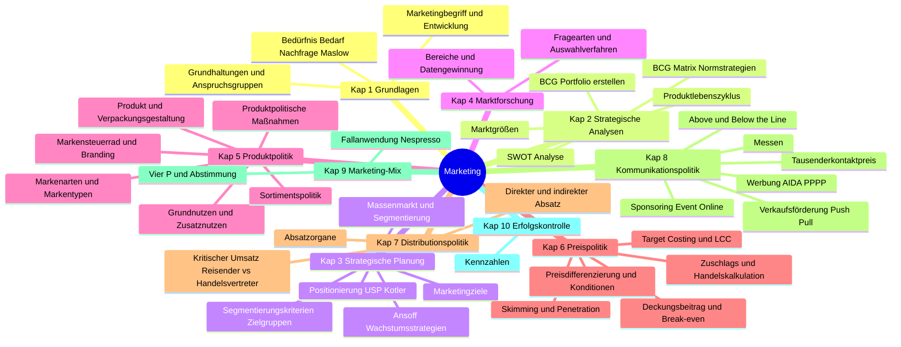
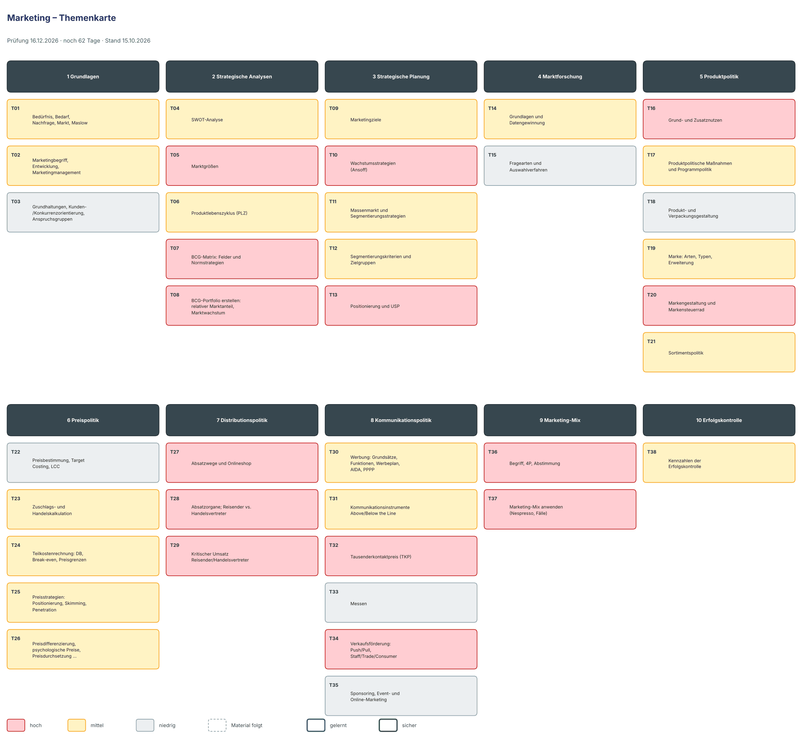

# Lernplan: Marketing

<!-- klausur: 2026-12-16 -->
> Stand 15.10.2026 · erstellt aus: Skript Marketing 2026 (78 S., 41 Übungen), Musterklausur Marketing 2025 und dein Spickzettel BWL + Marketing

## Prüfung auf einen Blick

| | |
|---|---|
| **Klausur „Grundlagen der BWL“** | **Mi 16.12.2026** – noch 62 Tage |
| Form | gemeinsame Klausur mit BWL, **120 Minuten**; Marketing-Teil vermutlich ≈ 48 Min. (Musterklausur 48 von 120 Punkten – nur ein Indiz) |
| Uhrzeit, Raum | noch offen |
| Hilfsmittel | unbekannt – Spickzettel und Taschenrechner sind nirgends geregelt; den Spickzettel erst nach Bestätigung einplanen |
| Musterklausur | Marketing 2025: 7 Aufgaben, 48 Punkte, ohne Lösung; roter Faden „Miller Gartenmöbel KG“ |
| Dozentin | Michaela Geiger · Vorlesungen erst ab 18.11. (6 Termine bis 01.12.) |
| ⚠️ Spickzettel | weicht vom Skript ab: Maslow-Stufe 4 heißt im Skript „Prestigebedürfnisse“ (S. 4); im Markensteuerrad (S. 45) steht bei der Markentonalität „Wie biete ich an?“ – in Eschs Original heißt es „Wie bin ich?“ (über das Skript hinaus) |

## Höchste Priorität

1. **T05 + T08 Marktgrößen und relativer Marktanteil:** MK A1a/b = 8 P, reine Rechenpunkte.
2. **T07 BCG-Matrix:** MK A1c = 4 P; Matrix zeichnen, Felder, Normstrategien, Bezug zum Lebenszyklus.
3. **T29 + T32 Kritischer Umsatz und Tausenderkontaktpreis:** MK A6 + A7 = 8 P.
4. **T16 + T20 Zusatznutzen und Markensteuerrad:** MK A2 = 10 P.
5. **T34 + T36/T37 Push/Pull und Marketing-Mix am Fall:** MK A3 + A4 = 12 P.
6. **T13 + T27 Kotler-Positionierung und Onlineshop:** MK A5 = 6 P.

## Fortschritt

`░░░░░░░░░░░░░░░░░░░░` 0 von 38 Themen gelernt · 0 sicher · 1075 Min. Lernzeit gesamt

## Themen

Relevanz: 🔴 hoch · 🟡 mittel · ⚪ niedrig — Status: neu → gelernt → sicher — Stufe 1–5: nächste Wiederholung nach 1 / 3 / 7 / 14 / 30 Tagen

### 1 Grundlagen

| Nr | Thema | Lernziele | Relevanz | Quelle | Min | Status | Stufe | Nächste Wdh. |
|---|---|---|---|---|---|---|---|---|
| T01 | Bedürfnis, Bedarf, Nachfrage, Markt, Maslow | Ich kann Bedürfnis, Bedarf und Nachfrage erklären und abgrenzen. Ich kann die fünf Maslow-Stufen in richtiger Reihenfolge nennen und Kaufentscheidungen einer Stufe einordnen. Ich kann die fünf Akteursgruppen auf Märkten nennen. | 🟡 mittel – nicht in MK, aber das Modulhandbuch nennt Maslow ausdrücklich | S. 4; Ü 2 (S. 7) | 20 | neu | – | – |
| T02 | Marketingbegriff, Entwicklung, Marketingmanagement | Ich kann die Marketingdefinition (Planung, Organisation, Durchführung, Kontrolle) nennen. Ich kann Verkäufer- und Käufermarkt erklären und die Entwicklungsstufen 1950er–2000er einordnen. Ich kann die 7 Stufen des Marketingmanagement-Prozesses nennen. | 🟡 mittel – nicht in MK; Begriffsgrundlage, Modulhandbuch „Entwicklung und Konzept“ | S. 5–7; Ü 1 (S. 7) | 25 | neu | – | – |
| T03 | Grundhaltungen, Kunden-/Konkurrenzorientierung, Anspruchsgruppen | Ich kann die vier unternehmerischen Grundhaltungen nennen und ihre Probleme erklären. Ich kann die sechs Voraussetzungen der Marketingorientierung nennen. Ich kann Anspruchsgruppen dem passenden Marketingbereich zuordnen (einordnen). | ⚪ niedrig – nicht in MK, keine Übung; USP-Gedanke wird in T13 gebraucht | S. 8–9 | 20 | neu | – | – |

### 2 Strategische Analysen

| Nr | Thema | Lernziele | Relevanz | Quelle | Min | Status | Stufe | Nächste Wdh. |
|---|---|---|---|---|---|---|---|---|
| T04 | SWOT-Analyse | Ich kann Faktoren als Stärke, Schwäche, Chance oder Risiko einordnen. Ich kann die vier Strategietypen SO, ST, WO, WT erklären. Ich kann eine SWOT auf einen Fall (Siller, INFO 1) anwenden. | 🟡 mittel – nicht in MK, aber großer Übungsfall | S. 10–12; Ü 3 (S. 11, INFO 1 S. 12) | 30 | neu | – | – |
| T05 | Marktgrößen | Ich kann Marktvolumen, Marktpotenzial, Marktanteil und Marktausschöpfungsgrad erklären. Ich kann Marktanteil und Marktausschöpfungsgrad berechnen. Ich kann die Formeln umstellen und Marktvolumen bzw. Marktpotenzial berechnen. | 🔴 hoch – MK A1a (6 P) | S. 13–14; Ü 4, 5 (S. 13), Ü 6 (S. 14) | 40 | neu | – | – |
| T06 | Produktlebenszyklus (PLZ) | Ich kann den PLZ mit Umsatz- und Gewinnkurve zeichnen und die Phasen beschriften. Ich kann je Phase Absatz, Gewinn, Konkurrenz, Marketingziel und Investitionen nennen. Ich kann Produktgruppen anhand ihrer Umsatzentwicklung einer Phase einordnen. Ich kann den Nutzen des PLZ als Planungs-, Kontroll- und Prognoseinstrument erklären. | 🟡 mittel – nicht direkt in MK; Phasenwissen hilft bei MK A1c (Stars = Wachstumsphase, S. 19) | S. 15–17; Ü 7 (S. 17) | 30 | neu | – | – |
| T07 | BCG-Matrix: Felder und Normstrategien | Ich kann die BCG-Matrix mit Achsen und vier Feldern zeichnen. Ich kann je Feld die Merkmale und die Normstrategie nennen. Ich kann die Felder den PLZ-Phasen zuordnen (einordnen). | 🔴 hoch – MK A1c (4 P) | S. 18–19; Ü 8c (S. 20), Ü 9a (S. 21) | 30 | neu | – | – |
| T08 | BCG-Portfolio erstellen: relativer Marktanteil, Marktwachstum | Ich kann den relativen Marktanteil (dezimal) berechnen. Ich kann das relative Marktwachstum berechnen. Ich kann SGE in das Portfolio zeichnen und auf Ausgewogenheit prüfen (anwenden). | 🔴 hoch – MK A1b (2 P) | S. 18, 20–22; Ü 8a/b (S. 20), Ü 9b (S. 21), Ü 10 (S. 22) | 40 | neu | – | – |

### 3 Strategische Planung

| Nr | Thema | Lernziele | Relevanz | Quelle | Min | Status | Stufe | Nächste Wdh. |
|---|---|---|---|---|---|---|---|---|
| T09 | Marketingziele | Ich kann ökonomische und psychografische Marketingziele nennen. Ich kann Neukundengewinnung, Kundenbindung und Kundenrückgewinnung erklären. Ich kann Brand Recall, Brand Recognition und Top-of-Mind erklären. Ich kann aus einem Unternehmensziel Marketingziele ableiten (anwenden). | 🟡 mittel – nicht in MK; zwei Übungen | S. 23–24; Ü 11 (S. 24), Ü 14a/b (S. 33) | 25 | neu | – | – |
| T10 | Wachstumsstrategien (Ansoff) | Ich kann die Produkt-Markt-Matrix zeichnen. Ich kann Maßnahmen den vier Wachstumsstrategien zuordnen (einordnen). Ich kann horizontale, vertikale und laterale Diversifikation mit Beispiel erklären. | 🔴 hoch – MK A5b greift S. 25 wörtlich auf („bisherige Produkte auf neuen Märkten“ = Marktentwicklung); die Punkte gibt es dort für Onlineshop-Vorteile | S. 25–26; Ü 12 (S. 26), Ü 14c (S. 33) | 30 | neu | – | – |
| T11 | Massenmarkt und Segmentierungsstrategien | Ich kann Massenmarktstrategie und Marktsegmentierung erklären. Ich kann Segmentkonzentration, selektive Spezialisierung und Marktabdeckung auf ein Beispiel anwenden. Ich kann die Voraussetzungen einer rentablen Segmentierung nennen. | 🟡 mittel – nicht in MK; Modulhandbuch nennt Marktsegmentierung | S. 27; Ü 13a/c (S. 31), Ü 14d (S. 33) | 25 | neu | – | – |
| T12 | Segmentierungskriterien und Zielgruppen | Ich kann sozio-demografische, psychografische und verhaltensbezogene Kriterien mit Beispielen nennen. Ich kann Zielgruppenmodelle (Akronyme, Sinus-Milieus, Personas) erklären. Ich kann das Umsatzpotenzial zweier Segmente berechnen und vergleichen. | 🟡 mittel – nicht in MK; Rechenteil in Ü 13b | S. 28–31; Ü 13b (S. 31), Ü 14d (S. 33) | 30 | neu | – | – |
| T13 | Positionierung und USP | Ich kann USP und Positionierung erklären. Ich kann einen Eigenschaftsraum zeichnen und eine Positionierungslücke einordnen. Ich kann die vier Kotler-Anforderungen nennen. | 🔴 hoch – MK A5a (3 P) | S. 32 (USP auch S. 9) | 20 | neu | – | – |

### 4 Marktforschung

| Nr | Thema | Lernziele | Relevanz | Quelle | Min | Status | Stufe | Nächste Wdh. |
|---|---|---|---|---|---|---|---|---|
| T14 | Grundlagen und Datengewinnung | Ich kann die Definition und die Bereiche Marktanalyse, -beobachtung und -prognose erklären. Ich kann Primär- und Sekundärforschung erklären und Methoden zuordnen (einordnen). Ich kann die Forschungsgegenstände nennen. | 🟡 mittel – nicht in MK; Modulhandbuch nennt Primär-/Sekundärforschung | S. 34–35; Ü 15 (S. 34), Ü 16 (S. 35) | 30 | neu | – | – |
| T15 | Fragearten und Auswahlverfahren | Ich kann offene und geschlossene Fragen erklären und selbst formulieren (anwenden). Ich kann Voll- und Teilerhebung sowie die fünf Auswahlverfahren nennen. | ⚪ niedrig – nicht in MK, keine eigene Übung | S. 36 | 20 | neu | – | – |

### 5 Produktpolitik

| Nr | Thema | Lernziele | Relevanz | Quelle | Min | Status | Stufe | Nächste Wdh. |
|---|---|---|---|---|---|---|---|---|
| T16 | Grund- und Zusatznutzen | Ich kann Grundnutzen und die drei Arten des Zusatznutzens erklären. Ich kann die Nutzenarten auf ein neues Produkt (z. B. Uhr) anwenden. Ich kann erklären, warum Werbung den Zusatznutzen betont. | 🔴 hoch – MK A2a (6 P) | S. 37 | 25 | neu | – | – |
| T17 | Produktpolitische Maßnahmen und Programmpolitik | Ich kann Innovation (Differenzierung, Diversifikation), Variation und Eliminierung erklären. Ich kann Praxisfälle den Maßnahmen zuordnen (einordnen). Ich kann Programmbreite und Programmtiefe erklären. | 🟡 mittel – nicht in MK; Ü 17 mit 7 Fällen | S. 38–39; Ü 17 (S. 38) | 30 | neu | – | – |
| T18 | Produkt- und Verpackungsgestaltung | Ich kann Produktgestaltung im engeren und weiteren Sinn mit Beispielen nennen. Ich kann abstrakte und konkrete Gestaltungsmittel erklären. Ich kann die sechs Aspekte der Verpackungsgestaltung nennen. | ⚪ niedrig – nicht in MK, keine Übung | S. 39–40 | 20 | neu | – | – |
| T19 | Marke: Arten, Typen, Erweiterung | Ich kann die Markendefinition erklären. Ich kann die sechs Markenarten nennen. Ich kann Einzel-, Familien- und Dachmarke erklären und Beispiele einordnen. | 🟡 mittel – nicht in MK; Ü 18; Vorwissen für MK A2b | S. 41–43; Ü 18 (S. 42) | 30 | neu | – | – |
| T20 | Markengestaltung und Markensteuerrad | Ich kann die fünf Bestandteile des Markensteuerrads mit Leitfragen nennen. Ich kann das Markensteuerrad zeichnen und auf eine Marke anwenden. Ich kann den Prozess der Markengestaltung (Planung, Realisierung, Wirkung) erklären. Ich kann Ziele und Gestaltungsformen des Branding nennen. | 🔴 hoch – MK A2b (4 P) | S. 44–45, 72–73 | 30 | neu | – | – |
| T21 | Sortimentspolitik | Ich kann Kern-, Rand- und Zusatzsortiment erklären. Ich kann Händler nach Breite und Tiefe in die Sortimentsmatrix einordnen. Ich kann die Sortimentspyramide auf ein Beispiel anwenden. Ich kann Sortimentsdiversifikation, -differenzierung, -variation und -bereinigung erklären. | 🟡 mittel – nicht in MK; drei Übungen | S. 46–47; Ü 19, 20, 21 (S. 47) | 30 | neu | – | – |

### 6 Preispolitik

| Nr | Thema | Lernziele | Relevanz | Quelle | Min | Status | Stufe | Nächste Wdh. |
|---|---|---|---|---|---|---|---|---|
| T22 | Preisbestimmung, Target Costing, LCC | Ich kann kosten-, wettbewerbs- und nachfrageorientierte Preisbestimmung erklären. Ich kann das Target-Costing-Schema erklären. Ich kann moderne und traditionelle Kostenrechnungssysteme nennen. | ⚪ niedrig – nicht in MK, keine Übung | S. 48–49 | 25 | neu | – | – |
| T23 | Zuschlags- und Handelskalkulation | Ich kann Einzel- und Gemeinkosten erklären. Ich kann das Schema der Zuschlagskalkulation nennen und einen Listenverkaufspreis berechnen. Ich kann das Schema der Handelskalkulation nennen. | 🟡 mittel – nicht in MK, aber Rechenschema mit Übung | S. 50–51; Ü 22 (S. 50) | 40 | neu | – | – |
| T24 | Teilkostenrechnung: DB, Break-even, Preisgrenzen | Ich kann Stück- und Gesamtdeckungsbeitrag berechnen. Ich kann die Gewinnschwellenmenge berechnen und das Break-even-Diagramm zeichnen. Ich kann kurz- und langfristige Preisuntergrenze erklären. | 🟡 mittel – nicht in MK; Rechnen, überschneidet sich mit dem BWL-Teil (laut Spickzettel BWL Kap. 6) | S. 51–52; Ü 23, 24, 25 (S. 52) | 40 | neu | – | – |
| T25 | Preisstrategien: Positionierung, Skimming, Penetration | Ich kann Hoch-, Mittel- und Niedrigpreisstrategie erklären. Ich kann Skimming und Penetration erklären und Beispiele einordnen. | 🟡 mittel – nicht in MK; Ü 26, 27 | S. 53, 73; Ü 26, 27 (S. 53) | 25 | neu | – | – |
| T26 | Preisdifferenzierung, psychologische Preise, Preisdurchsetzung, Konditionen | Ich kann die sechs Arten der Preisdifferenzierung nennen und Fälle einordnen. Ich kann psychologische Preisstrategien erklären. Ich kann vertikale Preisbindung und UVP erklären. Ich kann Instrumente der Konditionenpolitik nennen. | 🟡 mittel – nicht in MK; Ü 28 mit 13 Fällen | S. 53–55; Ü 28 (S. 54) | 30 | neu | – | – |

### 7 Distributionspolitik

| Nr | Thema | Lernziele | Relevanz | Quelle | Min | Status | Stufe | Nächste Wdh. |
|---|---|---|---|---|---|---|---|---|
| T27 | Absatzwege und Onlineshop | Ich kann direkten und indirekten Absatz (ein-, zwei-, dreistufig) erklären. Ich kann die Wahl des Absatzwegs anhand von Kriterien anwenden. Ich kann Vorteile und Risiken eines Onlineshops nennen. | 🔴 hoch – MK A5b (3 P) | S. 56–57, 73–74; Ü 29 (S. 56), Ü 30 (S. 57) | 30 | neu | – | – |
| T28 | Absatzorgane; Reisender vs. Handelsvertreter | Ich kann unternehmenseigene und rechtlich selbstständige Absatzorgane nennen. Ich kann Reisenden und Handelsvertreter nach Rechtsstellung, Vertrag, Vergütung und Aufgaben erklären. Ich kann Handelsvertreter, Makler und Kommissionär abgrenzen (einordnen). | 🔴 hoch – MK A7, zweite Frage („weiterer Gesichtspunkt“) | S. 57–58; Ü 32.1 (S. 59) | 30 | neu | – | – |
| T29 | Kritischer Umsatz Reisender/Handelsvertreter | Ich kann die Kostenfunktionen aufstellen und den kritischen Umsatz berechnen. Ich kann beide Kostengeraden zeichnen. Ich kann erklären, wer unter bzw. über dem kritischen Umsatz günstiger ist. | 🔴 hoch – MK A7 (4 P) | S. 58–59; Ü 31, 32.2, 32.3 (S. 59) | 30 | neu | – | – |

### 8 Kommunikationspolitik

| Nr | Thema | Lernziele | Relevanz | Quelle | Min | Status | Stufe | Nächste Wdh. |
|---|---|---|---|---|---|---|---|---|
| T30 | Werbung: Grundsätze, Funktionen, Werbeplan, AIDA, PPPP | Ich kann Grundsätze und Funktionen der Werbung nennen. Ich kann die neun Fragen des Werbeplans nennen. Ich kann AIDA und PPPP erklären und auf eine Kampagne anwenden. | 🟡 mittel – nicht in MK | S. 60–61 | 30 | neu | – | – |
| T31 | Kommunikationsinstrumente Above/Below the Line | Ich kann klassische (ATL) und moderne (BTL) Instrumente nennen. Ich kann konkrete Maßnahmen dem passenden Instrument einordnen. | 🟡 mittel – nicht in MK; Ü 33 | S. 62–63; Ü 33 (S. 63) | 20 | neu | – | – |
| T32 | Tausenderkontaktpreis (TKP) | Ich kann den TKP mit Zielgruppenanteil berechnen und daraus eine Entscheidung ableiten (anwenden). Ich kann TKP (S. 63) und Tausenderpreis (S. 76) erklären und unterscheiden. | 🔴 hoch – MK A6 (4 P) | S. 63, 76; Ü 34 (S. 63), Ü 41.2 (S. 77) | 25 | neu | – | – |
| T33 | Messen | Ich kann Messe und Ausstellung abgrenzen (erklären). Ich kann Ziele, Unterscheidungskriterien und Phasen des Messemanagements nennen. Ich kann Vor- und Nachteile von Messen erklären. | ⚪ niedrig – nicht in MK; Ü 35 ist eine offene Fallfrage | S. 64–65; Ü 35 (S. 65) | 25 | neu | – | – |
| T34 | Verkaufsförderung: Push/Pull, Staff/Trade/Consumer | Ich kann Push- und Pull-Strategie erklären und ihre Unterschiede nennen. Ich kann die Merkmale der Verkaufsförderung nennen. Ich kann Maßnahmen der Staff, Trade oder Consumer Promotion zuordnen (einordnen). Ich kann eine VKF-Aktion beurteilen (anwenden). | 🔴 hoch – MK A4 (6 P) | S. 66–68; Ü 36 (S. 67), Ü 37, 38, 39 (S. 68) | 35 | neu | – | – |
| T35 | Sponsoring, Event- und Online-Marketing | Ich kann Sponsoring und Event-Marketing abgrenzen (erklären). Ich kann Sponsoringarten und Arten des Online-Marketings nennen. | ⚪ niedrig – nicht in MK, keine Übung | S. 69, 74 | 20 | neu | – | – |

### 9 Marketing-Mix

| Nr | Thema | Lernziele | Relevanz | Quelle | Min | Status | Stufe | Nächste Wdh. |
|---|---|---|---|---|---|---|---|---|
| T36 | Begriff, 4P, Abstimmung | Ich kann die vier Instrumente mit deutschem Namen und P-Begriff nennen. Ich kann je Instrument die Teilbereiche (Submix) nennen. Ich kann Wechselwirkungen und die Grob-, Fein- und Feinstabstimmung erklären. | 🔴 hoch – MK A3 (6 P) | S. 70 | 25 | neu | – | – |
| T37 | Marketing-Mix anwenden (Nespresso, Fälle) | Ich kann den Marketing-Mix am Beispiel Nespresso erklären. Ich kann für einen neuen Fall je Instrument zwei konkrete Maßnahmen anwenden. | 🔴 hoch – MK A3 (Fallanwendung), Ü 40 | S. 71–75; Ü 40 (S. 75) | 30 | neu | – | – |

### 10 Erfolgskontrolle

| Nr | Thema | Lernziele | Relevanz | Quelle | Min | Status | Stufe | Nächste Wdh. |
|---|---|---|---|---|---|---|---|---|
| T38 | Kennzahlen der Erfolgskontrolle | Ich kann absolute und relative Kennzahlen nennen. Ich kann Werbegewinn, Werberendite, Werbebudgetquote, Marktanteil und DB berechnen. Ich kann Kennzahlen den Marketinginstrumenten zuordnen (einordnen). | 🟡 mittel – nicht in MK; Rechnen, Modulhandbuch nennt Marketing-Controlling | S. 76–77; Ü 41 (S. 77) | 35 | neu | – | – |

## Mindmap

Als Bild mit Relevanz-Farben und Lernstand (aktualisieren mit `python3 -I lernen/status.py --karten`):

## Was über die Prüfung bekannt ist

| Punkt | Stand | Quelle |
|---|---|---|
| Klausur | „Grundlagen der BWL“, gemeinsam für Einführung BWL und Marketing (Modul W4WI_105, 1. Studienjahr, 5 ECTS, 150 h = 60 h Präsenz + 90 h Selbststudium) | ICS, faecher.json, Modulhandbuch |
| Termin | Mi 16.12.2026 (15 Tage nach der letzten Marketing-VL am 01.12.) | ICS |
| Uhrzeit, Raum | **unbekannt** („Uhrzeit laut Stundenplan noch offen“) | ICS |
| Dauer, Form | Klausur, 120 Minuten für die gesamte Prüfung, benotet | ICS, Modulhandbuch |
| Aufteilung BWL/Marketing | **nicht angegeben**. Indizien (Vermutung): BWL-MK 72 P + Marketing-MK 48 P = 120 P bei 120 min → etwa 1 Punkt pro Minute, Marketing-Teil ≈ 48 min (40 %). Das passt zum Präsenzanteil von 9 BWL- zu 6 Marketing-Terminen (60 : 40). Ob es getrennte Teile oder Bögen gibt, ist unbekannt. | MK, BWL-MK, ICS |
| Hilfsmittel | **unbekannt** – Spickzettel und Taschenrechner sind nirgends geregelt. Die MK verlangt Divisionen wie 250 · 100 / 95 oder 10.000 / 540.000. | – |
| Rundung | MK Marketing: **keine Vorgabe** (die BWL-MK nennt Genauigkeiten je Aufgabe) → 2 Nachkommastellen empfohlen | MK |
| Bestehensgrenze, Gewichtung | **unbekannt** | – |
| Musterlösung | **keine** (Moodle-Abschnitt „Lösungen“ leer) | Moodle-Liste |
| Prüferin | Michaela Geiger (Dozentin BWL und Marketing, Autorin beider Musterklausuren) | ICS, PDF-Metadaten |

**Musterklausur Marketing 2025 – alle Aufgaben** (der Fall „Miller Gartenmöbel KG“ zieht sich durch A1, A3, A5b, A6 und A7)

| Aufgabe | Thema | Punkte | Typ | Skriptstelle |
|---|---|---|---|---|
| MK A1a | Sechs „?“-Felder: Marktanteil Miller und stärkster Wettbewerber (Tische, Stühle), Marktausschöpfungsgrad Tische, Marktpotenzial Stühle (→ T05) | 6 | Rechnen | S. 13 (Ü 4, 5) |
| MK A1b | Relativer Marktanteil Tische und Stühle (→ T08) | 2 | Rechnen | S. 18 (Ü 8, 10) |
| MK A1c | Kennzeichen der „Stars“ im BCG-Portfolio, 4 Nennungen (→ T07) | 4 | Nennen (Grafikwissen BCG) | S. 18–19 (Ü 9a) |
| MK A2a | Zusatznutzen am Beispiel einer Uhr erklären (→ T16) | 6 | Erklären + Fallanwendung | S. 37 |
| MK A2b | Weitere Bestandteile des Markensteuerrads nach Esch (→ T20) | 4 | Nennen (Grafikwissen) | S. 44–45 (S. 72) |
| MK A3 | Bestandteile des Marketing-Mix + je 2 konkrete Beispiele für Miller (→ T36, T37) | 6 | Nennen + Fallanwendung | S. 70 (S. 71–74, Ü 40) |
| MK A4 | Push- und Pull-Strategie der Verkaufsförderung erklären, Unterschiede (→ T34) | 6 | Erklären | S. 66 (S. 67, Ü 36) |
| MK A5a | Drei Kotler-Anforderungen an eine erfolgreiche Positionierung (→ T13) | 3 | Nennen | S. 32 |
| MK A5b | Drei Vorteile eines integrierten Onlineshops beim Schritt auf neue Märkte (→ T27, T10) | 3 | Nennen + Fallanwendung | S. 25, 56–57, 73–74 (Ü 29, 30) |
| MK A6 | Tausenderkontaktpreis Influencer A und B + Entscheidung (→ T32) | 4 | Rechnen + Entscheidung | S. 63 (Ü 34) |
| MK A7 | Kritischer Umsatz Reisender vs. Handelsvertreter erklären + weiterer Gesichtspunkt (→ T29, T28) | 4 | Rechnen + Erklären | S. 57–59 (Ü 31, 32) |
| **Summe** | | **48** | | |

**Auswertung der MK**

- **Gesamtpunkte: 48** (A1 12 · A2 10 · A3 6 · A4 6 · A5 6 · A6 4 · A7 4). Die Bearbeitungszeit steht **nicht** in der MK, vermutlich sind es ≈ 48 min (siehe oben). Planungsvorschlag: 1 min pro Punkt.
- **Nach Aufgabentyp:**
  - Rechnen: 12 P (A1a, A1b, A6) + 4 P gemischt (A7), also rund ein Drittel.
  - Nennen: 14 P (A1c, A2b, A5a, A5b) + 6 P Nennen mit Fallbeispielen (A3).
  - Erklären: 12 P (A2a, A4).
  - Eine reine Zeichenaufgabe gibt es nicht. BCG-Matrix und Markensteuerrad werden aber als Grafikwissen abgefragt.
- **Nach Kapitel:** Kap. 2 = 12 P (25 %), Kap. 5 = 10 P, Kap. 8 = 10 P, Kap. 7 = 7 P, Kap. 9 = 6 P, Kap. 3 = 3 P.
  - **Nicht** in der MK: Kap. 1 Grundlagen, Kap. 4 Marktforschung, Kap. 6 Preispolitik (das größte Rechenkapitel!) und Kap. 10 Erfolgskontrolle.
  - SWOT und PLZ kommen nur indirekt vor, Ansoff nur als Einleitungssatz von A5b.
- **Stil:**
  - Die Aufgabentexte übernehmen Skriptsätze fast wörtlich (A4 ↔ S. 66, A5a ↔ S. 32, A5b ↔ S. 25).
  - Die Punkte entsprechen der Zahl verlangter Nennungen (A1c, A2b, A5a, A5b) bzw. 1 P je Rechenfeld (A1a).
  - Operatoren: „Berechnen Sie“, „Nennen Sie“ (mit Anzahl), „Erklären Sie“.
  - Tippfehler im Original: „Zusatznuten“ (A2a), „Handlungsreisende“ = Reisende (A7), Tabellenkopf „Miller GmbH“ statt KG.

**Stoffumfang laut Modulhandbuch (Marketing-Teil von W4WI_105)**

Das Modulhandbuch nennt: Bedürfnisse/Bedarf/Nachfrage (Maslow), Entwicklung und Konzept des Marketing (inkl. Konsum-, Investitionsgüter- und Dienstleistungsmarketing), Käuferverhaltensforschung (Kaufentscheidungstypen und -träger, Erklärungsmodelle), Grundlagen der Marktforschung (Primär-/Sekundärforschung, Marktsegmentierung), Ziele und Strategien, Marketing-Mix, Implementierung, Marketing-Controlling (Kennzahlen), Zukunftsperspektiven.

Im Skript **fehlen** Käuferverhalten, Konsum-/Investitionsgüter-/Dienstleistungsmarketing und Zukunftsperspektiven. Die Implementierung erscheint nur als Stufe 6 auf S. 7 (siehe Offene Punkte).

## Offene Punkte – in der Vorlesung klären

**Zur Prüfung**

- **Hilfsmittel** (Spickzettel, Taschenrechner) sind nirgends geregelt. Am besten in der ersten Marketing-VL (18.11.) oder schon in der BWL-VL bei Frau Geiger nachfragen. Den Spickzettel ohne Bestätigung nicht einplanen.
- **Aufteilung BWL/Marketing:** Ob es gemeinsame 120 min oder getrennte Teile gibt und ob 60 : 40 gewichtet wird, ist nur ein Indiz (72 + 48 Punkte, 9 : 6 Termine). Eine Bestehensgrenze ist ebenfalls unbekannt.
- **Uhrzeit und Raum** der Klausur am 16.12.2026 stehen noch aus.
- **Bewertung innerhalb der Aufgaben:**
  - A3: Wie verteilen sich 6 P auf 4 Instrumente + 8 Beispiele?
  - A7: Wie verteilen sich 4 P auf Rechnung und Gesichtspunkt?
  - A1c: Welche 4 Stars-Merkmale werden akzeptiert?
  - A5b: Das Skript hat keine fertige Liste „Vorteile Onlineshop“, der Erwartungshorizont ist offen.
- **Keine Lösungen:** Zur MK und zu den 41 Übungen gibt es keine Musterlösungen; die Moodle-Abschnitte „Lösungen“ und „Zusatzmaterial“ sind leer. Laut ROUTINE.md kommen Lösungen meist erst nach den Vorlesungen.
- **Nur ein Jahrgang:** Die MK zeigt nur 2025. 2026 kann andere Kapitel prüfen, z. B. Preispolitik-Rechnungen (Zuschlagskalkulation, Break-even), Erfolgskennzahlen, PLZ oder Ansoff.
- **Vorlesungen noch nicht begonnen:** Reihenfolge und Schwerpunkte der 6 Termine sind unbekannt. Den Lernplan nach VL 1 abgleichen.

**Zum Skript und zum Stoff**

- **Lücken und Unklarheiten im Skript:**
  - „im Hundert“ (S. 50) verweist auf „siehe unten“, eine Erklärung fehlt.
  - Ü 13b verweist auf ein „Glossar“, das im Skript fehlt.
  - Der Nenner der Imagequote (S. 76) lautet „Kunden, die das Ziel kennen“ – vermutlich ein Tippfehler.
  - Die BCG-Trennlinien unterscheiden sich zwischen den Übungen (Ü 8: 10 %, Ü 9: 8 %).
  - Die PLZ-Grafik S. 15 zeigt das Umsatzmaximum mitten in der Reife, während der Text sagt, der Umsatz steige dort noch. S. 16 und S. 19 legen das Maximum eher an den Übergang Reife/Sättigung – beim Zeichnen so umsetzen.
- **Übungsantworten, die nicht im Skript stehen:** Probleme der SWOT (Ü 3b), Kritik an den Normstrategien (Ü 8c), Vor- und Nachteile der Portfolioanalyse (Ü 9a), der Sekundärforschung (Ü 16a), der Markentypen (Ü 18a) und von Skimming/Penetration (Ü 26).
- **Modulhandbuch-Themen ohne Skript-Abdeckung:** Käuferverhalten (Kaufentscheidungstypen und -träger, Erklärungsmodelle), Konsum-, Investitionsgüter- und Dienstleistungsmarketing, Zukunftsperspektiven; Implementierung nur als Prozessstufe. Prüfen, ob die Vorlesung das ergänzt.
- **Alte Kopfzeilen:** S. 1, 77 und 78 tragen die Jahre 2022/2024. Möglicherweise sind diese Seiten (z. B. Ü 41) aus älteren Fassungen.
- **Spickzettel im Repo:** Die Abweichungen (Markentonalität „Wie bin ich?“, Maslow-Begriff, fehlende Kennzahlen Imagequote, E-Commerce-Anteil, DB % und Tausenderpreis S. 76) sind hier nur notiert. Das Repo wurde nicht geändert.

## Quellen

**Ausgewertete Materialien**

- **Skript** = „Marketing - Skript - 2026.pdf“ (78 S., Autorin Geiger, PDF vom 02.10.2026): Inhaltsverzeichnis S. 2–3, Kapitel 1–10, Quellen S. 78, **41 Übungen**. Vollständig mit `pdftotext -layout` gelesen. Grafikseiten gerendert und angesehen: S. 4–7, 9, 11, 15–21, 27–30, 32–35, 38–46, 48–51, 56, 61–62, 64–67, 69–74, 76 (u. a. Maslow-Pyramide, Marketing-Historie, Meffert-Prozess, SWOT-Matrix, PLZ-Kurven, BCG-Matrix, BCG im PLZ, Portfolio-Raster Ü 8/9, Segmentierungsbaum, Sinus-Milieus, Eigenschaftsraum, Datengewinnung, produktpolitische Maßnahmen, Markentypen, Markengestaltungsprozess, Markensteuerrad Esch/AXE/Nespresso, Sortimentsmatrix und -pyramide, Target Costing, Handelskalkulation, Break-even-Diagramm, Absatzwege, Werbepsychologie, ATL/BTL, Messeprozess, Push/Pull, Staff/Trade/Consumer Promotion, Online-Marketing, Gesamtmix-System, Kennzahlentabelle).
- **Seitenzahlen:** Die aufgedruckte Seitenzahl stimmt auf allen 78 Seiten mit der PDF-Seite überein (geprüft) → „Skript S. N“ = PDF-Seite N. Abweichend ist nur die Jahreszahl in der Kopfzeile: S. 1 zeigt „2022“ und „2026“, S. 77 „2022“, S. 78 „2024“ (vermutlich aus älteren Fassungen übernommen).
- **MK** = Musterklausur „Klausur_Marketing_2025.pdf“ (2 S., Autorin Geiger, PDF vom 05.10.2026): 7 Aufgaben, **48 Punkte**. S. 1 hat keine aufgedruckte Seitenzahl, S. 2 trägt die „2“ – keine Abweichung. Zitierweise „MK A1b“. Beide Seiten gerendert (keine Kopfzeile, keine Zeit- oder Hilfsmittelangabe).
- **Modulhandbuch** Wirtschaftsinformatik Heilbronn (Stand 15.10.2026, lag in `/tmp/dhbw-material/modulhandbuch/`): Modul **W4WI_105 „Grundlagen der Betriebswirtschaftslehre“**, in allen 5 Studienrichtungen gleich. Nur für Prüfungsform und Stoffumfang genutzt.
- **BWL-Musterklausur** „Klausur_BWL_2025.pdf“: nur Kopfzeile und Punktzahlen gelesen (8 Aufgaben, **72 Punkte**), um die Zeitaufteilung abzuschätzen. Den Inhalt bearbeitet der BWL-Agent.
- **Moodle-Kursliste 18615** (`/tmp/dhbw-material/_listen/18615.json`): nur „Skript + Übungen“ und „Musterklausur“. Die Abschnitte „Lösungen“ und „Zusatzmaterial“ sind **leer**, es gibt also keine offiziellen Lösungen.

**Repo-Notizen (nur gelesen, nichts geändert)**

- `marketing/README.md`: Fortschrittstabelle leer. Beide Materialien „gesehen am 06.10.2026“, Status „noch nicht ausgewertet“. Keine eigenen Notizen.
- `stundenplan/DHBW_DS26A2_1Semester.ics`: Marketing an 6 Terminen (18.11., 19.11., 24.11., 26.11., 30.11., 01.12.2026), jeweils 09:00–12:15, Kursraum C.2.11, Michaela Geiger. „Klausur Grundlagen der BWL (120 Min)“ am 16.12.2026 mit dem Vermerk „Uhrzeit laut Stundenplan noch offen“. Einführung BWL hat 9 Termine (15.10.–17.11.), ebenfalls 09:00–12:15.
- `faecher.json`: „Klausur Grundlagen der BWL“ gehört zu den Ordnern `bwl` und `marketing`. `bwl/README.md`: Dozentin ist auch dort Michaela Geiger.
- `klausur/spickzettel_bwl_marketing.html` (+ PDF; Commit 572fff9 vom 15.10.2026, „DIN A4, Vorder- und Rückseite, nur Skriptinhalte“): Vorderseite BWL, **Rückseite Marketing** (4 Spalten, ca. 6,4 pt).
  - **Deckt ab:** alle 10 Skriptkapitel. Kap. 1: Bedürfnis/Bedarf/Nachfrage, Maslow, Definition, Grundhaltungen, Anspruchsgruppen. Kap. 2: SWOT, Marktgrößen-Formeln mit genau dem Beispiel aus MK A1 (Tische/Stühle), PLZ-Tabelle, BCG mit Normstrategien. Kap. 3: Ziele, Ansoff, Segmentierung, Positionierung mit Kotler. Kap. 4: Marktforschung. Kap. 5: Grund-/Zusatznutzen mit Uhr-Beispiel (= MK A2a), produktpolitische Maßnahmen, Marke, Markentypen, Markensteuerrad (= MK A2b), Sortiment. Kap. 6: Zuschlags- und Handelskalkulation, DB, Gewinnschwelle, Preisuntergrenzen, Preisstrategien. Kap. 7: Absatzwege, Onlineshop-Vorteile (= MK A5b), Absatzorgane, Reisender vs. Handelsvertreter mit kritischem Umsatz 2,27 Mio € (= MK A7). Kap. 8: Werbung, AIDA, PPPP, ATL/BTL, TKP mit 18,52 €/20,00 € (= MK A6), Push/Pull (= MK A4), Staff/Trade/Consumer, Messen, Sponsoring, Online. Kap. 9: 4P mit Gartenmöbel-Beispiel (= MK A3). Kap. 10: Kennzahlen. Damit ist die **gesamte MK** abgebildet.
  - **Fehlt oder weicht vom Skript ab:**
    - Bei der Markentonalität steht „Wie bin ich?“, im Skript (S. 45) heißt es „Wie biete ich an?“.
    - Maslow-Stufe 4 heißt im Skript „Prestigebedürfnisse“ (Spickzettel: „Wertschätzung“).
    - Es fehlen Imagequote, E-Commerce-Anteil, DB (%) und der Tausenderpreis ohne Zielgruppenanteil (S. 76).
    - Es fehlen außerdem die PLZ-Eingriffe Perfektionierung/Attraktivierung/Relaunch/Revival (S. 16), der Marketingmanagement-Prozess (S. 7), Käufer- vs. Verkäufermarkt (S. 5, Ü 1), die Ziele des Branding (S. 45) und der Messeprozess (S. 65).
  - **Erlaubnis:** Nirgends steht, dass ein Spickzettel oder andere Hilfsmittel erlaubt sind. Weder die MK noch das Modulhandbuch („Besonderheiten: –“) noch Moodle noch das Repo (READMEs, ROUTINE.md, Briefings, Notizen) sagen etwas dazu. Status: **unbekannt**.

## Dateien zu diesem Fach

- [Kernpunkte, Klausurfallen und Visualisierungsideen](kernpunkte.md)
- Karteikarten: `karteikarten.md` (entsteht beim Lernen)
- Fehlerprotokoll: `fehlerprotokoll.md` (entsteht beim Lernen)
- Grafiken: [`grafiken/`](grafiken/) – u. a. die Themenkarte
