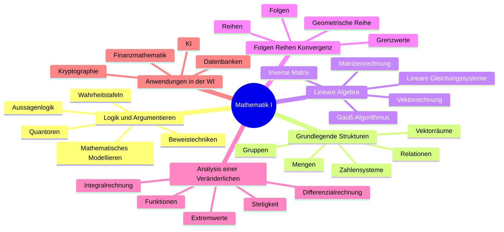
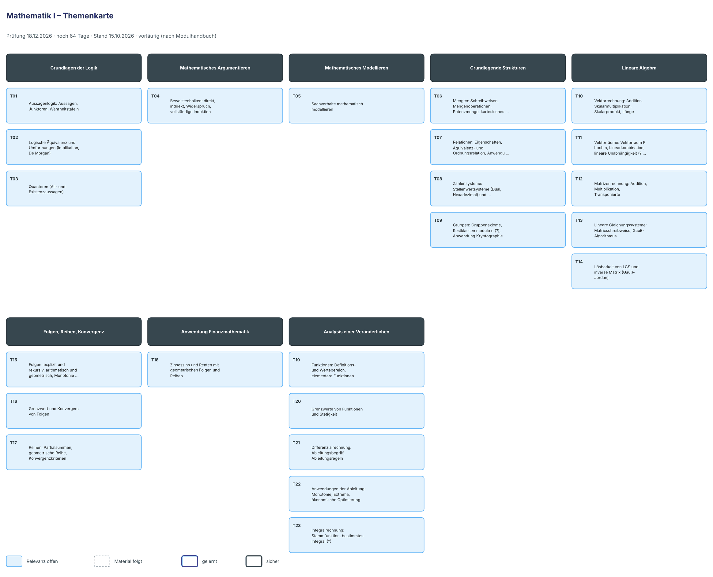

# Lernplan: Mathematik I

<!-- klausur: 2026-12-18 -->
> Stand 15.10.2026 · erstellt aus: DHBW-Modulhandbuch Wirtschaftsinformatik, Studienrichtung Data Science, Heilbronn (Modul W4WI_108) – noch kein Skript
>
> ⚠️ **Vorläufig:** Für Mathe I gibt es noch kein Material (erste Vorlesung am 19.10.). Themen und Reihenfolge stammen aus dem Modulhandbuch und sind damit selbst „über das Skript hinaus“. Sobald das Skript da ist, baue ich den Plan danach neu.

## Prüfung auf einen Blick

| | |
|---|---|
| **Klausur** | **Fr 18.12.2026** – noch 64 Tage |
| Form | Klausur, **120 Minuten** – eigenes Modul W4WI_108 (5 ECTS), zählt voll für die Modulnote |
| Uhrzeit, Raum | noch offen |
| Hilfsmittel | unbekannt (Formelsammlung? Taschenrechner?) |
| Dozenten | Dr. Pascal Wortel und Dr. Till Heller, je 7 Termine (19.10.–02.12.) |
| Nicht Teil von Mathe I | Statistik, Wahrscheinlichkeitsrechnung, Eigenwerte, Analysis mehrerer Veränderlicher (→ Mathematik II) |

## Höchste Priorität

Noch nicht bestimmbar – das entscheiden die ersten Vorlesungen.

Vorab lohnt sich, was du aus Grundlagen der IT schon kennst: **Logik** (Wahrheitstabellen, De Morgan ↔ GIT T15–T17) und **Zahlensysteme** (↔ GIT T09–T13).

## Fortschritt

`░░░░░░░░░░░░░░░░░░░░` 0 von 23 Themen gelernt · 0 sicher · 785 Min. Lernzeit gesamt

## Themen

Relevanz: 🔴 hoch · 🟡 mittel · ⚪ niedrig · ❔ offen — Status: neu → gelernt → sicher — Stufe 1–5: nächste Wiederholung nach 1 / 3 / 7 / 14 / 30 Tagen

### Grundlagen der Logik

| Nr | Thema | Lernziele | Relevanz | Quelle | Min | Status | Stufe | Nächste Wdh. |
|---|---|---|---|---|---|---|---|---|
| T01 | Aussagenlogik: Aussagen, Junktoren, Wahrheitstafeln | Ich kann Aussagen von Nicht-Aussagen unterscheiden. Ich kann Wahrheitstafeln für zusammengesetzte Aussagen aufstellen. Ich kann Tautologien und Widersprüche erkennen. | ❔ offen – Skript fehlt noch | MHB W4WI_108 | 30 | neu | – | – |
| T02 | Logische Äquivalenz und Umformungen (Implikation, De Morgan) | Ich kann logische Äquivalenzen mit Wahrheitstafeln nachweisen. Ich kann aussagenlogische Ausdrücke mit den De-Morgan-Regeln umformen. | ❔ offen – Skript fehlt noch | MHB W4WI_108 | 30 | neu | – | – |
| T03 | Quantoren (All- und Existenzaussagen) | Ich kann Aussagen mit All- und Existenzquantor formulieren. Ich kann quantifizierte Aussagen korrekt verneinen. | ❔ offen – Skript fehlt noch | MHB W4WI_108 | 25 | neu | – | – |

### Mathematisches Argumentieren

| Nr | Thema | Lernziele | Relevanz | Quelle | Min | Status | Stufe | Nächste Wdh. |
|---|---|---|---|---|---|---|---|---|
| T04 | Beweistechniken: direkt, indirekt, Widerspruch, vollständige Induktion | Ich kann direkten und indirekten Beweis unterscheiden. Ich kann eine einfache Aussage durch Widerspruch beweisen. Ich kann eine Summenformel mit vollständiger Induktion beweisen. | ❔ offen – Skript fehlt noch | MHB W4WI_108 | 40 | neu | – | – |

### Mathematisches Modellieren

| Nr | Thema | Lernziele | Relevanz | Quelle | Min | Status | Stufe | Nächste Wdh. |
|---|---|---|---|---|---|---|---|---|
| T05 | Sachverhalte mathematisch modellieren | Ich kann einen Sachverhalt aus der Wirtschaftsinformatik in Variablen, Mengen oder Gleichungen übersetzen. Ich kann die Lösung eines Modells im Sachkontext interpretieren. | ❔ offen – Skript fehlt noch | MHB W4WI_108 | 25 | neu | – | – |

### Grundlegende Strukturen

| Nr | Thema | Lernziele | Relevanz | Quelle | Min | Status | Stufe | Nächste Wdh. |
|---|---|---|---|---|---|---|---|---|
| T06 | Mengen: Schreibweisen, Mengenoperationen, Potenzmenge, kartesisches Produkt | Ich kann Mengen aufzählend und beschreibend angeben. Ich kann Vereinigung, Schnitt, Differenz und Komplement bilden. Ich kann Potenzmenge und kartesisches Produkt bestimmen. | ❔ offen – Skript fehlt noch | MHB W4WI_108 | 35 | neu | – | – |
| T07 | Relationen: Eigenschaften, Äquivalenz- und Ordnungsrelation, Anwendung Datenbanken | Ich kann Reflexivität, Symmetrie und Transitivität einer Relation prüfen. Ich kann Äquivalenz- und Ordnungsrelationen unterscheiden. Ich kann eine Datenbanktabelle als Relation erklären. | ❔ offen – Skript fehlt noch | MHB W4WI_108 | 40 | neu | – | – |
| T08 | Zahlensysteme: Stellenwertsysteme (Dual, Hexadezimal) und Zahlbereiche (?) | Ich kann Zahlen zwischen Dezimal-, Dual- und Hexadezimalsystem umrechnen. Ich kann im Dualsystem addieren. Ich kann die Zahlbereiche N, Z, Q und R unterscheiden. | ❔ offen – Skript fehlt noch | MHB W4WI_108 | 30 | neu | – | – |
| T09 | Gruppen: Gruppenaxiome, Restklassen modulo n (?), Anwendung Kryptographie | Ich kann die Gruppenaxiome an einem Beispiel prüfen. Ich kann mit Restklassen modulo n rechnen. Ich kann erklären, wozu Modulo-Rechnung in der Kryptographie dient. | ❔ offen – Skript fehlt noch | MHB W4WI_108 | 40 | neu | – | – |

### Lineare Algebra

| Nr | Thema | Lernziele | Relevanz | Quelle | Min | Status | Stufe | Nächste Wdh. |
|---|---|---|---|---|---|---|---|---|
| T10 | Vektorrechnung: Addition, Skalarmultiplikation, Skalarprodukt, Länge | Ich kann Vektoren addieren und mit Skalaren multiplizieren. Ich kann Skalarprodukt und Länge eines Vektors berechnen. Ich kann Daten als Vektoren darstellen, z. B. Merkmalsvektoren in der KI. | ❔ offen – Skript fehlt noch | MHB W4WI_108 | 30 | neu | – | – |
| T11 | Vektorräume: Vektorraum R hoch n, Linearkombination, lineare Unabhängigkeit (?) – im MHB unter „grundlegende Strukturen“ | Ich kann die Vektorraumeigenschaften am Beispiel R hoch n erklären. Ich kann prüfen, ob Vektoren linear unabhängig sind. | ❔ offen – Skript fehlt noch | MHB W4WI_108 | 30 | neu | – | – |
| T12 | Matrizenrechnung: Addition, Multiplikation, Transponierte | Ich kann Matrizen addieren und multiplizieren und dabei die Dimensionen prüfen. Ich kann die Transponierte einer Matrix bilden. Ich kann begründen, warum die Matrixmultiplikation nicht kommutativ ist. | ❔ offen – Skript fehlt noch | MHB W4WI_108 | 35 | neu | – | – |
| T13 | Lineare Gleichungssysteme: Matrixschreibweise, Gauß-Algorithmus | Ich kann ein LGS als erweiterte Koeffizientenmatrix aufschreiben. Ich kann ein LGS mit dem Gauß-Algorithmus lösen. | ❔ offen – Skript fehlt noch | MHB W4WI_108 | 40 | neu | – | – |
| T14 | Lösbarkeit von LGS und inverse Matrix (Gauß-Jordan) | Ich kann an der Stufenform entscheiden, ob ein LGS keine, genau eine oder unendlich viele Lösungen hat. Ich kann die Inverse einer Matrix mit dem Gauß-Jordan-Verfahren berechnen. | ❔ offen – Skript fehlt noch | MHB W4WI_108 | 35 | neu | – | – |

### Folgen, Reihen, Konvergenz

| Nr | Thema | Lernziele | Relevanz | Quelle | Min | Status | Stufe | Nächste Wdh. |
|---|---|---|---|---|---|---|---|---|
| T15 | Folgen: explizit und rekursiv, arithmetisch und geometrisch, Monotonie, Beschränktheit | Ich kann Folgen explizit und rekursiv darstellen. Ich kann Monotonie und Beschränktheit einer Folge untersuchen. | ❔ offen – Skript fehlt noch | MHB W4WI_108 | 30 | neu | – | – |
| T16 | Grenzwert und Konvergenz von Folgen | Ich kann Grenzwerte von Folgen mit den Grenzwertsätzen berechnen. Ich kann konvergente und divergente Folgen unterscheiden. | ❔ offen – Skript fehlt noch | MHB W4WI_108 | 35 | neu | – | – |
| T17 | Reihen: Partialsummen, geometrische Reihe, Konvergenzkriterien | Ich kann Partialsummen einer Reihe berechnen. Ich kann den Grenzwert einer konvergenten geometrischen Reihe bestimmen. Ich kann ein Konvergenzkriterium wie das Quotientenkriterium anwenden. | ❔ offen – Skript fehlt noch | MHB W4WI_108 | 40 | neu | – | – |

### Anwendung Finanzmathematik

| Nr | Thema | Lernziele | Relevanz | Quelle | Min | Status | Stufe | Nächste Wdh. |
|---|---|---|---|---|---|---|---|---|
| T18 | Zinseszins und Renten mit geometrischen Folgen und Reihen | Ich kann ein Endkapital mit Zinseszins berechnen. Ich kann den Barwert einer Rente mit der geometrischen Summenformel bestimmen. | ❔ offen – Skript fehlt noch | MHB W4WI_108 | 35 | neu | – | – |

### Analysis einer Veränderlichen

| Nr | Thema | Lernziele | Relevanz | Quelle | Min | Status | Stufe | Nächste Wdh. |
|---|---|---|---|---|---|---|---|---|
| T19 | Funktionen: Definitions- und Wertebereich, elementare Funktionen | Ich kann Definitions- und Wertebereich einer Funktion bestimmen. Ich kann Polynom-, Exponential- und Logarithmusfunktionen skizzieren und ihre Eigenschaften beschreiben. | ❔ offen – Skript fehlt noch | MHB W4WI_108 | 35 | neu | – | – |
| T20 | Grenzwerte von Funktionen und Stetigkeit | Ich kann Grenzwerte von Funktionen berechnen. Ich kann prüfen, ob eine Funktion an einer Stelle stetig ist. | ❔ offen – Skript fehlt noch | MHB W4WI_108 | 30 | neu | – | – |
| T21 | Differenzialrechnung: Ableitungsbegriff, Ableitungsregeln | Ich kann die Ableitung als Steigung der Tangente erklären. Ich kann Ableitungen mit Produkt-, Quotienten- und Kettenregel berechnen. | ❔ offen – Skript fehlt noch | MHB W4WI_108 | 40 | neu | – | – |
| T22 | Anwendungen der Ableitung: Monotonie, Extrema, ökonomische Optimierung | Ich kann Extremstellen mit notwendiger und hinreichender Bedingung bestimmen. Ich kann eine Optimierungsaufgabe wie eine Gewinnmaximierung mit Ableitungen lösen. | ❔ offen – Skript fehlt noch | MHB W4WI_108 | 40 | neu | – | – |
| T23 | Integralrechnung: Stammfunktion, bestimmtes Integral (?) | Ich kann Stammfunktionen elementarer Funktionen angeben. Ich kann ein bestimmtes Integral berechnen und als Fläche deuten. | ❔ offen – Skript fehlt noch | MHB W4WI_108 | 35 | neu | – | – |

## Mindmap

---

Als Bild mit Relevanz-Farben und Lernstand (aktualisieren mit `python3 -I lernen/status.py --karten`):

## Was über die Prüfung bekannt ist

| Merkmal | Angabe |
|---|---|
| Modulname | Mathematik I (engl. Mathematics I) |
| Modulnummer | W4WI_108 |
| Verortung | 1. Studienjahr, Moduldauer 1 Semester (laut Stundenplan das 1. Semester: 19.10.–02.12.2026) |
| ECTS / Workload | 5 ECTS; 150 h, davon 60 h Präsenz und 90 h Selbststudium |
| Lehrformen | Vorlesung, Übung |
| Prüfungsleistung | **Klausur, 120 Minuten, benotet** |
| Laut StuPrO 2026 | 1 benotete Prüfungsleistung, 0 unbenotete (gilt für Immatrikulation ab 01.10.2026) |
| Gewichtung | Im MHB nicht genannt. Weil es nur eine bPL gibt, zählt die Klausur zu 100 % für die Modulnote (abgeleitet). |
| Modulverantwortung (DHBW-weit) | Prof. Dr. Tobias Straub, Prof. Dr. Katja Wengler. Das sind die Modulverantwortlichen, nicht die Heilbronner Dozenten. |
| Sprache | Deutsch/Englisch |
| Voraussetzungen / Besonderheiten | keine („-“) |
| Abgleich mit dem Stundenplan | 14 Termine = 60 UE. Davon hält Dr. Pascal Wortel 7 Termine (30 UE) und Dr. Till Heller 7 Termine (30 UE). Klausur Fr 18.12.2026, 120 Min. |
| **Nicht** Teil von Mathe I | Diese Themen gehören zu **Mathematik II (W4WI_109)** mit eigener 120-Min.-Klausur, vermutlich im 2. Semester (Voraussetzung dort: Mathematik I): deskriptive Statistik, Wahrscheinlichkeitsrechnung, induktive Statistik, lineare Abbildungen, Eigenwerte/Eigenvektoren, Koordinatentransformation, Analysis mehrerer Veränderlicher, Gradient, numerische Verfahren, Optimierung und Simulation. |

## Offene Punkte – in der Vorlesung klären

- **Zwei Dozenten:** Lehren Dr. Wortel und Dr. Heller getrennte Themenblöcke? Ist die Klausur zweigeteilt (z. B. 2 × 60 Min.)?
- **Stoffumfang:** Was ist mit „Zahlensysteme“ gemeint (Stellenwertsysteme oder Zahlbereiche N, Z, Q, R)? Wie tief gehen Gruppen und Vektorräume? Gehört Integralrechnung dazu?
- **Hilfsmittel:** Formelsammlung, Taschenrechner, Spickzettel?
- **Uhrzeit und Raum** der Klausur am 18.12.

## Quellen

- DHBW-Modulhandbuch Wirtschaftsinformatik – Studienrichtung Data Science – Heilbronn, Modul W4WI_108 (S. 17–18): https://www.dhbw.de/fileadmin/user/public/SP/HN/Wirtschaftsinformatik/Data_Science.pdf
- DHBW StuPrO Wirtschaft vom 09.07.2026 (Mathe I: 1 benotete Prüfungsleistung): https://www.dhbw.de/fileadmin/user_upload/Dokumente/Amtliche_Bekanntmachungen/2026/26_2026_Bekanntmachung_DHBW_StuPrO_Wirtschaft.pdf
- Stundenplan `stundenplan/DHBW_DS26A2_1Semester.ics`

## Dateien zu diesem Fach

- [Kernpunkte, Klausurfallen und Visualisierungsideen](kernpunkte.md)
- Karteikarten: `karteikarten.md` (entsteht beim Lernen)
- Fehlerprotokoll: `fehlerprotokoll.md` (entsteht beim Lernen)
- Grafiken: [`grafiken/`](grafiken/) – u. a. die Themenkarte
