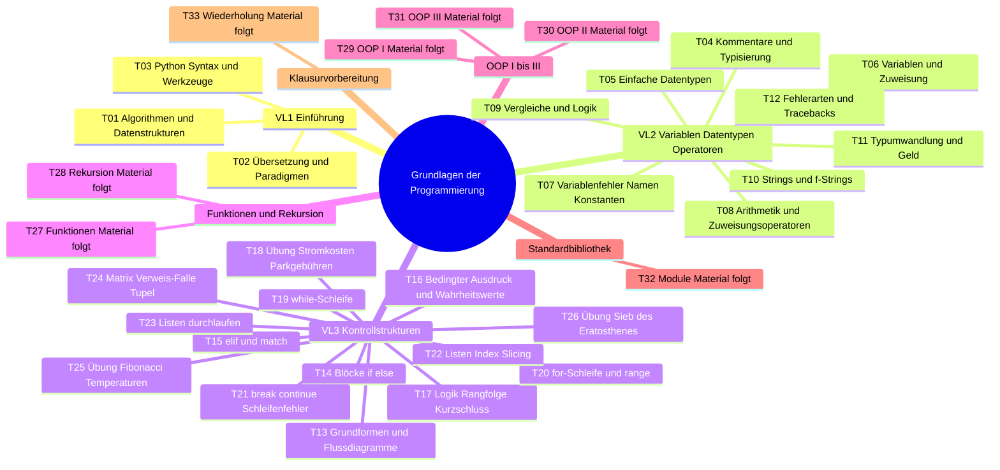
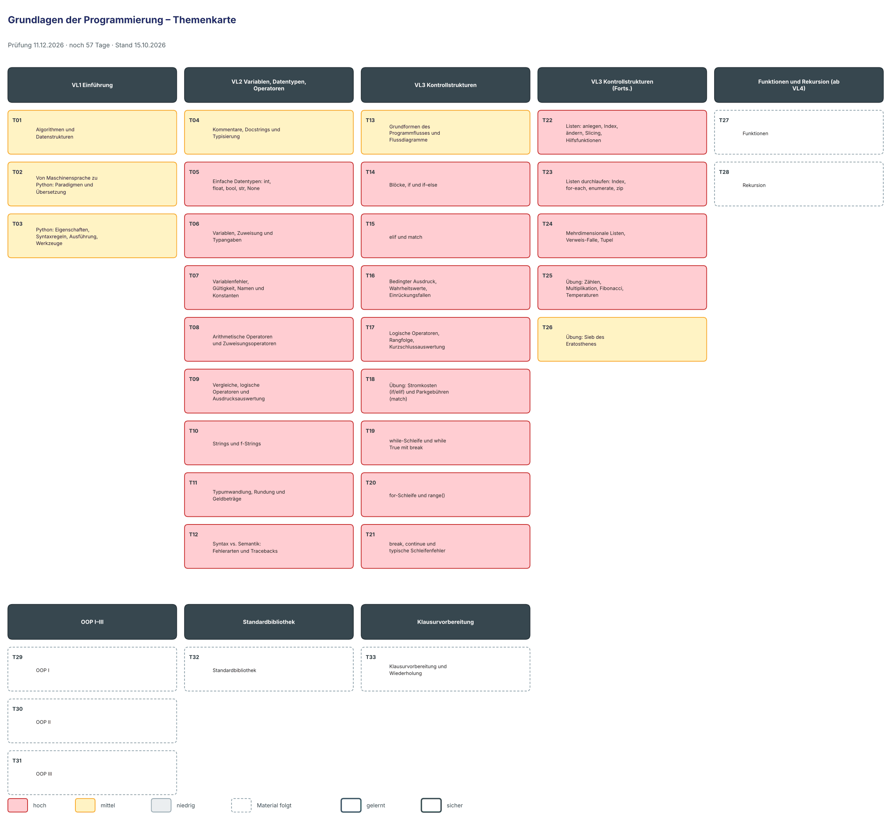

# Lernplan: Grundlagen der Programmierung

<!-- klausur: 2026-12-11 -->
> Stand 15.10.2026 · erstellt aus: Folien VL 1–3, Musterlösungen zu VL 2 und deine Vorlesungsnotizen 01–03

## Prüfung auf einen Blick

| | |
|---|---|
| **Klausur** | **Fr 11.12.2026** – noch 57 Tage |
| Form | Klausur, **120 Minuten** – ob auf Papier oder am Rechner, ist offen |
| Uhrzeit, Raum | noch offen |
| Hilfsmittel | unbekannt |
| Musterklausur | keine – Relevanz aus Übungen und Mini-Aufgaben auf den Folien |
| Dozent | Dr. Markus Rosenfelder · 15 Blöcke bis 27.11.; Material bisher VL 1–3 |
| Wahrscheinliche Aufgabentypen | „Was gibt das aus?“, Fehler finden und Fehlermeldung deuten („die wichtigste Fähigkeit“, VL1 F. 49), Code nach Textaufgabe schreiben |

## Höchste Priorität

1. **T12 + T16 Fehlerarten, Tracebacks, Einrückungsfallen:** Fehlermeldungen lesen ist laut Dozent „die wichtigste Fähigkeit“; Übung 5.
2. **T08 + T09 Operatoren und Ausdrucksauswertung:** die Mini-Aufgaben „Was wird ausgegeben?“ stehen direkt auf den Folien (VL2 F. 54, 57, 61).
3. **T19–T21 Schleifen:** Trace-Tabellen, Off-by-one, Endlosschleife – eigene Fehlerfolien.
4. **T14–T18 Verzweigungen, Logik und die Übungen Stromkosten/Parkgebühren:** die größten Programmieraufgaben bisher.
5. **T22–T24 Listen:** Basis aller Algorithmus-Aufgaben; die Verweis-Falle `[[0] * 4] * 3`.
6. **T11 Typumwandlung und Rundung:** stille Fehler wie `int(19.99 * 100)` → 1998.

## Fortschritt

`░░░░░░░░░░░░░░░░░░░░` 0 von 33 Themen gelernt · 0 sicher · 1050 Min. Lernzeit gesamt · 7 Themen warten noch auf Material

## Themen

Relevanz: 🔴 hoch · 🟡 mittel · ⚪ niedrig — Status: neu → gelernt → sicher — Stufe 1–5: nächste Wiederholung nach 1 / 3 / 7 / 14 / 30 Tagen

### VL1 Einführung

| Nr | Thema | Lernziele | Relevanz | Quelle | Min | Status | Stufe | Nächste Wdh. |
|---|---|---|---|---|---|---|---|---|
| T01 | Algorithmen und Datenstrukturen | Ich kann die vier Anforderungen an Algorithmen nennen. Ich kann terminierend, determiniert und deterministisch unterscheiden. Ich kann Stack (LIFO) und Queue (FIFO) erklären und je ein Alltagsbeispiel nennen. | 🟡 mittel – Begriffsfragen plausibel, aber keine Übung dazu | VL1 F. 7–19 | 25 | neu | – | – |
| T02 | Von Maschinensprache zu Python: Paradigmen und Übersetzung | Ich kann Interpreter, Compiler und Zwischencode (Bytecode + VM) mit Vor- und Nachteilen unterscheiden. Ich kann erklären, wie CPython eine .py-Datei ausführt (Syntaxprüfung, Bytecode, VM, JIT). Ich kann die Paradigmen imperativ, objektorientiert, funktional und deklarativ nennen. | 🟡 mittel – klassische Theoriefrage, 17 Folien, keine Übung | VL1 F. 20–36 | 30 | neu | – | – |
| T03 | Python: Eigenschaften, Syntaxregeln, Ausführung, Werkzeuge | Ich kann „dynamisch, aber stark typisiert“ erklären. Ich kann die Syntaxregeln (4 Leerzeichen Einrückung, Doppelpunkt, kein Semikolon, Groß-/Kleinschreibung) anwenden. Ich kann die Aufgaben von uv, ruff, ty und CPython unterscheiden. | 🟡 mittel – Syntaxregeln sind Grundlage für alles; Installation selbst nicht klausurrelevant | VL1 F. 37–57 | 25 | neu | – | – |

### VL2 Variablen, Datentypen, Operatoren

| Nr | Thema | Lernziele | Relevanz | Quelle | Min | Status | Stufe | Nächste Wdh. |
|---|---|---|---|---|---|---|---|---|
| T04 | Kommentare, Docstrings und Typisierung | Ich kann sinnvolle von überflüssigen Kommentaren unterscheiden (Warum statt Was). Ich kann einen Docstring im Google-Stil (Kurzbeschreibung, Args, Returns) anwenden. Ich kann statische, dynamische und graduelle Typisierung unterscheiden. | 🟡 mittel – Docstrings werden ab VL04 Standard; Typisierung als Verständnisfrage | VL2 F. 6–15 | 25 | neu | – | – |
| T05 | Einfache Datentypen: int, float, bool, str, None | Ich kann den Typ von Werten wie 3.0, "3", True, None vorhersagen. Ich kann erklären, warum 0.1 + 0.2 == 0.3 False ergibt. Ich kann ord() und chr() anwenden (z. B. nächster Buchstabe). Ich kann für Alltagsdaten (PLZ, Preis, Anzahl, Telefonnummer) den passenden Typ nennen. | 🔴 hoch – Übung 1 mit Musterlösung; Grundlage aller Themen | VL2 F. 16–27; ML2 uebung1.py | 35 | neu | – | – |
| T06 | Variablen, Zuweisung und Typangaben | Ich kann das Modell „Name zeigt auf Wert, Typ gehört zum Wert“ erklären. Ich kann Mehrfachzuweisung und Tauschen in einer Trace-Tabelle vorhersagen. Ich kann unterscheiden, was ty vorab meldet und was Python beim Ausführen tut. | 🔴 hoch – Übung 2; Speichermodell ist Basis der Listen-Verweis-Falle (VL3 F. 81) | VL2 F. 29–42; ML2 uebung2.py | 30 | neu | – | – |
| T07 | Variablenfehler, Gültigkeit, Namen und Konstanten | Ich kann die drei Ursachen für NameError nennen. Ich kann vorhersagen, wann eine Variable aus einem übersprungenen Block fehlt. Ich kann gültige von ungültigen und unüblichen Namen unterscheiden. Ich kann Konstanten mit Final anwenden. | 🔴 hoch – typische „Fehler finden“-Fälle; Übung 2 | VL2 F. 43–48; ML2 uebung2.py | 30 | neu | – | – |
| T08 | Arithmetische Operatoren und Zuweisungsoperatoren | Ich kann Ergebnis und Typ von /, //, % und ** vorhersagen, auch für negative Zahlen. Ich kann Punkt-vor-Strich und ** beim Auswerten anwenden. Ich kann das Ergebnis einer Folge von Zuweisungsoperatoren vorhersagen. Ich kann erklären, warum x++ ein SyntaxError ist und ++x nichts ändert. | 🔴 hoch – Übung 3; Mini-Aufgaben „Was passiert?“ auf den Folien | VL2 F. 50–58; ML2 uebung3.py | 35 | neu | – | – |
| T09 | Vergleiche, logische Operatoren und Ausdrucksauswertung | Ich kann das Ergebnis von Vergleichen vorhersagen (immer bool, 30 == "30"). Ich kann == und is unterscheiden. Ich kann and, or, not und verkettete Vergleiche anwenden. Ich kann Semantikfehler durch die Rangfolge erklären (5 + 2 / 2). | 🔴 hoch – Übung 3, Mini-Aufgabe F. 61; Basis für VL3 | VL2 F. 59–68; ML2 uebung3.py | 30 | neu | – | – |
| T10 | Strings und f-Strings | Ich kann Index, negativen Index und Slicing bei Strings vorhersagen. Ich kann +, *, len, in und .upper() anwenden. Ich kann formatierte Ausgaben mit f-Strings und :.2f programmieren. | 🔴 hoch – Übung 4 (Ausgabezeile exakt vorgegeben) | VL2 F. 23, 70–71; ML2 uebung4.py | 25 | neu | – | – |
| T11 | Typumwandlung, Rundung und Geldbeträge | Ich kann Ergebnisse von int(), float(), str() und round() vorhersagen. Ich kann erklären, wann Python automatisch umwandelt und wann TypeError oder ValueError entstehen. Ich kann Geldbeträge mit round() oder Decimal("…") korrekt programmieren. | 🔴 hoch – Übung 4 mit Musterlösung; stille Fehler („ein Cent weg“) | VL2 F. 72–82; ML2 uebung4.py | 35 | neu | – | – |
| T12 | Syntax vs. Semantik: Fehlerarten und Tracebacks | Ich kann Syntax-, Typ-, Laufzeit- und Logikfehler unterscheiden. Ich kann einen Traceback von unten nach oben lesen und Fehlerart und Zeile nennen. Ich kann erklären, welcher Prüfer (ruff, ty, Ausführung) welchen Fehler findet. | 🔴 hoch – Übung 5; „wichtigste Fähigkeit“ laut VL1 F. 49 | VL2 F. 84–93; ML2 uebung5.py | 30 | neu | – | – |

### VL3 Kontrollstrukturen

| Nr | Thema | Lernziele | Relevanz | Quelle | Min | Status | Stufe | Nächste Wdh. |
|---|---|---|---|---|---|---|---|---|
| T13 | Grundformen des Programmflusses und Flussdiagramme | Ich kann Sequenz, Selektion und Iteration unterscheiden. Ich kann zu einem Flussdiagramm den passenden Python-Code programmieren. Ich kann erklären, wozu Schleifen statt ausgeschriebener Wiederholung dienen. | 🟡 mittel – 5 Folien mit Flussdiagrammen, aber keine Übung dazu | VL3 F. 4–13 | 25 | neu | – | – |
| T14 | Blöcke, if und if–else | Ich kann erklären, wie Einrückung Blöcke bildet (ohne eigenen Gültigkeitsbereich). Ich kann if und if–else syntaktisch korrekt programmieren. Ich kann die Ausgabe verschachtelter if–else-Strukturen vorhersagen. | 🔴 hoch – Basis jeder Programmieraufgabe | VL3 F. 15–22 | 25 | neu | – | – |
| T15 | elif und match | Ich kann erklären, warum bei elif nur der erste Treffer zählt. Ich kann match mit case, case _ und mehreren Werten pro Fall programmieren. Ich kann unterscheiden, wann if–elif (Bereiche) und wann match (feste Werte) passt. | 🔴 hoch – Übung Teil 1 (Parkgebühren mit match) | VL3 F. 23–26 | 30 | neu | – | – |
| T16 | Bedingter Ausdruck, Wahrheitswerte, Einrückungsfallen | Ich kann den bedingten Ausdruck anwenden und in if–else umschreiben. Ich kann vorhersagen, ob 0, "0", "", [], [0], None oder -1 als wahr gelten. Ich kann SyntaxError und IndentationError bei Doppelpunkt und Einrückung erklären. | 🔴 hoch – ideale „Was gibt das aus?“- und „Fehler finden“-Fälle | VL3 F. 27–33 | 30 | neu | – | – |
| T17 | Logische Operatoren, Rangfolge, Kurzschlussauswertung | Ich kann die Rangfolge Klammern, Vergleiche, not, and, or anwenden. Ich kann das Ergebnis zusammengesetzter Bedingungen vorhersagen. Ich kann Kurzschlussauswertung erklären und Absicherungen nach vorn stellen. Ich kann Kommutativ-, Assoziativ- und Distributivgesetz nennen. | 🔴 hoch – 11 Folien; häufige Fehlerquelle in Bedingungen | VL3 F. 35–45 | 35 | neu | – | – |
| T18 | Übung: Stromkosten (if/elif) und Parkgebühren (match) | Ich kann eine Staffelpreis-Berechnung mit if/elif/else, Final-Konstanten und input() programmieren. Ich kann eine Gebührenberechnung mit match, Rabatt, Grundgebühr und Höchstpreis programmieren. Ich kann Zwischenergebnisse für gegebene Eingaben vorhersagen. | 🔴 hoch – umfangreichste Programmieraufgaben bisher („Code schreiben“) | VL3 F. 47–51 | 40 | neu | – | – |
| T19 | while-Schleife und while True mit break | Ich kann erklären, dass while zuerst prüft und eventuell nie läuft. Ich kann eine Zählschleife mit while ohne Endlosschleife programmieren. Ich kann das Muster while True mit break für die Eingabeprüfung anwenden. | 🔴 hoch – Kern der Iteration; Trace-Tabellen | VL3 F. 53–58 | 30 | neu | – | – |
| T20 | for-Schleife und range() | Ich kann die Zahlenfolgen von range mit 1, 2 und 3 Argumenten vorhersagen. Ich kann for-Schleifen mit range programmieren (z. B. Fakultät). Ich kann Java-Zählschleifen und Python-for-Schleifen unterscheiden und ineinander übersetzen. | 🔴 hoch – range-Grenzen sind klassische Fehlerquelle | VL3 F. 59–62 | 30 | neu | – | – |
| T21 | break, continue und typische Schleifenfehler | Ich kann break und continue unterscheiden und ihre Wirkung vorhersagen. Ich kann Endlosschleife, Off-by-one, falschen Startwert und falsche Schrittweite erklären und beheben. Ich kann erklären, wann ein else nach einer Schleife läuft. | 🔴 hoch – eigene Fehlerfolien; „Fehler finden“ | VL3 F. 63–69 | 30 | neu | – | – |
| T22 | Listen: anlegen, Index, ändern, Slicing, Hilfsfunktionen | Ich kann Listen als Literal, als leere list[int] und mit [0] * n anlegen und mit append erweitern (programmieren). Ich kann Indexzugriffe, negative Indizes und Slicing vorhersagen, inkl. IndexError. Ich kann len, sum, min, max, in und sorted anwenden. | 🔴 hoch – erste Datenstruktur; in allen Übungen Teil 2 | VL3 F. 71–76 | 35 | neu | – | – |
| T23 | Listen durchlaufen: Index, for-each, enumerate, zip | Ich kann eine Liste über range(len()), direkt, mit enumerate und mit zip durchlaufen (programmieren). Ich kann die Ausgabe von enumerate- und zip-Schleifen vorhersagen. Ich kann erklären, wozu strict=True bei zip dient. | 🔴 hoch – Standardmuster jeder Listenaufgabe | VL3 F. 77–78 | 25 | neu | – | – |
| T24 | Mehrdimensionale Listen, Verweis-Falle, Tupel | Ich kann mit matrix[zeile][spalte] und verschachtelten Schleifen programmieren. Ich kann erklären, warum [[0] * 4] * 3 dreimal dieselbe Zeile enthält. Ich kann Liste und Tupel (veränderlich, unveränderlich) unterscheiden. | 🔴 hoch – Verweis-Falle verbindet Speichermodell (VL2) mit Listen; Vorbereitung OOP | VL3 F. 79–82 | 30 | neu | – | – |
| T25 | Übung: Zählen, Multiplikation, Fibonacci, Temperaturen | Ich kann Zähler, Summe und Maximum mit Schleifen programmieren. Ich kann Fibonacci mit a, b = b, a + b programmieren und als Trace-Tabelle vorhersagen. Ich kann die Schleifenlösung und sum()/max() unterscheiden. | 🔴 hoch – Übungen Teil 2, typische „Code schreiben“-Aufgaben | VL3 F. 84–86 | 40 | neu | – | – |
| T26 | Übung: Sieb des Eratosthenes | Ich kann den Ablauf des Siebs erklären und für n = 20 von Hand anwenden. Ich kann das Sieb mit bool-Liste und range mit Schrittweite programmieren. | 🟡 mittel – als „zum Knobeln“ markiert; gutes Training Listen + Schleifen | VL3 F. 87 | 30 | neu | – | – |

### Funktionen und Rekursion (ab VL4)

| Nr | Thema | Lernziele | Relevanz | Quelle | Min | Status | Stufe | Nächste Wdh. |
|---|---|---|---|---|---|---|---|---|
| T27 | Funktionen (Material folgt) – vermutet: def, Parameter und Rückgabe mit Typangaben, Docstrings im Google-Stil, lokale Gültigkeit, mehrere Rückgabewerte als Tupel | Ich kann eine Funktion mit Typangaben und Google-Docstring programmieren (vorläufig). Ich kann lokale und globale Gültigkeit unterscheiden (vorläufig). | 🔴 hoch (vermutet) – Lernziel „Funktionen anwenden“, mehrfach angekündigt | VL1 F. 6; VL2 F. 8, 10, 44; VL3 F. 82 | 40 | neu | – | – |
| T28 | Rekursion (Material folgt) – vermutet: Basisfall, rekursiver Aufruf, Fakultät/Fibonacci rekursiv | Ich kann eine rekursive Funktion mit Basisfall programmieren (vorläufig). Ich kann die Aufruffolge einer Rekursion vorhersagen (vorläufig). | 🔴 hoch (vermutet) – eigener Agendapunkt | VL1 F. 6 | 30 | neu | – | – |

### OOP I–III

| Nr | Thema | Lernziele | Relevanz | Quelle | Min | Status | Stufe | Nächste Wdh. |
|---|---|---|---|---|---|---|---|---|
| T29 | OOP I (Material folgt) – vermutet: Klassen und Objekte, Attribute, Methoden | Ich kann Klasse und Objekt unterscheiden (vorläufig). Ich kann eine einfache Klasse mit Attributen und Methoden programmieren (vorläufig). | 🔴 hoch (vermutet) – drei Agendapunkte; Lernziel „Klassen anwenden“ | VL1 F. 6, 26; VL2 F. 26, 45 | 40 | neu | – | – |
| T30 | OOP II (Material folgt) – vermutet: Vertiefung, z. B. Kapselung, Beziehungen zwischen Klassen | Ich kann die Konzepte aus OOP II erklären (vorläufig). Ich kann sie in kleinen Klassen anwenden (vorläufig). | 🔴 hoch (vermutet) | VL1 F. 6 | 40 | neu | – | – |
| T31 | OOP III (Material folgt) – vermutet: z. B. Vererbung, Polymorphie, Enum | Ich kann die Konzepte aus OOP III erklären (vorläufig). Ich kann Aufzählungen mit Enum anwenden (vorläufig). | 🔴 hoch (vermutet) | VL1 F. 6; VL2 F. 26 | 40 | neu | – | – |

### Standardbibliothek

| Nr | Thema | Lernziele | Relevanz | Quelle | Min | Status | Stufe | Nächste Wdh. |
|---|---|---|---|---|---|---|---|---|
| T32 | Standardbibliothek (Material folgt) – vermutet: Module importieren und nutzen; ggf. dict, set, Dateien | Ich kann Module der Standardbibliothek importieren und anwenden (vorläufig). Ich kann dict und set unterscheiden (vorläufig). | 🟡 mittel (vermutet) – Umfang unklar | VL1 F. 14, 42; VL2 F. 26; VL3 F. 59, 82 | 40 | neu | – | – |

### Klausurvorbereitung

| Nr | Thema | Lernziele | Relevanz | Quelle | Min | Status | Stufe | Nächste Wdh. |
|---|---|---|---|---|---|---|---|---|
| T33 | Klausurvorbereitung und Wiederholung (Material folgt) – vermutet: Wiederholung, Hinweise zu Form, Hilfsmitteln, Aufgabentypen | Ich kann die Aufgabentypen der Klausur nennen (vorläufig). Ich kann Aufgaben aller Themen unter Zeitdruck programmieren (vorläufig). | 🔴 hoch – wichtigste Quelle für die offenen Prüfungsfragen | VL1 F. 6 | 30 | neu | – | – |

## Mindmap

Als Bild mit Relevanz-Farben und Lernstand (aktualisieren mit `python3 -I lernen/status.py --karten`):

## Was über die Prüfung bekannt ist

| Aspekt | Stand | Quelle |
|---|---|---|
| Form | Klausur (einzige genannte Prüfungsleistung) | VL1 F. 4; README |
| Datum | Fr 11.12.2026 (steht nicht auf den Folien) | README |
| Dauer | 120 Minuten (steht nicht auf den Folien) | README |
| Uhrzeit, Raum | **unbekannt** | – |
| Papier oder Rechner | **unbekannt**: keine Aussage in VL1–VL3. Im Kurs wird Code bewusst von Hand im Texteditor geschrieben, ohne IDE und ohne KI. | VL1 F. 49 |
| Hilfsmittel | **unbekannt** | – |
| Aufgabentypen, Punkte, Bestehensgrenze | **unbekannt**: keine Musterklausur, keine Angaben | – |
| Stoffumfang | **nicht festgelegt**. Annahme: alle Vorlesungsinhalte entlang der Lernziele (imperative, funktionale, objektorientierte Grundkonzepte; Programme entwickeln, testen, dokumentieren; Kontrollstrukturen, Funktionen, Datenstrukturen, Klassen anwenden; strukturiertes, analytisches Vorgehen) | VL1 F. 6 |
| Vorbereitung im Kurs | eigener Agendapunkt „Klausurvorbereitung & Wiederholung“, vermutlich am letzten Termin (Fr 27.11.) | VL1 F. 6 |
| Zeitrahmen | 15 Blöcke à 4 UE an 11 Tagen (05.10.–27.11.), 60 UE. Davon 3 gehalten (05.10., 09.10., 13.10.), 12 folgen. Nächster Termin: Fr 16.10., 13.15–16.30. Zwischen letzter Vorlesung und Klausur liegen 14 Tage, ab heute 57 Tage. | VL1 F. 5; README |
| Sprache, Stil | Python 3.14. Typangaben werden im Kurs überall geschrieben; ob sie in der Klausur erwartet werden, ist **unbekannt**. | VL1 F. 40–41; VL2 F. 33 |

Indirekte Hinweise auf Aufgabentypen (keine offizielle Aussage):
- **„Was wird ausgegeben?“ / „Was passiert?“**: Mini-Aufgaben stehen direkt auf den Folien (VL2 F. 54, 57, 61). Viele Folien zeigen Code neben der Ausgabe (VL3 F. 55–64).
- **Fehler finden und Fehlermeldung deuten**: Übung 5 (VL2 F. 93), Fehlerfolien VL2 F. 43, 58, 73, 77, 86–92 und VL3 F. 31–33, 66–69. Zitat Dozent: „Fehlermeldungen selbst lesen und verstehen ist die wichtigste Fähigkeit beim Programmieren“ (VL1 F. 49).
- **Code schreiben nach Textaufgabe**, oft mit Codegerüst (`Final`-Konstanten, `input()`, f-String-Ausgabe): VL3 F. 48–51, 85–87. Dazu die Übungen 1–5 aus VL2 (F. 27, 48, 68, 82, 93), einmal mit exakt vorgegebener Ausgabezeile (VL2 F. 82).
- **Begriffs- und Verständnisfragen** („Offene Frage in die Runde“): VL1 F. 8, 11, 15, 30; VL2 F. 6, 11, 29, 50, 84; VL3 F. 4.
- **Flussdiagramme** dienen zur Erklärung (VL3 F. 7, 9–11, 13). Ob Flussdiagramme in der Klausur verlangt werden, ist unbekannt.

## Offene Punkte – in der Vorlesung klären

1. **Prüfungsdetails fehlen:** Papier oder Rechner, Hilfsmittel, Aufgabentypen, Punkte, Bestehensgrenze, Uhrzeit und Raum sind unbekannt. Beim Dozenten erfragen, z. B. morgen (Fr 16.10.), spätestens beim Termin „Klausurvorbereitung“.
2. **Datum und Dauer** (11.12.2026, 120 Min) stammen nur aus README/Kalender, nicht aus den Folien. Offiziell bestätigen lassen.
3. VL1 F. 48 sagt zu ruff und ty: „Wir lassen sie vor jeder Abgabe laufen“. Gibt es Abgaben (z. B. Übungsabgaben), und zählen sie? Laut VL1 F. 4 ist die Klausur die einzige Prüfungsleistung.
4. Ist die Theorie aus VL1 (Algorithmus-Eigenschaften, Generationen, Übersetzungsstrategien) klausurrelevant? Im Entwurf als „mittel“ angenommen.
5. Werden Werkzeugmeldungen im Wortlaut geprüft (ruff-Regel B002, ty-Codes wie `invalid-assignment` oder `unresolved-reference`)? Werden Typangaben im Klausurcode erwartet?
6. **Stand VL3:** Die Repo-Notiz 03 hat den Status „vorbereitet“. Bis zu welcher Folie kam der Termin am 13.10., und folgt der Rest am 16.10.?
7. Die Repo-Notiz 02 nennt 70 Folien, das PDF hat 95. Die Notiz beruht vermutlich auf einer älteren Fassung, der Inhalt deckt sich aber.
8. **Musterlösung uebung2.py widersprüchlich:** Der Kommentar in Zeile 18–20 sagt, `alter = "zwanzig"` stehe nicht im Code; Zeile 22 enthält die Zuweisung aber aktiv. `ty check` meldet dort `invalid-assignment`, Python führt die Datei trotzdem aus. Zur Aufgabe passt die Zeile (VL2 F. 48, Aufgabe 2), der Kommentar ist falsch.
9. Für die VL3-Übungen (Stromkosten, Parkgebühren, Teil 2, Sieb) gibt es noch keine Musterlösungen.
10. **Uneindeutige Aufgabenstellung VL3 F. 48 und 50:**
    - Stromkosten: Gilt ein Preis pro kWh für den gesamten Verbrauch je Bereich, oder wird stufenweise abgerechnet?
    - Parkgebühren: Wird der Rabatt vor oder nach der Grundgebühr abgezogen? Die TODO-Reihenfolge im Codegerüst spricht für „Rabatt auf Stundenpreis, dann Grundgebühr, dann Höchstpreis“.
11. `dict` und `set` sind angekündigt (VL1 F. 14; VL2 F. 26), haben aber keinen eigenen Agendapunkt. Wann werden sie behandelt?
12. Welche Flussdiagramm-Notation wird erwartet? Die Folien nutzen einfache Rauten und Rechtecke; Struktogramm oder Programmablaufplan nach Norm werden nicht erwähnt. Dazu der Widerspruch Laufbedingung (VL3 F. 7, 54) gegenüber „Abbruchbedingung“ (VL3 F. 13).
13. Rundung bei .5 („zur geraden Zahl“, `round(2.5)` → 2) wird auf den Folien nur als „Gleitkomma-Effekte!“ angedeutet (VL2 F. 72). Ist das prüfungsrelevant?
14. Für die 12 verbleibenden Blöcke ist die Themenverteilung unbekannt; laut Vorverweisen ist VL04 = Funktionen. Die Platzhalter T27–T33 nach Erhalt der Folien zerlegen und die Lernzeiten neu schätzen.

## Quellen

Stand: Do 15.10.2026 (Entwurf). Zitierweise: „VL2 F. 30“ = PDF-Seite 30 = Folie 30 der Vorlesung 2; „ML2 uebung4.py“ = Datei aus den Musterlösungen zu VL2.

| Kürzel | Material | Umfang | Hinweis |
|---|---|---|---|
| VL1 | „VL01 Kennenlernen, Organisatorisches & Einführung“ (`vl01_einfuehrung.pdf`) | 58 Folien | vollständig ausgewertet: Organisatorisches F. 1–6, Teil 1 Algorithmen und Datenstrukturen F. 7–19, Teil 2 Exkurs Programmiersprachen F. 20–36, Teil 3 Einstieg in Python F. 37–57 |
| VL2 | „VL02 Variablen, Datentypen und Operatoren“ (`vl02_variablen_datentypen_operatoren.pdf`) | 95 Folien, Übungen 1–5 | vollständig ausgewertet (PDF vom 08.10.2026) |
| VL3 | „VL03 Kontrollstrukturen“ (`vl03_kontrollstrukturen.pdf`) | 88 Folien, Übungen Teil 1 + 2 | vollständig ausgewertet |
| ML2 | Musterlösungen VL02 (`VL02_Loesungen.zip` → `uebung1.py` … `uebung5.py`) | 5 Python-Dateien, zusammen ca. 3,6 KB (Stand 12.10.2026) | nur gelesen, nicht ausgeführt; je eine Datei zu Übung 1–5 (VL2 F. 27, 48, 68, 82, 93) |

- Grafikfolien, bei denen der Text nicht eindeutig war, wurden gerendert und angesehen: VL3 F. 7 (Schema Sequenz/Selektion/Iteration), VL3 F. 13 (Schleifenschema), VL2 F. 40 (Speicherbild „Zwei Namen, ein Wert“).
- Repo-Notizen (nur gelesen): `programmierung/README.md` (Kursdaten, Klausur 120 Min am 11.12.2026, Agenda, Fortschritt, Materialliste), `programmierung/vorlesungen/01_2026-10-05.md` (abgeschlossen), `02_2026-10-09.md` (abgeschlossen), `03_2026-10-13.md` (Status „vorbereitet“).
- Nicht ausgewertet (nur auf den Folien empfohlen): w3schools-Abschnitte (VL1 F. 57, VL2 F. 94, VL3 F. 47, 84), offizielles Python-Tutorial und Rheinwerk-Handbuch (VL1 F. 38).
- Die selbst entworfenen Beispielaufgaben unter „Kernpunkte“ wurden mit einem eigenen Skript (Python 3.13) gegengeprüft. Lösungen stehen bewusst nicht in dieser Datei.

## Dateien zu diesem Fach

- [Kernpunkte, Klausurfallen und Visualisierungsideen](kernpunkte.md)
- Karteikarten: `karteikarten.md` (entsteht beim Lernen)
- Fehlerprotokoll: `fehlerprotokoll.md` (entsteht beim Lernen)
- Grafiken: [`grafiken/`](grafiken/) – u. a. die Themenkarte
