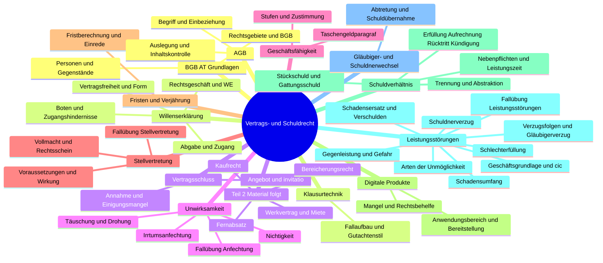
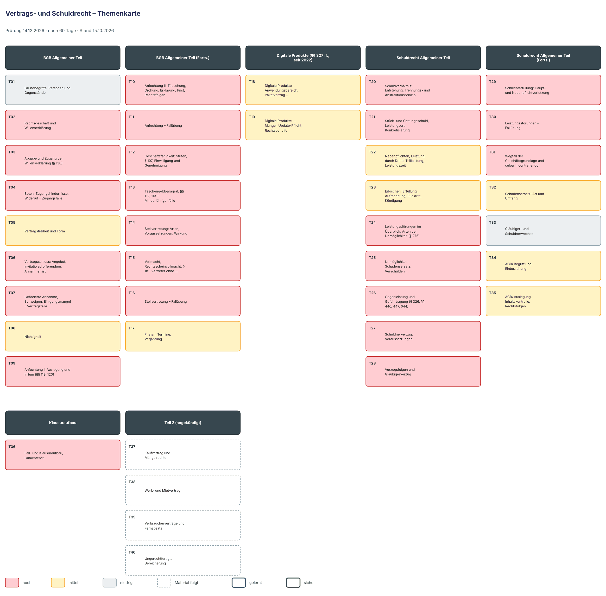

# Lernplan: Vertrags- und Schuldrecht

<!-- klausur: 2026-12-14 -->
> Stand 15.10.2026 · erstellt aus: Skript Bürgerliches Recht Teil 1 (BGB AT + Schuldrecht AT, 51 S., 31 Fälle) und deine Vorlesungsnotizen 01–02

## Prüfung auf einen Blick

| | |
|---|---|
| **Klausur** | **Mo 14.12.2026** – noch 60 Tage |
| Form | Klausur, **60 Minuten** – laut Skript „im sog. Gutachtenstil zu schreiben“ (S. 50–51) |
| Uhrzeit, Raum | noch offen |
| Hilfsmittel | unbekannt – vor allem: Ist ein BGB-Gesetzestext erlaubt? |
| Musterklausur | keine – einziges Muster ist der Beispielfall „Abendkleid“ mit Lösung (Skript S. 51) |
| Dozentin | RAin Silke Hennig · 7 Termine bis 23.11. |
| Stoff | sicher Skript Teil 1; Teil 2 (Kaufrecht, Bereicherungsrecht …) ist angekündigt, liegt aber nicht vor |

## Höchste Priorität

1. **T36 + T06/T07 Anspruchsaufbau im Gutachtenstil und Vertragsschluss:** der einzige ausdrückliche Klausurhinweis im Skript; T36 am besten vorziehen.
2. **T09–T11 Anfechtung:** Prüfungsschritte im Skript und 4 Fälle.
3. **T12–T13 Geschäftsfähigkeit:** Taschengeld- und Ratenfälle sind Klassiker.
4. **T14–T16 Stellvertretung:** die meisten Skriptfälle (7).
5. **T24–T30 Leistungsstörungen:** der größte Block des Schuldrechts AT mit 6 Fällen.
6. **T03–T04 Zugang (§ 130):** „Wichtig bitte lesen“ im Skript; Vorfrage bei Annahme, Anfechtung, Kündigung und Rücktritt.

## Fortschritt

`░░░░░░░░░░░░░░░░░░░░` 0 von 40 Themen gelernt · 0 sicher · 1205 Min. Lernzeit gesamt · 4 Themen warten noch auf Material

## Themen

Relevanz: 🔴 hoch · 🟡 mittel · ⚪ niedrig — Status: neu → gelernt → sicher — Stufe 1–5: nächste Wiederholung nach 1 / 3 / 7 / 14 / 30 Tagen

### BGB Allgemeiner Teil

| Nr | Thema | Lernziele | Relevanz | Quelle | Min | Status | Stufe | Nächste Wdh. |
|---|---|---|---|---|---|---|---|---|
| T01 | Grundbegriffe, Personen und Gegenstände | Ich kann Privatrecht und öffentliches Recht sowie materielles und formelles Recht abgrenzen. Ich kann die fünf Bücher des BGB nennen und Schuldrecht AT (§§ 241–432) und BT (§§ 433–853) abgrenzen. Ich kann Rechtsfähigkeit (§ 1), Geschäftsfähigkeit und Deliktsfähigkeit abgrenzen. Ich kann Verbraucher (§ 13) und Unternehmer (§ 14) definieren. | ⚪ niedrig – reine Grundbegriffe ohne Skriptfälle. Die §§ 13, 14 braucht man aber später (§ 286 III, § 310 III, § 327) | Kap. BGB AT 1.0–2.0 · Skript S. 5–7 | 30 | neu | – | – |
| T02 | Rechtsgeschäft und Willenserklärung | Ich kann Rechtsgeschäft und Gefälligkeit abgrenzen (Merkmal laut Skript: Unentgeltlichkeit). Ich kann die Willenserklärung definieren und ausdrückliche von konkludenter Erklärung abgrenzen. Ich kann einseitige (empfangsbedürftige und nicht empfangsbedürftige) und mehrseitige Rechtsgeschäfte mit Beispielen nennen. Ich kann Verpflichtungs- und Verfügungsgeschäft an einem Kauf erklären. | 🔴 hoch – Grundbegriffe jeder Fallprüfung; Verpflichtung und Verfügung sind eine klassische Falle | Kap. BGB AT 3.1–3.2 · Skript S. 7–8 | 25 | neu | – | – |
| T03 | Abgabe und Zugang der Willenserklärung (§ 130) | Ich kann die Abgabe einer empfangsbedürftigen WE definieren (auch E-Mail, versehentliches „Senden“). Ich kann den Zugang nach § 130 I 1 wortnah definieren (Machtbereich und Möglichkeit der Kenntnisnahme unter normalen Umständen). Ich kann den Zugangszeitpunkt bei mündlicher Erklärung, Brief, E-Mail (Geschäftsverkehr/privat) und Fax im Fall prüfen. | 🔴 hoch – „Wichtig bitte lesen: § 130“ und „Merke“ im Skript; eigener Fallblock | Kap. BGB AT 3.2.1–3.2.2 · Skript S. 8–10 | 30 | neu | – | – |
| T04 | Boten, Zugangshindernisse, Widerruf – Zugangsfälle | Ich kann Empfangsbote und Erklärungsbote abgrenzen und die Risikoverteilung erklären. Ich kann berechtigte und unberechtigte Annahmeverweigerung (Zugangsfiktion) sowie fehlende Empfangseinrichtungen abgrenzen. Ich kann den Widerruf nach § 130 I 2 prüfen. Ich kann die Zugangsfälle 1–4 mit Varianten (S. 11) im Gutachtenstil prüfen. | 🔴 hoch – 4 Fälle und 2 Varianten; Fristfragen (Kündigung) sind klausurtypisch | Kap. BGB AT 3.2.2 Nr. 5–6, Fälle · Skript S. 10–11 | 35 | neu | – | – |
| T05 | Vertragsfreiheit und Form | Ich kann die drei Komponenten der Vertragsfreiheit nennen. Ich kann Schriftform (§ 126), elektronische Form (§ 126a), Textform (§ 126b), notarielle Beurkundung (§ 128) und öffentliche Beglaubigung (§ 129) abgrenzen. Ich kann die Folge eines Formverstoßes (§ 125 S. 1) und die Heilung (§ 311b I 2, § 518 II) erklären. Ich kann das Elitepartner-Urteil (BGH III ZR 387/15) und § 309 Nr. 13 auf eine Kündigungsklausel anwenden. | 🟡 mittel – Formnichtigkeit ist ein Wirksamkeitshindernis im Fall; keine eigenen Skriptfälle | Kap. BGB AT 3.3 · Skript S. 12 | 25 | neu | – | – |
| T06 | Vertragsschluss: Angebot, invitatio ad offerendum, Annahmefrist | Ich kann den Vertrag als zwei übereinstimmende wirksame Willenserklärungen definieren. Ich kann Angebot und invitatio ad offerendum (Schaufenster, Prospekt, Katalog, Internet) abgrenzen. Ich kann Bindung (§ 145), Erlöschen (§ 146) und Annahmefristen (§§ 147 I, II, 148) prüfen. | 🔴 hoch – Einstieg jeder Anspruchsprüfung aus § 433; der Musterfall der Klausuranleitung (S. 51) ist ein invitatio-Fall | Kap. BGB AT 4.0 · Skript S. 13 | 30 | neu | – | – |
| T07 | Geänderte Annahme, Schweigen, Einigungsmangel – Vertragsfälle | Ich kann § 150 I, II (verspätete oder geänderte Annahme = neuer Antrag) anwenden. Ich kann erklären, wann eine Annahmehandlung genügt (§ 151) und warum Schweigen grundsätzlich keine Annahme ist. Ich kann offenen und versteckten Einigungsmangel (§§ 154, 155) abgrenzen. Ich kann die drei Vertragsfälle (S. 14–15) im Gutachtenstil prüfen. | 🔴 hoch – Beispiel Fred/Fritz und 3 Fälle; Standardproblem jeder Vertragsprüfung | Kap. BGB AT 4.0, Fälle · Skript S. 13–15 | 35 | neu | – | – |
| T08 | Nichtigkeit | Ich kann die Nichtigkeitsgründe (§§ 105 I, 125, 134, 138) nennen. Ich kann die Fallgruppen der Sittenwidrigkeit und den Wucher (§ 138 II) erklären. Ich kann nichtige von anfechtbaren und schwebend unwirksamen Geschäften abgrenzen. | 🟡 mittel – Wirksamkeitshindernis im Prüfungsaufbau, aber keine eigenen Fälle | Kap. BGB AT 5.1 · Skript S. 15 | 20 | neu | – | – |
| T09 | Anfechtung I: Auslegung und Irrtum (§§ 119, 120) | Ich kann den Grundsatz „Auslegung vor Anfechtung“ (§§ 133, 157) erklären. Ich kann Inhalts- und Erklärungsirrtum (§ 119 I) sowie Eigenschaftsirrtum (§ 119 II) definieren und an Beispielen abgrenzen. Ich kann den Übermittlungsirrtum (§ 120) vom Fehler eines Empfangsboten abgrenzen. | 🔴 hoch – Kernstoff; das Skript gibt die Prüfungsschritte vollständig vor und hat 4 Fälle | Kap. BGB AT 5.2–5.2.1 A · Skript S. 15–16 | 35 | neu | – | – |
| T10 | Anfechtung II: Täuschung, Drohung, Erklärung, Frist, Rechtsfolgen | Ich kann arglistige Täuschung und widerrechtliche Drohung (§ 123 I) mit allen Merkmalen definieren. Ich kann Anfechtungserklärung (§ 143 I) und Frist (§ 121 unverzüglich bzw. § 124 ein Jahr) prüfen. Ich kann die Rückwirkung (§ 142 I) und den Ersatz des Vertrauensschadens (§ 122) erklären. | 🔴 hoch – vollständiges Prüfschema im Skript; Fälle 2 und 4 auf S. 18 | Kap. BGB AT 5.2.1 B–5.2.2 · Skript S. 16–17 | 30 | neu | – | – |
| T11 | Anfechtung – Fallübung | Ich kann eine Anfechtung vollständig prüfen (Grund, Erklärung, Frist, Rechtsfolge). Ich kann erklären, warum die Anfechtung ausscheiden kann, wenn der Gegner das Gewollte gelten lässt (Fall 1). Ich kann § 122 auf Fall 2 anwenden (Vertrauensschaden, Obergrenze Erfüllungsinteresse). Ich kann Täuschung durch Unterlassen von bloßem Verschweigen abgrenzen (Fall 4). | 🔴 hoch – die 4 Skriptfälle decken Erklärungsirrtum, Eigenschaftsirrtum und Täuschung ab | Kap. BGB AT 5.2, Fälle · Skript S. 18 | 30 | neu | – | – |
| T12 | Geschäftsfähigkeit: Stufen, § 107, Einwilligung und Genehmigung | Ich kann die drei Stufen der Geschäftsfähigkeit mit Altersgrenzen und Normen nennen (§§ 104 Nr. 1, 105, 106, 2). Ich kann „lediglich rechtlich vorteilhaft“ (§ 107) definieren und vom wirtschaftlichen Vorteil abgrenzen. Ich kann Einwilligung (§ 183) und Genehmigung (§§ 108 I, 184 I) abgrenzen und den Schwebezustand erklären. | 🔴 hoch – eigenes Schaubild (S. 21) und 4 Fälle | Kap. BGB AT 6.0–6.3 · Skript S. 19–21 | 30 | neu | – | – |
| T13 | Taschengeldparagraf, §§ 112, 113 – Minderjährigenfälle | Ich kann die Voraussetzungen des § 110 nennen. Ich kann erklären, warum Raten- und Kreditgeschäfte nicht unter § 110 fallen. Ich kann die Teilgeschäftsfähigkeit nach §§ 112, 113 erklären. Ich kann das System der §§ 106 ff. auf die vier Fälle (S. 22) anwenden, auch § 108 II. | 🔴 hoch – Taschengeldfälle sind Klausurklassiker; 4 Fälle | Kap. BGB AT 6.2.1, Fälle · Skript S. 19–22 | 35 | neu | – | – |
| T14 | Stellvertretung: Arten, Voraussetzungen, Wirkung | Ich kann die Arten der Vertretung nennen (rechtsgeschäftlich, gesetzlich § 1629, organschaftlich). Ich kann die Voraussetzungen des § 164 I prüfen (eigene WE, im fremden Namen, Vertretungsmacht, Zulässigkeit). Ich kann Stellvertreter und Bote abgrenzen. Ich kann die Wirkung (§ 164 I) und die Zurechnung von Willensmängeln (§ 166 I) erklären. | 🔴 hoch – eigenes Schaubild (S. 27); das Kapitel mit den meisten Fällen (7) | Kap. BGB AT 7.0–7.3 · Skript S. 23–24, 27 | 35 | neu | – | – |
| T15 | Vollmacht, Rechtsscheinvollmacht, § 181, Vertreter ohne Vertretungsmacht | Ich kann Innen- und Außenvollmacht (§ 167 I) sowie Spezial-, Gattungs- und Generalvollmacht abgrenzen. Ich kann das Erlöschen der Vollmacht (§ 168) erklären. Ich kann Duldungs- und Anscheinsvollmacht abgrenzen. Ich kann §§ 177, 179 und § 181 im Fall prüfen. | 🔴 hoch – Grundlage für die Fälle 3, 5, 6 und 7 auf S. 25–26 | Kap. BGB AT 7.1, 7.4–7.7 · Skript S. 23–25 | 35 | neu | – | – |
| T16 | Stellvertretung – Fallübung | Ich kann das System der §§ 164 ff. (S. 27) auf die sieben Fälle anwenden. Ich kann das „Geschäft für den, den es angeht“ von einem Eigengeschäft des Handelnden abgrenzen (Fall 4). Ich kann die Haftung des Vertreters ohne Vertretungsmacht (§ 179 I) prüfen (Fall 7). Ich kann begründet abgrenzen, ob ein Kind als Bote oder als Vertreter handelt (Fall 1). | 🔴 hoch – 7 Skriptfälle | Kap. BGB AT 7.0, Fälle · Skript S. 25–27 | 35 | neu | – | – |
| T17 | Fristen, Termine, Verjährung | Ich kann Frist und Termin definieren und die Regeln zur Fristberechnung (§§ 186–193) nennen. Ich kann die Wirkung der Verjährung (§ 214) erklären. Ich kann die regelmäßige Verjährungsfrist (§ 195) und abweichende Fristen (§§ 438, 634a, 548, 196, 197) nennen. | 🟡 mittel – kurz im Skript, aber Verjährung ist eine Einrede im Klausurschritt 5 (S. 50) | Kap. BGB AT 8.0–9.0 · Skript S. 28 | 20 | neu | – | – |

### Digitale Produkte (§§ 327 ff., seit 2022)

| Nr | Thema | Lernziele | Relevanz | Quelle | Min | Status | Stufe | Nächste Wdh. |
|---|---|---|---|---|---|---|---|---|
| T18 | Digitale Produkte I: Anwendungsbereich, Paketvertrag, Bereitstellung | Ich kann den Anwendungsbereich der §§ 327 ff. nennen (Verbrauchervertrag § 310 III, digitale Inhalte und Dienstleistungen, Daten als Gegenleistung § 327 III). Ich kann Paketvertrag (§ 327a I) und Ware mit digitalen Elementen (§ 327a III) abgrenzen. Ich kann Bereitstellungspflicht (§ 327b) und Rechte bei fehlender Bereitstellung (§ 327c) erklären. | 🟡 mittel – 4 Skriptseiten und praxisnah für Wirtschaftsinformatik, aber ohne Fälle und ohne Schema | Kap. SchR AT Neuerungen 2022 · Skript S. 29–30 | 30 | neu | – | – |
| T19 | Digitale Produkte II: Mangel, Update-Pflicht, Rechtsbehelfe | Ich kann die Anforderungen an ein mangelfreies digitales Produkt (§ 327e) und die Update-Pflicht (§ 327f) nennen. Ich kann die Rangfolge der Rechtsbehelfe erklären (§ 327i: Nacherfüllung vor Beendigung, Minderung, Schadensersatz). Ich kann Nacherfüllung und Vertragsbeendigung bei digitalen Produkten vom Kaufrecht abgrenzen (§§ 327l, 327m I Nr. 3). Ich kann Verjährung (§ 327j) und Beweislastumkehr (§ 327k) nennen. | 🟡 mittel – detailreich und ohne Fälle; die Abgrenzung zum Kaufrecht ist prüfbar | Kap. SchR AT Neuerungen 2022 · Skript S. 30–32 | 35 | neu | – | – |

### Schuldrecht Allgemeiner Teil

| Nr | Thema | Lernziele | Relevanz | Quelle | Min | Status | Stufe | Nächste Wdh. |
|---|---|---|---|---|---|---|---|---|
| T20 | Schuldverhältnis: Entstehung, Trennungs- und Abstraktionsprinzip | Ich kann erklären, wie Schuldverhältnisse entstehen (Vertrag § 311 I oder Gesetz) und wer Gläubiger und wer Schuldner ist (§ 241). Ich kann Verpflichtungs- und Verfügungsgeschäft definieren. Ich kann das Abstraktionsprinzip auf einen Kauf mit unwirksamem Kaufvertrag anwenden. | 🔴 hoch – klassische Verständnisfrage und Klausurfalle | Kap. SchR AT 1.0–2.1 · Skript S. 33 | 25 | neu | – | – |
| T21 | Stück- und Gattungsschuld, Leistungsort, Konkretisierung | Ich kann Stück- und Gattungsschuld abgrenzen und § 243 I (mittlere Art und Güte) erklären. Ich kann Hol-, Bring- und Schickschuld nach Leistungs- und Erfolgsort abgrenzen (§ 269). Ich kann prüfen, wann Konkretisierung eintritt (§ 243 II). | 🔴 hoch – Voraussetzung für die Unmöglichkeits- und Gefahrfälle 1, 3 und 5 (S. 44–45) | Kap. SchR AT 2.2.1.1 · Skript S. 34–35 | 35 | neu | – | – |
| T22 | Nebenpflichten, Leistung durch Dritte, Teilleistung, Leistungszeit | Ich kann leistungssichernde Nebenpflichten und Schutzpflichten (§ 241 II) abgrenzen. Ich kann die Regeln zu Leistung durch Dritte (§ 267 I), Teilleistung (§ 266) und Leistungszeit (§ 271) nennen. Ich kann das Zurückbehaltungsrecht (§ 273) erklären. | 🟡 mittel – Grundlagen für Verzug und Schutzpflichtverletzung, keine eigenen Fälle | Kap. SchR AT 2.2 · Skript S. 35–36 | 20 | neu | – | – |
| T23 | Erlöschen: Erfüllung, Aufrechnung, Rücktritt, Kündigung | Ich kann die Erfüllung (§ 362 I) prüfen. Ich kann die Aufrechnungslage (§ 387) prüfen und die Wirkung (§ 389) nennen. Ich kann Rücktritt (§§ 346, 349) und Kündigung (ordentlich oder außerordentlich, § 626) nach Voraussetzungen und Wirkung abgrenzen. Ich kann die zwei Fälle (S. 37) im Gutachtenstil prüfen. | 🟡 mittel – 2 Fälle; die Erlöschensgründe gehören in Klausurschritt 5 (Gegenrechte) | Kap. SchR AT 2.3 · Skript S. 36–37 | 35 | neu | – | – |
| T24 | Leistungsstörungen im Überblick, Arten der Unmöglichkeit (§ 275) | Ich kann die vier Arten der Leistungsstörung nennen. Ich kann objektive und subjektive sowie anfängliche und nachträgliche Unmöglichkeit an Beispielen abgrenzen. Ich kann § 275 I, II (faktische) und III (persönliche Unmöglichkeit) abgrenzen. | 🔴 hoch – Einstieg in den größten Block des Schuldrechts (S. 38–46) | Kap. SchR AT 3.0–3.1.1 · Skript S. 38 | 25 | neu | – | – |
| T25 | Unmöglichkeit: Schadensersatz, Verschulden, Aufwendungsersatz | Ich kann die Anspruchsgrundlagen für Schadensersatz statt der Leistung bei anfänglicher (§§ 275 IV, 311a II) und nachträglicher Unmöglichkeit (§§ 275 IV, 280 I, III, 283) nennen. Ich kann Vorsatz und Fahrlässigkeit (§ 276) definieren und die Beweislastumkehr erklären. Ich kann § 278 (Erfüllungsgehilfe) im Fall anwenden. Ich kann Aufwendungsersatz (§ 284) vom Schadensersatz abgrenzen. | 🔴 hoch – die Ketten von Anspruchsgrundlagen und das Verschulden stecken in jeder Schadensersatzprüfung | Kap. SchR AT 3.1.2.1–3.1.2.2 · Skript S. 39–40 | 35 | neu | – | – |
| T26 | Gegenleistung und Gefahrtragung (§ 326, §§ 446, 447, 644) | Ich kann den Grundsatz des § 326 I 1 erklären. Ich kann die Ausnahmen (§ 326 II 1 Alt. 1 und 2, §§ 446, 447, 644) im Fall anwenden. Ich kann Leistungsgefahr und Preisgefahr (Gegenleistungsgefahr) abgrenzen. | 🔴 hoch – „Kann V den Kaufpreis verlangen?“ ist eine typische Fallfrage (Fälle 2, 3, 5 auf S. 44–45) | Kap. SchR AT 3.1.2.3, Einschub Gefahr · Skript S. 40, 43 | 30 | neu | – | – |
| T27 | Schuldnerverzug: Voraussetzungen | Ich kann die Voraussetzungen des Schuldnerverzugs nennen (Merksatz: „schuldhafte Nichtleistung trotz Fälligkeit und Mahnung“). Ich kann absolutes und relatives Fixgeschäft abgrenzen. Ich kann prüfen, wann die Mahnung entbehrlich ist (§ 286 II Nr. 1–4) und wann § 286 III (30 Tage) greift. Ich kann die Besonderheit beim Verbraucher (Hinweis in der Rechnung) erklären. | 🔴 hoch – vollständiges Schema im Skript; Fall 6 auf S. 45 | Kap. SchR AT 3.2.1 · Skript S. 40–41 | 35 | neu | – | – |
| T28 | Verzugsfolgen und Gläubigerverzug | Ich kann die Rechtsfolgen des Schuldnerverzugs nennen (§§ 280 I, II, 286; §§ 288, 247; §§ 280 I, III, 281; § 323). Ich kann Verzögerungsschaden und Schadensersatz statt der Leistung abgrenzen. Ich kann die Voraussetzungen des Gläubigerverzugs (§§ 293, 294) prüfen. Ich kann die Folgen des Gläubigerverzugs (§ 300 I, II) anwenden. | 🔴 hoch – Verzögerungsschaden gegen Schadensersatz statt der Leistung ist die zentrale Unterscheidung; Fall 3 auf S. 44 | Kap. SchR AT 3.2.2–3.3 · Skript S. 42 | 30 | neu | – | – |
| T29 | Schlechterfüllung: Haupt- und Nebenpflichtverletzung | Ich kann Schadensersatz neben der Leistung (§ 280 I) und statt der Leistung (§ 281) abgrenzen. Ich kann die Voraussetzungen des § 281 prüfen (Fristsetzung, Entbehrlichkeit § 281 II, Wahl § 281 IV, Unerheblichkeit § 281 I 3). Ich kann Nebenpflichten (§§ 241 II, 242) an Beispielen erklären und den Anspruch aus § 280 I prüfen. | 🔴 hoch – § 280 I ist die Grundnorm fast jedes Schadensersatzfalls; Fall 4 auf S. 45 | Kap. SchR AT 3.4 · Skript S. 43–44 | 30 | neu | – | – |
| T30 | Leistungsstörungen – Fallübung | Ich kann in einem Sachverhalt die passende Leistungsstörung und Anspruchsgrundlage abgrenzen. Ich kann die Fälle 1–6 (S. 44–45) im Gutachtenstil prüfen. Ich kann den Verzugsbeginn nach § 286 III mit §§ 187, 188 kalendermäßig prüfen. | 🔴 hoch – 6 Fälle; bündelt den Kern des Schuldrechts AT | Kap. SchR AT 3.0–3.4, Fälle · Skript S. 44–45 | 40 | neu | – | – |
| T31 | Wegfall der Geschäftsgrundlage und culpa in contrahendo | Ich kann Voraussetzungen und Rechtsfolgen des § 313 nennen (Anpassung, Rücktritt oder Kündigung). Ich kann das vorvertragliche Schuldverhältnis (§ 311 II, III) erklären. Ich kann den Anspruch aus §§ 280 I, 311 II, 241 II im Kaufhaus-Fall (S. 46) prüfen. | 🔴 hoch – c.i.c. hat ein Schema und einen Fall; die Geschäftsgrundlage (ohne Fall) eher mittel | Kap. SchR AT 3.5 · Skript S. 45–46 | 30 | neu | – | – |
| T32 | Schadensersatz: Art und Umfang | Ich kann materiellen und immateriellen Schaden abgrenzen (§ 253 I, II). Ich kann Naturalrestitution (§ 249 I) und Geldersatz (§ 249 II) erklären. Ich kann entgangenen Gewinn (§ 252) und Mitverschulden (§ 254) im Fall anwenden. | 🟡 mittel – Rechtsfolgenseite jeder Schadensersatzprüfung; nur eine Skriptseite | Kap. SchR AT 3.6 · Skript S. 47 | 20 | neu | – | – |
| T33 | Gläubiger- und Schuldnerwechsel | Ich kann die Abtretung (§ 398) definieren und den Erhalt der Einwendungen (§ 404) erklären. Ich kann Schuldübernahme (§§ 414, 415) und Schuldbeitritt abgrenzen. | ⚪ niedrig – eine halbe Skriptseite, keine Fälle | Kap. SchR AT 4.0 · Skript S. 47 | 20 | neu | – | – |
| T34 | AGB: Begriff und Einbeziehung | Ich kann AGB nach § 305 I 1 definieren (auch „Vielzahl“ = mindestens dreimalige Verwendung). Ich kann die Einbeziehung prüfen (§ 305 II Nr. 1, 2, Einverständnis). Ich kann überraschende Klauseln (§ 305c I) erklären und die Sonderregeln für Verbraucherverträge (§ 310 III) nennen. | 🟡 mittel – klare Prüfungsfolge über 2 Seiten; Bezug zum Elitepartner-Urteil; keine Fälle | Kap. SchR AT 5.1–5.2 · Skript S. 48 | 30 | neu | – | – |
| T35 | AGB: Auslegung, Inhaltskontrolle, Rechtsfolgen | Ich kann die Auslegungsregeln (§ 305c II, § 305b) anwenden. Ich kann die Reihenfolge der Inhaltskontrolle (§ 309, dann § 308, dann § 307) erklären. Ich kann die Rechtsfolge unwirksamer Klauseln (§ 306) nennen und § 309 Nr. 13 auf eine Kündigungsklausel anwenden. | 🟡 mittel – klares Schema, aber keine Fälle | Kap. SchR AT 5.3–5.6 · Skript S. 49 (mit S. 12) | 25 | neu | – | – |

### Klausuraufbau

| Nr | Thema | Lernziele | Relevanz | Quelle | Min | Status | Stufe | Nächste Wdh. |
|---|---|---|---|---|---|---|---|---|
| T36 | Fall- und Klausuraufbau, Gutachtenstil | Ich kann die sechs Schritte des Fallaufbaus nennen. Ich kann das Muster „Wer will was von wem woraus?“ auf eine Fallfrage anwenden und daraus den Obersatz bilden. Ich kann vertragliche und gesetzliche Anspruchsgrundlagen nennen (§§ 433, 437, 535, 631; §§ 985, 1004, 823, 812). Ich kann Gutachtenstil und Urteilsstil abgrenzen. | 🔴 hoch – der einzige ausdrückliche Klausurhinweis: „Die Klausur ist im sog. Gutachtenstil zu schreiben“ | Kap. Anhang · Skript S. 50–51 | 30 | neu | – | – |

### Teil 2 (angekündigt)

| Nr | Thema | Lernziele | Relevanz | Quelle | Min | Status | Stufe | Nächste Wdh. |
|---|---|---|---|---|---|---|---|---|
| T37 | Kaufvertrag und Mängelrechte (Material folgt) | Ich kann die Hauptpflichten aus § 433 I 1 und II nennen. Ich kann die Mängelrechte nach § 437 nennen (Nacherfüllung § 439, Rücktritt, Minderung, Schadensersatz). Ich kann Gefahrübergang (§§ 446, 447) und Verjährung (§ 438) beim Kauf erklären. (vorläufig) | 🟡 mittel – vorläufig. Das Skript verweist auf Sonderregeln im „Skript Schuldrecht Besonderer Teil“ und nennt §§ 433, 437, 439 als wichtigste Anspruchsgrundlagen | Kap. Teil 2 (angekündigt) · Skript S. 43, 50 (Verweise) | 40 | neu | – | – |
| T38 | Werk- und Mietvertrag (Material folgt) | Ich kann die Hauptpflichten aus § 631 I und § 535 I 1, II nennen. Ich kann die Gefahrtragung beim Werkvertrag (§ 644) erklären. (vorläufig) | 🟡 mittel – vorläufig; in Teil 1 nur als Verweise | Kap. Teil 2 (angekündigt) · Skript S. 28, 36, 40, 43, 50 (Verweise) | 30 | neu | – | – |
| T39 | Verbraucherverträge und Fernabsatz (Material folgt) | Ich kann die Sondervorschriften für den elektronischen Geschäftsverkehr (§§ 312b–g) nennen. Ich kann Widerruf und Rücktritt abgrenzen (§ 357). (vorläufig) | 🟡 mittel – vorläufig. Das Skript verweist auf „Schuldrecht Besonderer Teil 6.5.1.3“ | Kap. Teil 2 (angekündigt) · Skript S. 14, 36 (Verweise) | 30 | neu | – | – |
| T40 | Ungerechtfertigte Bereicherung (Material folgt) | Ich kann erklären, wie nach dem Abstraktionsprinzip eine Leistung ohne wirksamen Vertrag zurückgefordert wird (§ 812). Ich kann § 812 als gesetzliche Anspruchsgrundlage von vertraglichen Ansprüchen abgrenzen. (vorläufig) | 🟡 mittel – vorläufig. Skript S. 33 kündigt ausdrücklich das „Skript Teil 2 ‚ungerechtfertigte Bereicherung‘“ an | Kap. Teil 2 (angekündigt) · Skript S. 33, 50 (Verweise) | 30 | neu | – | – |

## Mindmap

Als Bild mit Relevanz-Farben und Lernstand (aktualisieren mit `python3 -I lernen/status.py --karten`):

## Was über die Prüfung bekannt ist

| Punkt | Stand | Quelle |
|---|---|---|
| Form | Schriftliche Klausur | README („Prüfung: Klausur, 60 Minuten“) |
| Dauer | 60 Minuten | README; Auftrag |
| Datum | Montag, 14.12.2026. **Uhrzeit, Raum und Nachschreibtermin: unbekannt** | Auftrag (steht nicht im README und nicht im Skript) |
| Aufgabentyp | Fallbearbeitung als Anspruchsprüfung („Wer will was von wem woraus?“) im **Gutachtenstil**. Wörtlich: „Die Klausur ist im sog. ‚Gutachtenstil‘ zu schreiben“, aber „bei eindeutigen Tatbestandsmerkmalen kein Gutachtenstil verwenden“. Außerdem: „keine Ansprüche prüfen, die nicht gefragt sind!!!“ | Skript S. 50–51 (Anhang „Fall- und Klausuraufbau“) |
| Wissens- oder Definitionsfragen | **unbekannt** | – |
| Hilfsmittel | **unbekannt.** Das Skript nennt keine. Es verweist aber auf den Gesetzestext („Wichtig bitte lesen: § 130 Abs. 1 S. 1 BGB“). Ob ein BGB erlaubt ist und welche Ausgabe, ist offen | Skript S. 9 |
| Stoffumfang | **unbekannt.** Sicher ist Skript Teil 1 (BGB AT + Schuldrecht AT). Teil 2 ist angekündigt (Bereicherungsrecht, Schuldrecht BT), liegt aber nicht vor | Skript S. 14, 33, 43 |
| Punkte, Gewichtung, Bestehensgrenze | **unbekannt** | – |
| Musterklausur, Altklausuren | Keine bekannt. Das einzige Muster ist der Beispielfall „Abendkleid“ mit Lösung in 5 Schritten | Skript S. 51 |
| Vorlesungstermine | 13.10., 15.10., 26.10., 09.11., 12.11., 18.11., 23.11.2026. Nach dem letzten Termin bleiben 3 Wochen bis zur Klausur | Auftrag; README |

**Einschätzung (nicht bestätigt):** Das Skript beschreibt den Klausuraufbau ausdrücklich. Wahrscheinlich ist deshalb eine Fallklausur mit wenigen kurzen Sachverhalten. Gefragt wäre dann ein sauberer Anspruchsaufbau, und Unproblematisches sollte im Urteilsstil abgehandelt werden, um Zeit zu sparen.

## Offene Punkte – in der Vorlesung klären

- **Hilfsmittel:** Ist ein Gesetzestext (BGB) erlaubt? Welche Ausgabe? Sind Markierungen und Register erlaubt? Das Skript empfiehlt, das Gesetz zu lesen (S. 9).
- **Aufgabenformat:** Gibt es nur Fallbearbeitung im Gutachtenstil oder auch Wissens- und Definitionsfragen? Unbekannt sind auch die Anzahl der Fälle, die Punkte und die Bestehensgrenze.
- **Organisation:** Uhrzeit, Raum und Nachschreibtermin der Klausur am 14.12.2026 sind unbekannt. Eine Musterklausur oder Altklausur bei der Dozentin anfragen.
- **Skript Teil 2:** Es ist angekündigt: „Skript Teil 2 ‚ungerechtfertigte Bereicherung‘“ (S. 33), „Skript Schuldrecht Besonderer Teil“ (S. 43) und „Schuldrecht Besonderer Teil 6.5.1.3“ (S. 14). Es liegt noch nicht vor; Moodle führt laut README nur Teil 1. Unklar ist, ob Teil 2 zu dieser Klausur gehört oder zu einem späteren Modul (das Titelblatt nennt „Recht I“). T37–T40 sind nur Platzhalter.
- **Neuerungen 2022:** Ist der Abschnitt „Das neue Schuldrecht“ (§§ 327 ff., S. 29–32) prüfungsrelevant? Er hat 4 Seiten, aber keinen Fall.
- **Nicht behandelte Anspruchsgrundlagen:** Deliktsrecht (§§ 823, 831) und Sachenrecht (§§ 985, 1004, 861, 862) nennt das Skript als Anspruchsgrundlagen (S. 50), behandelt sie aber nicht. Kommen sie in Teil 2 oder in der Vorlesung?
- **Lösungen fehlen:** Zu allen 31 Skriptfällen gibt es keine Lösungen. Die Lösungsskizzen in den Repo-Notizen stammen nicht aus dem Skript und sind in der Vorlesung abzugleichen.
- **Stand der Vorlesung:** Im Repo sind die Termine 1 und 2 nur „vermutet“ zugeordnet (Kap. 1–4 bzw. 5–7). Wie der Rest auf die Termine 3–7 verteilt wird, ist unbekannt.
- **Seitenangaben in Repo-Notiz 02:** Die Anfechtungsfälle stehen auf S. 18 (nicht 19), die Geschäftsfähigkeitsfälle auf S. 22 (nicht 23).
- **Wohl veraltete oder ungenaue Normangaben im Skript** (mit dem aktuellen Gesetz prüfen):
  - S. 40: § 474 II; heute regelt § 475 II den Versendungskauf beim Verbrauchsgüterkauf.
  - S. 47: § 651f; heute § 651n II.
  - S. 31: „§ 327 II S. 1“ meint wohl § 327l II 1.
  - S. 32: „§ 327 II“ bei der Beweislastumkehr meint wohl § 327k II.
  - S. 5 nennt den BT mit „§§ 432–853“, S. 33 mit „§§ 433 bis 853“.
  - S. 8 verweist auf „Punkt III“; gemeint ist 3.2.2 Nr. 5.
  - Die Gliederung springt von 3.5.1 auf 3.5.3; ein 3.5.2 fehlt.
  - S. 48: „unwirksam, § 305c I“; genau: Die Klausel wird nicht Vertragsbestandteil, und für Mehrdeutigkeit gilt § 305c II.
  - S. 10: § 130 I 2 „zur Kenntnis genommen“; das Gesetz sagt „zugeht“.
  - S. 45: § 313 „beides nach Vertragsschluss“; bei Abs. 2 waren die Vorstellungen schon bei Vertragsschluss falsch.
- **Normen, die Skriptfälle brauchen, das Skript aber nicht erklärt:** § 108 II (Fall 4 S. 22), § 241a (Fall 3 S. 15), § 295 (Fall 3 S. 44), § 166 II (Fall 2 S. 25), §§ 105, 165 (Fall 1 S. 25), § 179 II, III (Fall 7 S. 26), § 362 II mit § 185 und § 270 I (Fall 1 S. 37), § 346 III Nr. 3 (Fall 2 S. 37), § 288 II (Fall 6 S. 45). Werden diese Normen in der Klausur erwartet?
- **Lernreihenfolge:** Die Tabelle folgt dem Skript. Für die Planung empfiehlt es sich, T36 (Klausuraufbau) vorzuziehen und die Fallübungen T11, T16 und T30 jeweils direkt nach dem zugehörigen Theorieblock zu legen.

## Quellen

- **Stand:** Donnerstag, 15.10.2026 – Entwurf. „(über das Skript hinaus)“ heißt: steht nicht im Skript, sondern kommt aus dem Gesetzestext oder wird für die Lösung der Skriptfälle gebraucht. In der Vorlesung abgleichen.
- **Skript (einziges Material):** „Bürgerliches Recht I – BGB Allgemeiner Teil, Schuldrecht Allgemeiner Teil – Vorlesungsskript“ (Studienfach Recht I), RAin Silke Hennig. Fußzeile: „Vorlesungsskript Bürgerliches Recht I Teil I Oktober 2026“. Datei `2026 SilkeHennigSkriptATSchuldrecht Oktober 2026.pdf`, 51 Seiten, aus Moodle-Kurs 18614 (im README verlinkt).
  - Ausgewertet wurden alle 51 Seiten: der Text vollständig, dazu die Schaubilder S. 21 („System der §§ 106 ff.“) und S. 27 („System der §§ 164 ff.“) als Bild. S. 27 ist ein reines Bild ohne Text.
  - **Seitenzahlen:** Die aufgedruckte Seitenzahl ist auf allen 51 Seiten gleich der PDF-Seite. „Skript S. N“ gilt also für beides. Auch die Seitenangaben im Inhaltsverzeichnis (S. 1–4) stimmen.
  - **Aufbau:** S. 1–4 Inhaltsverzeichnis · S. 5–28 BGB AT (Kap. 1.0–9.0) · S. 29–32 „Das neue Schuldrecht – Neuerungen zum 1.1.2022“ (§§ 327 ff.) · S. 33–49 Schuldrecht AT (Kap. 1.0–5.0) · S. 50–51 Anhang „Fall- und Klausuraufbau“ und Literaturverzeichnis.
  - **Übungsmaterial im Skript:** 31 Fälle, alle ohne Lösung: Zugang 4 (+ 2 Varianten, S. 11), Vertrag 3 (S. 14–15), Anfechtung 4 (S. 18), Geschäftsfähigkeit 4 (S. 22), Stellvertretung 7 (S. 25–26), Beendigung 2 (S. 37), Leistungsstörungen 6 (S. 44–45), c.i.c. 1 (S. 46). Dazu das Beispiel Fred/Fritz (S. 14), ein Musterfall mit Lösung („Abendkleid“, S. 51) und 2 Schaubilder (S. 21, 27).
  - Literaturverzeichnis des Skripts (nicht ausgewertet): Brox/Walker, AT des BGB / Besonderes Schuldrecht (50. Aufl.); Musielak/Hau, Grundkurs BGB (19. Aufl.); NomosPraxis, Das neue Schuldrecht (2022).
- **Repo-Notizen (nur gelesen):**
  - `recht/README.md`: Prüfung „Klausur, 60 Minuten“; 7 Termine, der erste am 13.10.2026. Als Material ist nur dieses Skript gelistet.
  - `recht/vorlesungen/01_2026-10-13.md`: Termin 1, Grundlage „vermutet“ Kap. 1–4 BGB AT. Die Lösungsskizzen zu den Fällen S. 11–15 stammen laut Notiz „von der Routine, nicht aus dem Skript“.
  - `recht/vorlesungen/02_2026-10-15.md`: Termin 2, Status „vorbereitet“, vermutet Kap. 5–7. Die Fallseiten dort (S. 19 und S. 23) sind falsch, richtig sind S. 18 und S. 22.
- **Aus dem Auftrag:** Klausur am Montag, 14.12.2026, 60 Minuten. Termine: 13.10., 15.10., 26.10., 09.11., 12.11., 18.11., 23.11.2026.

## Dateien zu diesem Fach

- [Kernpunkte, Klausurfallen und Visualisierungsideen](kernpunkte.md)
- Karteikarten: `karteikarten.md` (entsteht beim Lernen)
- Fehlerprotokoll: `fehlerprotokoll.md` (entsteht beim Lernen)
- Grafiken: [`grafiken/`](grafiken/) – u. a. die Themenkarte
