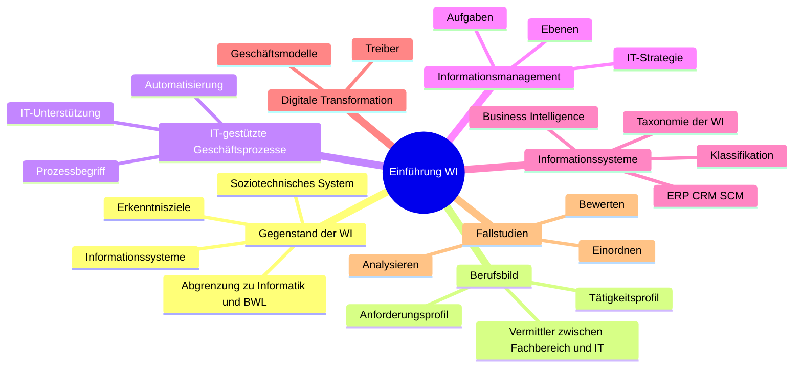
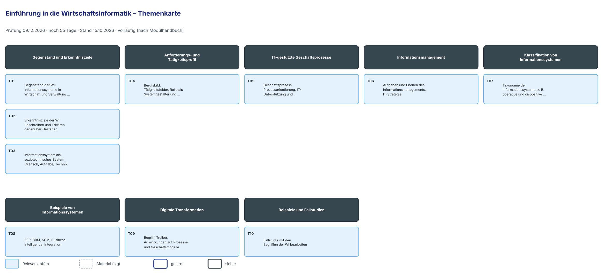

# Lernplan: Einführung in die Wirtschaftsinformatik

<!-- klausur: 2026-12-09 -->
> Stand 15.10.2026 · erstellt aus: DHBW-Modulhandbuch Wirtschaftsinformatik, Studienrichtung Data Science, Heilbronn (Modul W4WI_101) – noch kein Skript
>
> ⚠️ **Vorläufig:** Für Einführung WI gibt es noch kein Material (Blockvorlesung 28.–30.10.). Themen und Reihenfolge stammen aus dem Modulhandbuch und sind damit selbst „über das Skript hinaus“. Nach der Blockvorlesung baue ich den Plan nach dem echten Material neu.

## Prüfung auf einen Blick

| | |
|---|---|
| **Klausur** | **Mi 09.12.2026** – noch 55 Tage |
| Form | Klausur, **48 Minuten** – vermutlich der Einführungsteil (≈ 40 %) der Modulprüfung W4WI_101 „Grundlegende Methoden der WI“; Systemanalyse und -entwurf folgt vermutlich im 2. Semester (abgeleitet, nicht bestätigt) |
| Uhrzeit, Raum | noch offen |
| Hilfsmittel | unbekannt |
| Dozent | Dr. Matthias Hauser · Blockvorlesung 28.–30.10. (6 Termine) |

## Höchste Priorität

Noch nicht bestimmbar – das entscheidet die Blockvorlesung.

Vorwissen aus Grundlagen der IT nutzen: **Daten und Information, Digitalisierung, IT-Infrastrukturen und Cloud** (↔ GIT T01–T05) überschneiden sich mit „Gegenstand der WI“ und „Digitale Transformation“.

## Fortschritt

`░░░░░░░░░░░░░░░░░░░░` 0 von 10 Themen gelernt · 0 sicher · 325 Min. Lernzeit gesamt

## Themen

Relevanz: 🔴 hoch · 🟡 mittel · ⚪ niedrig · ❔ offen — Status: neu → gelernt → sicher — Stufe 1–5: nächste Wiederholung nach 1 / 3 / 7 / 14 / 30 Tagen

### Gegenstand und Erkenntnisziele

| Nr | Thema | Lernziele | Relevanz | Quelle | Min | Status | Stufe | Nächste Wdh. |
|---|---|---|---|---|---|---|---|---|
| T01 | Gegenstand der WI: Informationssysteme in Wirtschaft und Verwaltung, Abgrenzung zu Informatik und BWL | Ich kann den Gegenstand der Wirtschaftsinformatik definieren. Ich kann die Wirtschaftsinformatik von Informatik und BWL abgrenzen. | ❔ offen – Skript fehlt noch | MHB W4WI_101 | 30 | neu | – | – |
| T02 | Erkenntnisziele der WI: Beschreiben und Erklären gegenüber Gestalten | Ich kann theoretische und gestaltungsorientierte Erkenntnisziele der WI unterscheiden. Ich kann an einem Beispiel erläutern, was „Gestaltung von Informationssystemen“ bedeutet. | ❔ offen – Skript fehlt noch | MHB W4WI_101 | 25 | neu | – | – |
| T03 | Informationssystem als soziotechnisches System (Mensch, Aufgabe, Technik) | Ich kann ein reales Informationssystem als soziotechnisches System beschreiben. Ich kann die Begriffe Daten, Information und Wissen unterscheiden. | ❔ offen – Skript fehlt noch | MHB W4WI_101 | 30 | neu | – | – |

### Anforderungs- und Tätigkeitsprofil

| Nr | Thema | Lernziele | Relevanz | Quelle | Min | Status | Stufe | Nächste Wdh. |
|---|---|---|---|---|---|---|---|---|
| T04 | Berufsbild: Tätigkeitsfelder, Rolle als Systemgestalter und Vermittler | Ich kann typische Tätigkeitsfelder von Wirtschaftsinformatikern nennen. Ich kann die Vermittlerrolle zwischen Fachabteilung und IT erklären. | ❔ offen – Skript fehlt noch | MHB W4WI_101 | 25 | neu | – | – |

### IT-gestützte Geschäftsprozesse

| Nr | Thema | Lernziele | Relevanz | Quelle | Min | Status | Stufe | Nächste Wdh. |
|---|---|---|---|---|---|---|---|---|
| T05 | Geschäftsprozess, Prozessorientierung, IT-Unterstützung und Automatisierung | Ich kann den Begriff Geschäftsprozess definieren und Beispiele nennen. Ich kann erläutern, wie IT einen Geschäftsprozess unterstützt oder automatisiert. | ❔ offen – Skript fehlt noch | MHB W4WI_101 | 35 | neu | – | – |

### Informationsmanagement

| Nr | Thema | Lernziele | Relevanz | Quelle | Min | Status | Stufe | Nächste Wdh. |
|---|---|---|---|---|---|---|---|---|
| T06 | Aufgaben und Ebenen des Informationsmanagements, IT-Strategie | Ich kann Aufgaben des Informationsmanagements nennen und den Ebenen strategisch, taktisch und operativ zuordnen. Ich kann den Zusammenhang von Unternehmens- und IT-Strategie erläutern. | ❔ offen – Skript fehlt noch | MHB W4WI_101 | 35 | neu | – | – |

### Klassifikation von Informationssystemen

| Nr | Thema | Lernziele | Relevanz | Quelle | Min | Status | Stufe | Nächste Wdh. |
|---|---|---|---|---|---|---|---|---|
| T07 | Taxonomie der Informationssysteme, z. B. operative und dispositive Systeme, Standard- und Individualsoftware | Ich kann Informationssysteme nach gängigen Kriterien klassifizieren. Ich kann ein reales Informationssystem in die Taxonomie der WI einordnen. | ❔ offen – Skript fehlt noch | MHB W4WI_101 | 35 | neu | – | – |

### Beispiele von Informationssystemen

| Nr | Thema | Lernziele | Relevanz | Quelle | Min | Status | Stufe | Nächste Wdh. |
|---|---|---|---|---|---|---|---|---|
| T08 | ERP, CRM, SCM, Business Intelligence; Integration | Ich kann die Aufgaben von ERP-, CRM- und SCM-Systemen beschreiben. Ich kann an einem Beispiel erklären, welchen Nutzen integrierte Systeme bringen. | ❔ offen – Skript fehlt noch | MHB W4WI_101 | 35 | neu | – | – |

### Digitale Transformation

| Nr | Thema | Lernziele | Relevanz | Quelle | Min | Status | Stufe | Nächste Wdh. |
|---|---|---|---|---|---|---|---|---|
| T09 | Begriff, Treiber, Auswirkungen auf Prozesse und Geschäftsmodelle | Ich kann digitale Transformation erklären und von Digitalisierung abgrenzen. Ich kann Treiber und Auswirkungen an einem Unternehmensbeispiel erläutern. | ❔ offen – Skript fehlt noch | MHB W4WI_101 | 35 | neu | – | – |

### Beispiele und Fallstudien

| Nr | Thema | Lernziele | Relevanz | Quelle | Min | Status | Stufe | Nächste Wdh. |
|---|---|---|---|---|---|---|---|---|
| T10 | Fallstudie mit den Begriffen der WI bearbeiten | Ich kann eine Fallstudie mit den Begriffen der WI analysieren. Ich kann Vorschläge für den IT-Einsatz im Fall begründen. | ❔ offen – Skript fehlt noch | MHB W4WI_101 | 40 | neu | – | – |

## Mindmap

---

Als Bild mit Relevanz-Farben und Lernstand (aktualisieren mit `python3 -I lernen/status.py --karten`):

## Was über die Prüfung bekannt ist

| Merkmal | Angabe |
|---|---|
| Modulname | **Grundlegende Methoden der Wirtschaftsinformatik** (engl. Basic Methods in Business Information Systems). „Einführung in die Wirtschaftsinformatik“ ist einer von zwei Inhaltsblöcken; der andere ist „Systemanalyse und -entwurf“. |
| Modulnummer | W4WI_101 |
| Verortung | 1. Studienjahr, Moduldauer **2 Semester** |
| ECTS / Workload | 5 ECTS für das ganze Modul; 150 h, davon 60 h Präsenz und 90 h Selbststudium. Das MHB nennt **keine** Stundenaufteilung zwischen den beiden Blöcken. |
| Lehrformen | Übung, Vorlesung |
| Prüfungsleistung | „Klausur oder Kombinierte Modulprüfung (Klausur und Präsentation)“, 120 Minuten, benotet. Besonderheit laut MHB: „Die Prüfungsdauer gilt nur für die Klausur als alleinige Prüfungsleistung.“ |
| Laut StuPrO 2026 | 1 benotete Prüfungsleistung für das ganze Modul (gilt für Immatrikulation ab 01.10.2026) |
| Gewichtung | Im MHB nicht genannt. Rechnerisch gilt: 48 Min. sind 40 % von 120 Min. und entsprechen 24 von 60 UE. Der Einführungsteil zählt dann vermutlich etwa **40 %** der Modulnote, Systemanalyse und -entwurf etwa 60 %. Das ist abgeleitet und nicht bestätigt. |
| Modulverantwortung (DHBW-weit) | Prof. Dr. Stefan Klink, Prof. Dr. Jürgen Schwille |
| Sprache | Deutsch/Englisch |
| Voraussetzungen | keine („-“) |
| Abgleich mit dem Stundenplan | Blockveranstaltung 28.–30.10.2026, 6 Termine zu je 4 UE = 24 UE, Dr. Matthias Hauser. Klausur Mi 09.12.2026, 48 Min. |

## Offene Punkte – in der Vorlesung klären

- **Prüfungsteil:** Ist die 48-Minuten-Klausur nur der Einführungsteil von W4WI_101? Wie wird er mit Systemanalyse und -entwurf verrechnet (Punkteaddition oder gewichtet)? Muss er einzeln bestanden werden?
- **Stoff:** Welche Klassifikationsschemata und Fallstudien verwendet der Dozent?
- **Hilfsmittel, Uhrzeit, Raum** der Klausur am 09.12.

## Quellen

- DHBW-Modulhandbuch Wirtschaftsinformatik – Studienrichtung Data Science – Heilbronn, Modul W4WI_101 (S. 3–4): https://www.dhbw.de/fileadmin/user/public/SP/HN/Wirtschaftsinformatik/Data_Science.pdf
- DHBW StuPrO Wirtschaft vom 09.07.2026: https://www.dhbw.de/fileadmin/user_upload/Dokumente/Amtliche_Bekanntmachungen/2026/26_2026_Bekanntmachung_DHBW_StuPrO_Wirtschaft.pdf
- Stundenplan `stundenplan/DHBW_DS26A2_1Semester.ics`

## Dateien zu diesem Fach

- [Kernpunkte, Klausurfallen und Visualisierungsideen](kernpunkte.md)
- Karteikarten: `karteikarten.md` (entsteht beim Lernen)
- Fehlerprotokoll: `fehlerprotokoll.md` (entsteht beim Lernen)
- Grafiken: [`grafiken/`](grafiken/) – u. a. die Themenkarte
